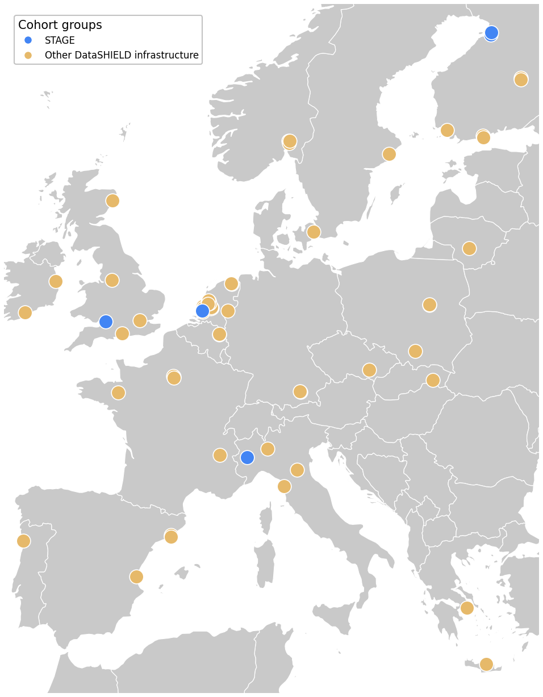

# Slidev
Vibe coding presentations with Slidev and Claude code

  
<strong>Tim Cadman</strong>

  
Senior Data Scientist

  
  

---
layout: content
heading: How this deck was made
clicks: 1
---

<Terminal :text="`I need to write a very simple presentation explaining what slide-dev is and giving examples of some of the graphics/components I've used in previous presentations.\n\nUse the standard Molgenis template. Use section dividers at the bottom.\n\nBackground should be what is slidedev, how does it compare to other solutions (powerpoint, latex).\n\nProcess should explain my workflow - (i) initially design a reusable template, (ii) use Claude to write initial vibe coded draft, (iii) try to make components generalisable, (iv) I then edit the final version.\n\nDiscussion should be pros and cons of slidev: pros: looks more professional, can easily make nice graphics using html, vue etc, no more misaligned graphics, main con is that it is hard to work on a shared presentation with colleagues.\n\nI want you to use this prompt in the first main slide after the title page (use the console graphic of writing text)`" :char-ms="55" />

---
layout: section
---

# Background

---
layout: content
heading: What is Slidev?
subheading: Markdown + Vue, rendered in the browser
section: Background
---

- A slide deck is a **Markdown file** — each slide is plain text, with Vue components dropped in wherever you need a custom graphic
- Runs as a **web app**: every slide is HTML/CSS, so layouts, animations and interactivity are just normal front-end code
- The whole deck lives in **git** like any other codebase — one file, versioned, diffable

| | Slidev | PowerPoint | LaTeX / Beamer |
|---|---|---|---|
| Source | Markdown + Vue | Binary `.pptx` | Plain text `.tex` |
| Graphics | Live HTML/CSS/SVG/Vue — build exactly what you want | Drag-and-drop shapes | TikZ — precise, but slow to iterate |
| Alignment | Laid out by code — never off by a pixel | Eyeballed, easy to nudge out of line | Laid out by code |
| Diffs in git | Clean, line-by-line | Opaque | Clean, line-by-line |
| Co-editing | Single file | Real-time, multi-author | Single file |

---
layout: section
---

# Process

---
layout: content
heading: My workflow
section: Process
---

<v-clicks>

1. **Vibe-code a reusable template** — one Slidev theme (layouts, fonts, the section rail) shared across decks, not rebuilt each time
2. **Vibe-code a first draft with Claude** — describe the slide or graphic I want, let Claude write the first version
3. **Make the components generalisable** — turn a one-off graphic into a component with props, so the next deck can reuse it with new data
4. **Edit the final version myself** — tighten spacing, wording and pacing by hand

</v-clicks>

---
layout: content
heading: "Example: cohort trajectories"
subheading: From the STAGE webinar
section: Process
---

<svg width="655" height="320" viewBox="65 0 655 320" style="width: 100%; max-width: 560px; height: auto; margin: 0; display: block;">
  <!-- underlying cohort data points (raw measurements feeding the model), age 0-90 -->
  <circle cx="140" cy="78" r="3.5" fill="#999" fill-opacity="0.4" />
  <circle cx="152" cy="92" r="3.5" fill="#999" fill-opacity="0.4" />
  <circle cx="177" cy="86" r="3.5" fill="#999" fill-opacity="0.4" />
  <circle cx="202" cy="100" r="3.5" fill="#999" fill-opacity="0.4" />
  <circle cx="233" cy="95" r="3.5" fill="#999" fill-opacity="0.4" />
  <circle cx="264" cy="110" r="3.5" fill="#999" fill-opacity="0.4" />
  <circle cx="296" cy="120" r="3.5" fill="#999" fill-opacity="0.4" />
  <circle cx="327" cy="105" r="3.5" fill="#999" fill-opacity="0.4" />
  <circle cx="358" cy="135" r="3.5" fill="#999" fill-opacity="0.4" />
  <circle cx="389" cy="125" r="3.5" fill="#999" fill-opacity="0.4" />
  <circle cx="420" cy="150" r="3.5" fill="#999" fill-opacity="0.4" />
  <circle cx="451" cy="140" r="3.5" fill="#999" fill-opacity="0.4" />
  <circle cx="482" cy="165" r="3.5" fill="#999" fill-opacity="0.4" />
  <circle cx="513" cy="155" r="3.5" fill="#999" fill-opacity="0.4" />
  <circle cx="544" cy="180" r="3.5" fill="#999" fill-opacity="0.4" />
  <circle cx="576" cy="170" r="3.5" fill="#999" fill-opacity="0.4" />
  <circle cx="625" cy="195" r="3.5" fill="#999" fill-opacity="0.4" />
  <circle cx="681" cy="205" r="3.5" fill="#999" fill-opacity="0.4" />

  <!-- fitted trajectory curves, one per exposure level, age 0-90 -->
  <path d="M140,80 C202,80 265,88 327,88 C378,88 431,100 482,100 C513,100 545,108 576,108 C617,108 659,114 700,114"
        fill="none" stroke="#0097A7" stroke-width="3" stroke-linecap="round" />
  <path d="M140,85 C202,85 265,105 327,105 C378,105 431,140 482,140 C513,140 545,160 576,160 C617,160 659,180 700,180"
        fill="none" stroke="#E6B96A" stroke-width="3" stroke-linecap="round" />
  <path d="M140,90 C202,90 265,130 327,130 C378,130 431,185 482,185 C513,185 545,215 576,215 C617,215 659,250 700,250"
        fill="none" stroke="#D9534F" stroke-width="3" stroke-linecap="round" />

  <!-- axes -->
  <line x1="140" y1="40" x2="140" y2="260" stroke="#999" stroke-width="1.5" />
  <line x1="140" y1="260" x2="700" y2="260" stroke="#999" stroke-width="1.5" />
  <line x1="140" y1="260" x2="140" y2="265" stroke="#999" stroke-width="1.5" />
  <line x1="202" y1="260" x2="202" y2="265" stroke="#999" stroke-width="1.5" />
  <line x1="264" y1="260" x2="264" y2="265" stroke="#999" stroke-width="1.5" />
  <line x1="327" y1="260" x2="327" y2="265" stroke="#999" stroke-width="1.5" />
  <line x1="389" y1="260" x2="389" y2="265" stroke="#999" stroke-width="1.5" />
  <line x1="451" y1="260" x2="451" y2="265" stroke="#999" stroke-width="1.5" />
  <line x1="513" y1="260" x2="513" y2="265" stroke="#999" stroke-width="1.5" />
  <line x1="576" y1="260" x2="576" y2="265" stroke="#999" stroke-width="1.5" />
  <line x1="638" y1="260" x2="638" y2="265" stroke="#999" stroke-width="1.5" />
  <line x1="700" y1="260" x2="700" y2="265" stroke="#999" stroke-width="1.5" />
  <text style="font-size: 12px" x="140" y="276" fill="#666" text-anchor="middle">0</text>
  <text style="font-size: 12px" x="202" y="276" fill="#666" text-anchor="middle">10</text>
  <text style="font-size: 12px" x="264" y="276" fill="#666" text-anchor="middle">20</text>
  <text style="font-size: 12px" x="327" y="276" fill="#666" text-anchor="middle">30</text>
  <text style="font-size: 12px" x="389" y="276" fill="#666" text-anchor="middle">40</text>
  <text style="font-size: 12px" x="451" y="276" fill="#666" text-anchor="middle">50</text>
  <text style="font-size: 12px" x="513" y="276" fill="#666" text-anchor="middle">60</text>
  <text style="font-size: 12px" x="576" y="276" fill="#666" text-anchor="middle">70</text>
  <text style="font-size: 12px" x="638" y="276" fill="#666" text-anchor="middle">80</text>
  <text style="font-size: 12px" x="700" y="276" fill="#666" text-anchor="middle">90</text>
  <text style="font-size: 14px" x="420" y="294" fill="#555" text-anchor="middle">Age (years)</text>
  <text style="font-size: 14px" x="0" y="0" fill="#555" text-anchor="middle" transform="translate(120,150) rotate(-90)">Cognitive function</text>

  <!-- legend -->
  <line x1="270" y1="20" x2="290" y2="20" stroke="#0097A7" stroke-width="4" stroke-linecap="round" />
  <text style="font-size: 13px" x="296" y="24" fill="#333">Low exposure</text>
  <line x1="400" y1="20" x2="420" y2="20" stroke="#E6B96A" stroke-width="4" stroke-linecap="round" />
  <text style="font-size: 13px" x="426" y="24" fill="#333">Medium exposure</text>
  <line x1="560" y1="20" x2="580" y2="20" stroke="#D9534F" stroke-width="4" stroke-linecap="round" />
  <text style="font-size: 13px" x="586" y="24" fill="#333">High exposure</text>
</svg>

---
layout: content
heading: "Example: performance dial"
subheading: From the DataSHIELD performance demo
section: Process
---

<ProgressDonut :value="29" :total="123" label="functions refactored" />

---
layout: content
heading: "Example: federated analysis"
subheading: From the STAGE webinar
section: Process
clicks: 6
---

<DatashieldArchitectureSimple />

---
layout: chart-full
heading: "Example: federated nodes map"
---

  
  

    <ul style="padding-left: 1.5rem; margin: 0;">
    </ul>
  

---
layout: section
---

# Discussion

---
layout: content
heading: Pros and cons
section: Discussion
clicks: 1
---

<FocusCards :columns="2" :items="[
  { title: 'Pros', body: [
    'Looks more professional &mdash; one consistent theme across every slide',
    'Easy to build nice graphics &mdash; raw HTML, CSS, SVG, Vue, not drag-and-drop shapes',
    'No more misaligned graphics &mdash; layout is coded',
  ] },
  { title: 'Cons', body: [
    'Hard to work on a shared presentation with colleagues &mdash; it is one file, not a real-time co-editing tool',
    'Token use &mdash; much easier than powerpoint but with this cost',
  ] },
]" />

---
layout: content
heading: Find out more
---

- **Slidev** — https://sli.dev
- **This repo** — https://github.com/timcadman/presentations
