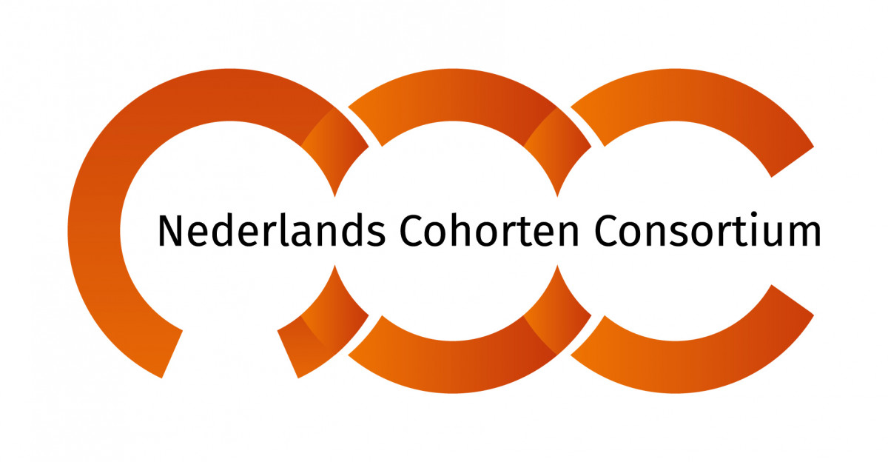

# MOLGENIS Armadillo & DataSHIELD
Secure Federated Analysis

  
<strong>Tim Cadman</strong>

  
  

---
layout: section
---

# Federated analysis with DataSHIELD

---
layout: content-two-cols
heading: DataSHIELD
subheading: What is it?
leftWidth: '34'
section: 'Federated analysis'
transition: slide-up
---

::left::

- R Studio based federated analysis platform

<v-clicks>

- Developed over 15 years in EU research projects
- Used primarily in epidemiology and population health science

</v-clicks>

::right::

<Terminal light title="Plots"><ForestPlot style="margin: 0 auto; align-self: flex-start" /></Terminal>

---
layout: content
heading: Example research questions
section: 'Federated analysis'
transition: slide-up
---

<v-clicks>

- Does exposure to PFAS ('forever chemicals') increase the risk of kidney cancer?
- Does regular physical activity reduce the risk of colorectal cancer?
- Does quality of life at diagnosis predict cancer outcomes?

</v-clicks>

---
layout: content
heading: DataSHIELD
subheading: Key ideas
clicks: 3
section: 'Federated analysis'
transition: slide-up
---

<FocusCards :items="[
  { title: 'Federated analysis', color: 'var(--c-blue)', body: ['Distributed analysis with central aggregation'] },
  { title: 'Disclosure control', color: 'var(--c-teal)', body: ['Per-function checks ensure no participant data returns'] },
  { title: 'Authentication', color: 'var(--c-gold-dark)', body: ['Life Science AAI'] },
  { title: 'Deployment', color: 'var(--c-purple)', body: ['Via MOLGENIS Armadillo'] },
]" />

---
src: ../library/datashield/analysis-options.md
subheading: 1- and 2-stage analysis options
section: 'Federated analysis'
transition: slide-up
---

---
layout: section
transition: slide-left
---

# DataSHIELD demo

---
layout: section
---

# Example projects

---
layout: content
heading: Existing DataSHIELD nodes
subheading: 
section: 'Projects'
---

<NodeMap simple legend="below" height="16rem" note="" />

---
layout: content-two-cols
heading: "Example 1: EU Child Cohort Network"
subheading: 2017–2022
section: 'Projects'
leftWidth: '55'
clicks: 2
---

::left::

<NodeMap simple project="LifeCycle" colour="#6AA2FF" map="world" zoom="auto" legend="none" note="" />

::right::

- <strong style="color: var(--slidev-theme-primary)">Aim:</strong> study early life stressors and health across the life course
- Harmonised >2000 variables from EU birth cohorts

---
layout: content-two-cols
heading: "Example 2: ATHLETE"
subheading: 2020–2024
section: 'Projects'
leftWidth: '55'
clicks: 2
---

::left::

<NodeMap simple project="Athlete" colour="#03DBE2" builds-on="LifeCycle" builds-on-colour="#6AA2FF" map="world" zoom="auto" legend="none" note="" />

::right::

- <strong style="color: var(--slidev-theme-primary)">Aim:</strong> study how chemicals and environmental exposures affect human health
- Onboarded new cohorts to the EU Child Cohort Network, adding environmental data

---
layout: content-two-cols
heading: "Example 3: Netherlands Cohorts Consortium"
subheading: 2026–2036
section: 'Projects'
leftWidth: '55'
clicks: 2
---

::left::

<NodeMap simple project="NCC" colour="#FF6917" map="europe" zoom="auto" legend="none" note="" />

::right::

- <strong style="color: var(--slidev-theme-primary)">Aim:</strong> align, harmonise and pool data to understand the causes of chronic diseases
- 11 population cohorts, over 440,000 participants

---
layout: section
---

# Setting up DataSHIELD

---
layout: content
heading: As a data owner
subheading: Setup steps
section: 'Setup'
transition: slide-up
---

<SetupSteps :steps="[
  { name: 'Install node application', points: ['MOLGENIS Armadillo'] },
  { name: 'Secure connection', points: ['TLS certificates', 'Authentication', 'Reverse proxy'] },
  { name: 'Upload data and manage access', points: ['Upload data', 'Manage access'] },
]" />

---
src: ../library/infrastructure/what-is-armadillo.md
section: 'Setup'
transition: slide-up
---

---
layout: section
transition: slide-up
---

# Armadillo demo

---
layout: content
heading: DataSHIELD/Armadillo in UNCAN
section: 'UNCAN'
transition: slide-up
---

  

    <h3>Use case</h3>
    
WP11: how does baseline quality of life predict cancer treatment outcomes?

  

  

    <h3>Collaboration</h3>
    
UMCG epidemiology department (Oncolifes study)

  

<h3 class="uncan-progress">Progress</h3>

<Timeline horizontal :items="[
  { text: 'Armadillo deployed at UMCG', status: 'done' },
  { text: 'Synthetic data uploaded', status: 'done' },
  { text: 'Awaiting DPAs for real data', status: 'current' },
  { text: 'Identify additional UNCAN partners' },
  { text: 'Harmonise study data to CDM' },
  { text: 'Deploy Armadillo at additional sites' },
  { text: 'Analysis and write-up' },
]" />

---
layout: content
heading: References
subheading: ""
---

**Armadillo**
Cadman T, Slofstra MK, van der Geest MA, et al. MOLGENIS Armadillo: a lightweight server for federated analysis using DataSHIELD. *Bioinformatics* 2025;41(1):btae726. https://doi.org/10.1093/bioinformatics/btae726

**Useful links**
- Armadillo documentation: https://molgenis.github.io/molgenis-service-armadillo/
- DataSHIELD wiki: https://wiki.datashield.org/
- MOLGENIS suite: https://molgenis.org/

