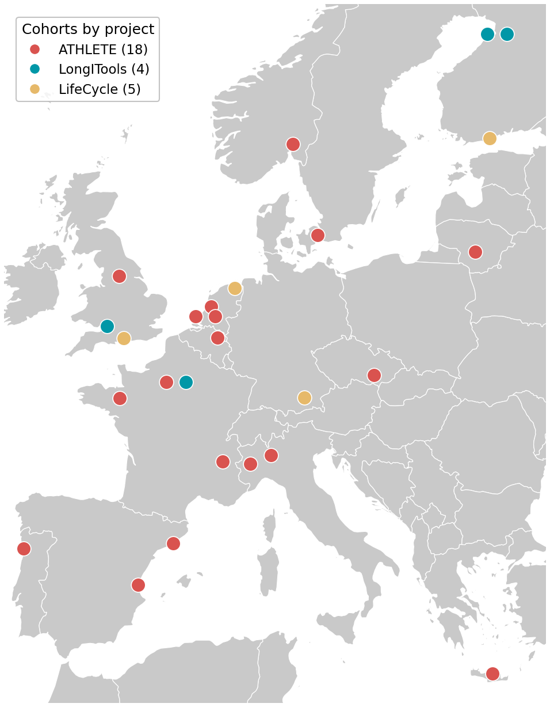

# IHEN tools
Federated analysis with DataSHIELD

  
<strong>Juan Carlos Rivillas, Tim Cadman & Hüseyin Küçükali</strong>

  
  

---
layout: contents
image: ./public/contents-notebook-coffee.jpg
---

1. **Reusing data**
2. **What is DataSHIELD?**
3. **DataSHIELD demo**
4. **Sharing your data**
5. **Discussion**

---
layout: content
heading: FAIR data
subheading: "Recap: the research cycle"
clicks: 1
---

<FairCycle :focus="$clicks >= 1 ? 4 : 0" />

---
layout: section
---

# Reusing data

---
src: ../../library/combining-data/options.md
section: Reusing data
---

---
layout: section
---

# Federated analysis

---
src: ../../library/datashield/what-is-datashield.md
section: 'Federated analysis'
---

---
layout: figure-cite
heading: The data stays put
section: 'What is DataSHIELD?'
sideWidth: '36'
---

<template #side>

<ul class="fq-steps">
<li v-click="1">Connect to the servers</li>
<li v-click="2">Send analysis commands</li>
<li v-click="3">Receive aggregate results</li>
</ul>

<ExwasPlot />

</template>

<template #default>

<FederatedQuery />

</template>

---
layout: content
heading: How it works
subheading: 
section: 'What is DataSHIELD?'
---

<DatashieldArchitecture />

---
src: ../../library/datashield/analysis-options.md
section: 'What is DataSHIELD?'
---

---
layout: section
---

# DataSHIELD demo

---
layout: section
---

# Sharing your data

---
layout: chart-full
heading: European DataSHIELD nodes
section: Sharing your data
---

  
  

    <ul style="padding-left: 1.5rem; margin: 0;">
      <li style="font-size: 18px; margin-bottom: 0.5rem; line-height: 1.5;">31 DataSHIELD nodes from LifeCycle, ATHLETE and LongITools cohorts.</li>
      <li style="font-size: 18px; margin-bottom: 0.5rem; line-height: 1.5;">This gives possibilities to connect analyses to additional data sources.</li>
    </ul>
  

---
layout: content
heading: Setting up DataSHIELD
subheading: Why share your data with DataSHIELD?
section: Sharing your data
---

- A secure way to share your data with other researchers
- Opens opportunities for your own analyses by joining the network built through LifeCycle and ATHLETE

---
layout: content-two-cols
heading: Setting up DataSHIELD
subheading: Two options
section: Sharing your data
---

<template #left>

**Option 1: Set it up yourself**

- Server or virtual machine: 8–32 GB memory, 100 GB disk, 4–8 CPU cores
- Administration rights, Java 21 and Docker
- A domain name and SSL certificate
- Tutorial: [escri11.github.io/datashield-workshop-2025](https://escri11.github.io/datashield-workshop-2025/)

</template>

<template #right>

**Option 2: We set it up for you**

- The MOLGENIS team at UMCG can set up and maintain a server
- Fully private: only you have access to the data
- Contact [support@molgenis.org](mailto:support@molgenis.org)

More: <a href="https://wiki.datashield.org/en/home">wiki.datashield.org</a> · <a href="https://datashield.org/">datashield.org</a>

</template>

---
layout: section
---

# Discussion

---
layout: content
heading: Discussion
subheading: 
section: Discussion
---

<v-clicks>

- Federated analysis gives an alternative to data transfer and sharing scripts
- Many exposome cohorts are already part of a large EU federated network
- UMCG can provide training and technical support
- We can also help develop new functionality for specific projects if required

</v-clicks>

---
layout: content
heading: Questions?
subheading: ""
section: Discussion
---

---
layout: content
heading: Further Information
subheading: ""
section: Discussion
---

For questions and support contact: <strong>support@molgenis.org</strong>

**Useful links:**
- DataSHIELD wiki: https://wiki.datashield.org/
- DataSHIELD website: https://datashield.org/
- Molgenis suite: https://molgenis.org/

