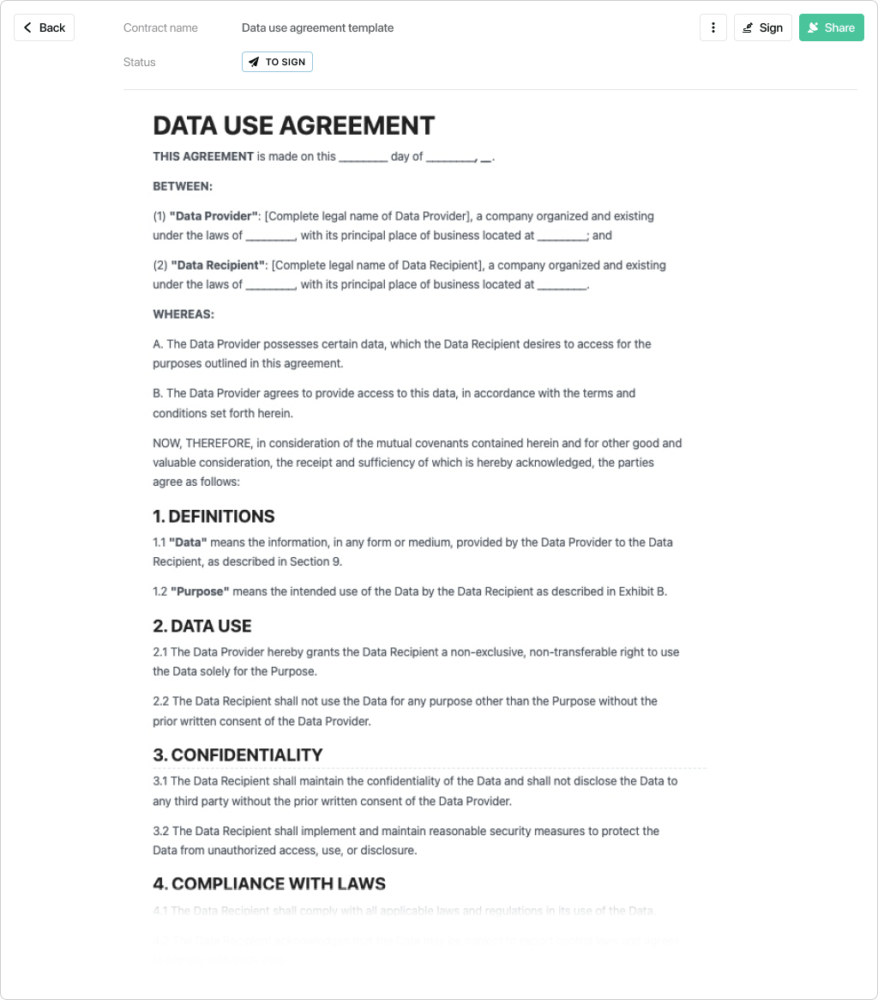

# IHEN tools
Federated analysis with DataSHIELD

  
<strong>Tim Cadman</strong>

  
Senior Data Scientist

  
  

---
layout: contents
image: ./public/contents-notebook-coffee.jpg
---

1. **Reusing data**
2. **What is DataSHIELD?**
3. **Demonstration**
4. **Setting up DataSHIELD**
5. **Discussion**

---
layout: content
heading: FAIR data
subheading: "Recap: the research cycle"
clicks: 1
---

<FairCycle :focus="$clicks >= 1 ? 4 : 0" />

---
layout: section
---

# Reusing data

---
src: ../../library/combining-data/options.md
section: Reusing data
---

---
layout: section
---

# DataSHIELD

---
src: ../../library/datashield/introducing-datashield.md
section: 'DataSHIELD'
transition: slide-up
---

---
src: ../../library/datashield/what-is-datashield.md
section: 'DataSHIELD'
transition: slide-up
---

---
layout: figure-cite
heading: How it works
section: 'DataSHIELD'
transition: slide-up
sideWidth: '36'
---

<template #side>

<ul class="fq-steps">
<li v-click="1">Connect to the servers</li>
<li v-click="2">Send analysis commands</li>
<li v-click="3">Receive aggregate results</li>
</ul>

<ExwasPlot />

</template>

<template #default>

<FederatedQuery />

</template>

---
src: ../../library/datashield/group-exercise.md
section: 'DataSHIELD'
transition: slide-up
---

---
src: ../../library/datashield/pooling-means.md
section: 'DataSHIELD'
transition: slide-up
---

---
layout: content
heading: Privacy-preserving statistics
subheading: 
section: 'DataSHIELD'
---

<table>
<thead>
<tr><th>Result</th><th>Condition</th></tr>
</thead>
<tbody>
<tr v-click><td>Mean, SD, quantiles</td><td>Group has at least N participants</td></tr>
<tr v-click><td>Counts and tables</td><td>Minimun cell size to display</td></tr>
<tr v-click><td>Model coefficients and SEs</td><td>Model not saturated; no cell too small</td></tr>
<tr v-click><td>Correlations, covariances</td><td>Minimum N, and not a near-perfect fit</td></tr>
<tr v-click><td>Plots (histograms, heatmaps)</td><td>Binned or noise-added</td></tr>
</tbody>
</table>

---
src: ../../library/datashield/analysis-options.md
section: 'DataSHIELD'
---

---
layout: content
heading: Current DataSHIELD network
subheading: 
section: 'DataSHIELD'
clicks: 3
---

<NodeMap :planned="false" />

---
layout: content
heading: Exposome research using DataSHIELD
subheading: A few examples
section: 'DataSHIELD'
---

<ExamplePapers />

---
layout: section
---

# Demonstration

---
layout: section
---

# Setting up DataSHIELD

---
layout: content-two-cols
heading: As a user
section: Setting up DataSHIELD
clicks: 4
---

<template #left>

<v-clicks>

- Arrange data access agreements with providers
- Install R packages
- Connect and analyse with RStudio

</v-clicks>

</template>

<template #right>

  <Terminal light title="R" :text="`install.packages(c(&quot;DSI&quot;, &quot;DSMolgenisArmadillo&quot;, &quot;dsBaseClient&quot;))`" :start-at-click="2" :char-ms="16" />

  <Terminal light title="R" :text="`fit <- ds.glmSLMA(\n  formula = &quot;asthma ~ no2 + ses&quot;,\n  family = &quot;binomial&quot;,\n  dataName = &quot;D&quot;\n)\n\nds.forestplot(fit, variable = &quot;no2&quot;)`" :start-at-click="3" :char-ms="16" />

= 4" class="user-setup-term">
  <Terminal light title="Plots"><ForestPlot style="margin: 0 auto; align-self: flex-start" /></Terminal>

</template>

---
layout: content
heading: As a data owner
subheading: "Why share data with DataSHIELD?"
section: Setting up DataSHIELD
---

<v-clicks>

- A secure way to share your data with other researchers
- Opens opportunities for your own research by joining existing exposomes networks

</v-clicks>

---
layout: content-two-cols
heading: As a data owner
subheading: Setup steps
section: Setting up DataSHIELD
transition: slide-up
---

<template #left>

<v-clicks>

- Harmonise your data to a common data model (e.g. OMOP)
- Install and configure Armadillo
- Arrange data access agreements
- Grant researchers access in Armadillo

</v-clicks>

</template>

<template #right>

= 4" src="./public/armadillo-ui-users.png" class="user-setup-img" style="height: auto" />

</template>

---
src: ../../library/infrastructure/what-is-armadillo.md
section: Setting up DataSHIELD
transition: slide-up
---

---
src: ../../library/infrastructure/setup-options.md
section: Setting up DataSHIELD
---

---
layout: section
---

# Discussion

---
layout: content
heading: Discussion
subheading: 
section: Discussion
---

<v-clicks>

- Combining data gives exposure contrast, power, replication and stronger causal inference
- Federated analysis with DataSHIELD does this securely: the data never leave the cohort
- Exposome tooling is already available in DataSHIELD
- Support is available from MOLGENIS: training, hosting and new functionality

</v-clicks>

---
layout: content
heading: Questions?
subheading: ""
section: Discussion
---

---
layout: content
heading: Further Information
subheading: ""
section: Discussion
---

For questions and support contact: <a class="support-link" href="mailto:support@molgenis.org"><strong>support@molgenis.org</strong></a>

**Useful links:**
- DataSHIELD wiki: https://wiki.datashield.org/
- Molgenis suite: https://molgenis.org/

**Armadillo reference:**
Cadman T, Slofstra MK, van der Geest MA, et al. MOLGENIS Armadillo: a lightweight server for federated analysis using DataSHIELD. *Bioinformatics* 2025;41(1):btae726. https://doi.org/10.1093/bioinformatics/btae726

