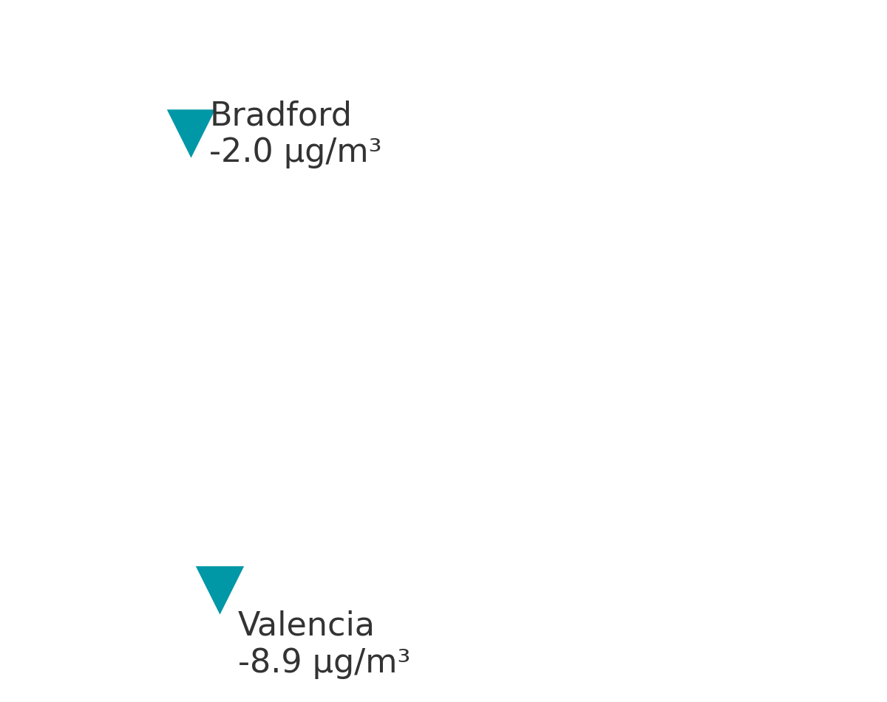
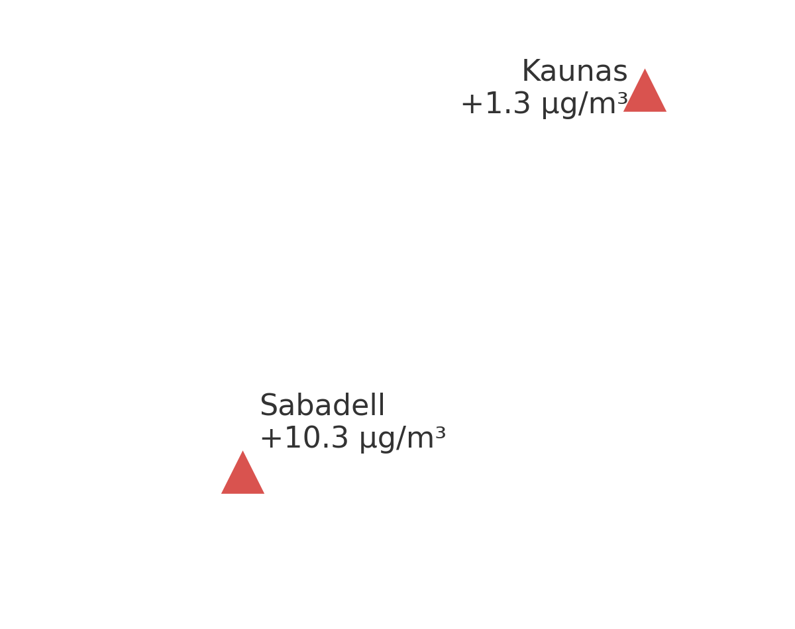

# IHEN exposome tools
Introduction

  
<strong>Tim Cadman, Juan Carlos Rivillas & Hüseyin Küçükali</strong>

  
  
  
  

---
layout: content-two-cols
heading: Contents
---

<template #left>

1. **Combining data**
   - Why combine data?
   - Examples
2. **FAIR data cycle**
3. **Exposome tools**
   - Molgenis metadata catalogue
   - Exposome Maps
   - Federated analysis with DataSHIELD

</template>

<template #right>

</template>

---
layout: section
---

# Introduction

---
src: ../../library/combining-data/why.md
section: 'Introduction'
---

---
layout: content
heading: Combining data
subheading: Example research question
section: Introduction
transition: slide-up
---

<ResearchQuestion
  question="Does exposure to air pollution in pregnancy predict maternal perinatal depression?"
  reference="Cadman et al. (2024) Environ Int 185:108453" />

---
layout: figure-cite
heading: Example 1
subheading: Increased exposure contrast
section: Introduction
transition: slide-up
citation: 'Cadman et al. (2024) Environ Int 185:108453'
---

<template #side>

- A single location may only cover part of the range of exposure values

</template>

<template #default>

<svg viewBox="0 22 720 308" preserveAspectRatio="xMinYMin meet" role="img" aria-label="PM10 distributions by cohort cover different parts of the exposure range">
  <line x1="90" y1="30" x2="690" y2="30" stroke="#eee" />
  <line x1="90" y1="90" x2="690" y2="90" stroke="#eee" />
  <line x1="90" y1="150" x2="690" y2="150" stroke="#eee" />
  <line x1="90" y1="210" x2="690" y2="210" stroke="#eee" />
  <line x1="90" y1="30" x2="90" y2="270" stroke="#999" stroke-width="1.5" />
  <line x1="90" y1="270" x2="690" y2="270" stroke="#999" stroke-width="1.5" />
  <text style="font-size: 14px" x="82" y="274" fill="#666" text-anchor="end">0.0</text>
  <text style="font-size: 14px" x="82" y="214" fill="#666" text-anchor="end">0.1</text>
  <text style="font-size: 14px" x="82" y="154" fill="#666" text-anchor="end">0.2</text>
  <text style="font-size: 14px" x="82" y="94" fill="#666" text-anchor="end">0.3</text>
  <text style="font-size: 14px" x="82" y="34" fill="#666" text-anchor="end">0.4</text>
  <text style="font-size: 14px" x="140" y="288" fill="#666" text-anchor="middle">10</text>
  <text style="font-size: 14px" x="240" y="288" fill="#666" text-anchor="middle">20</text>
  <text style="font-size: 14px" x="340" y="288" fill="#666" text-anchor="middle">30</text>
  <text style="font-size: 14px" x="440" y="288" fill="#666" text-anchor="middle">40</text>
  <text style="font-size: 14px" x="540" y="288" fill="#666" text-anchor="middle">50</text>
  <text style="font-size: 14px" x="640" y="288" fill="#666" text-anchor="middle">60</text>
  <text style="font-size: 16px" x="390" y="312" fill="#555" text-anchor="middle">PM₁₀ (µg/m³)</text>
  <text style="font-size: 16px" x="0" y="0" fill="#555" text-anchor="middle" transform="translate(30,150) rotate(-90)">Density</text>
  <g>
    <path d="M90.0,270.0 L95.0,270.0 L100.0,270.0 L105.0,270.0 L110.0,270.0 L115.0,269.8 L120.0,268.8 L125.0,265.3 L130.0,254.8 L135.0,230.1 L140.0,185.5 L145.0,125.6 L150.0,70.9 L155.0,48.4 L160.0,70.9 L165.0,125.6 L170.0,185.5 L175.0,230.1 L180.0,254.8 L185.0,265.3 L190.0,268.8 L195.0,269.8 L200.0,270.0 L205.0,270.0 L210.0,270.0 L215.0,270.0 L220.0,270.0 L225.0,270.0 L230.0,270.0 L235.0,270.0 L240.0,270.0 L245.0,270.0 L250.0,270.0 L255.0,270.0 L260.0,270.0 L265.0,270.0 L270.0,270.0 L275.0,270.0 L280.0,270.0 L285.0,270.0 L290.0,270.0 L295.0,270.0 L300.0,270.0 L305.0,270.0 L310.0,270.0 L315.0,270.0 L320.0,270.0 L325.0,270.0 L330.0,270.0 L335.0,270.0 L340.0,270.0 L345.0,270.0 L350.0,270.0 L355.0,270.0 L360.0,270.0 L365.0,270.0 L370.0,270.0 L375.0,270.0 L380.0,270.0 L385.0,270.0 L390.0,270.0 L395.0,270.0 L400.0,270.0 L405.0,270.0 L410.0,270.0 L415.0,270.0 L420.0,270.0 L425.0,270.0 L430.0,270.0 L435.0,270.0 L440.0,270.0 L445.0,270.0 L450.0,270.0 L455.0,270.0 L460.0,270.0 L465.0,270.0 L470.0,270.0 L475.0,270.0 L480.0,270.0 L485.0,270.0 L490.0,270.0 L495.0,270.0 L500.0,270.0 L505.0,270.0 L510.0,270.0 L515.0,270.0 L520.0,270.0 L525.0,270.0 L530.0,270.0 L535.0,270.0 L540.0,270.0 L545.0,270.0 L550.0,270.0 L555.0,270.0 L560.0,270.0 L565.0,270.0 L570.0,270.0 L575.0,270.0 L580.0,270.0 L585.0,270.0 L590.0,270.0 L595.0,270.0 L600.0,270.0 L605.0,270.0 L610.0,270.0 L615.0,270.0 L620.0,270.0 L625.0,270.0 L630.0,270.0 L635.0,270.0 L640.0,270.0 L645.0,270.0 L650.0,270.0 L655.0,270.0 L660.0,270.0 L665.0,270.0 L670.0,270.0 L675.0,270.0 L680.0,270.0 L685.0,270.0 L690.0,270.0 Z" fill="#119DA1" fill-opacity="0.35" stroke="#119DA1" stroke-width="1.5" />
    <text style="font-size: 15px" x="168" y="60" fill="#333">Rhea</text>
  </g>
  <g v-click>
    <path d="M90.0,270.0 L95.0,270.0 L100.0,270.0 L105.0,270.0 L110.0,270.0 L115.0,270.0 L120.0,270.0 L125.0,270.0 L130.0,270.0 L135.0,270.0 L140.0,270.0 L145.0,270.0 L150.0,270.0 L155.0,270.0 L160.0,270.0 L165.0,270.0 L170.0,270.0 L175.0,270.0 L180.0,270.0 L185.0,270.0 L190.0,270.0 L195.0,270.0 L200.0,270.0 L205.0,270.0 L210.0,270.0 L215.0,270.0 L220.0,270.0 L225.0,270.0 L230.0,270.0 L235.0,270.0 L240.0,270.0 L245.0,270.0 L250.0,270.0 L255.0,270.0 L260.0,270.0 L265.0,270.0 L270.0,270.0 L275.0,270.0 L280.0,270.0 L285.0,270.0 L290.0,270.0 L295.0,270.0 L300.0,270.0 L305.0,270.0 L310.0,270.0 L315.0,270.0 L320.0,270.0 L325.0,270.0 L330.0,270.0 L335.0,270.0 L340.0,270.0 L345.0,270.0 L350.0,270.0 L355.0,270.0 L360.0,270.0 L365.0,270.0 L370.0,270.0 L375.0,270.0 L380.0,270.0 L385.0,270.0 L390.0,270.0 L395.0,270.0 L400.0,270.0 L405.0,270.0 L410.0,270.0 L415.0,270.0 L420.0,270.0 L425.0,270.0 L430.0,269.9 L435.0,269.8 L440.0,269.5 L445.0,268.9 L450.0,267.7 L455.0,265.3 L460.0,261.2 L465.0,254.4 L470.0,244.3 L475.0,230.4 L480.0,213.1 L485.0,193.6 L490.0,174.2 L495.0,157.8 L500.0,147.4 L505.0,144.8 L510.0,150.7 L515.0,163.8 L520.0,181.8 L525.0,201.5 L530.0,220.4 L535.0,236.4 L540.0,248.8 L545.0,257.5 L550.0,263.1 L555.0,266.5 L560.0,268.3 L565.0,269.2 L570.0,269.7 L575.0,269.9 L580.0,270.0 L585.0,270.0 L590.0,270.0 L595.0,270.0 L600.0,270.0 L605.0,270.0 L610.0,270.0 L615.0,270.0 L620.0,270.0 L625.0,270.0 L630.0,270.0 L635.0,270.0 L640.0,270.0 L645.0,270.0 L650.0,270.0 L655.0,270.0 L660.0,270.0 L665.0,270.0 L670.0,270.0 L675.0,270.0 L680.0,270.0 L685.0,270.0 L690.0,270.0 Z" fill="#DA594A" fill-opacity="0.35" stroke="#DA594A" stroke-width="1.5" />
    <text style="font-size: 15px" x="520" y="140" fill="#333">DNBC</text>
  </g>
  <g v-click>
    <path d="M90.0,270.0 L95.0,270.0 L100.0,270.0 L105.0,270.0 L110.0,270.0 L115.0,270.0 L120.0,270.0 L125.0,270.0 L130.0,270.0 L135.0,270.0 L140.0,270.0 L145.0,270.0 L150.0,270.0 L155.0,270.0 L160.0,270.0 L165.0,270.0 L170.0,270.0 L175.0,270.0 L180.0,270.0 L185.0,270.0 L190.0,270.0 L195.0,270.0 L200.0,270.0 L205.0,269.8 L210.0,269.0 L215.0,265.9 L220.0,256.0 L225.0,231.9 L230.0,187.0 L235.0,125.3 L240.0,68.0 L245.0,44.2 L250.0,68.0 L255.0,125.3 L260.0,187.0 L265.0,231.9 L270.0,256.0 L275.0,265.9 L280.0,269.0 L285.0,269.8 L290.0,270.0 L295.0,270.0 L300.0,270.0 L305.0,270.0 L310.0,270.0 L315.0,270.0 L320.0,270.0 L325.0,270.0 L330.0,270.0 L335.0,270.0 L340.0,270.0 L345.0,270.0 L350.0,270.0 L355.0,270.0 L360.0,270.0 L365.0,270.0 L370.0,270.0 L375.0,270.0 L380.0,270.0 L385.0,270.0 L390.0,270.0 L395.0,270.0 L400.0,270.0 L405.0,270.0 L410.0,270.0 L415.0,270.0 L420.0,270.0 L425.0,270.0 L430.0,270.0 L435.0,270.0 L440.0,270.0 L445.0,270.0 L450.0,270.0 L455.0,270.0 L460.0,270.0 L465.0,270.0 L470.0,270.0 L475.0,270.0 L480.0,270.0 L485.0,270.0 L490.0,270.0 L495.0,270.0 L500.0,270.0 L505.0,270.0 L510.0,270.0 L515.0,270.0 L520.0,270.0 L525.0,270.0 L530.0,270.0 L535.0,270.0 L540.0,270.0 L545.0,270.0 L550.0,270.0 L555.0,270.0 L560.0,270.0 L565.0,270.0 L570.0,270.0 L575.0,270.0 L580.0,270.0 L585.0,270.0 L590.0,270.0 L595.0,270.0 L600.0,270.0 L605.0,270.0 L610.0,270.0 L615.0,270.0 L620.0,270.0 L625.0,270.0 L630.0,270.0 L635.0,270.0 L640.0,270.0 L645.0,270.0 L650.0,270.0 L655.0,270.0 L660.0,270.0 L665.0,270.0 L670.0,270.0 L675.0,270.0 L680.0,270.0 L685.0,270.0 L690.0,270.0 Z" fill="#E2A517" fill-opacity="0.35" stroke="#E2A517" stroke-width="1.5" />
    <text style="font-size: 15px" x="258" y="55" fill="#333">BiB</text>
  </g>
  <g v-click>
    <path d="M90.0,270.0 L95.0,270.0 L100.0,270.0 L105.0,270.0 L110.0,270.0 L115.0,270.0 L120.0,270.0 L125.0,270.0 L130.0,270.0 L135.0,270.0 L140.0,270.0 L145.0,270.0 L150.0,270.0 L155.0,270.0 L160.0,270.0 L165.0,269.9 L170.0,269.8 L175.0,269.6 L180.0,269.1 L185.0,268.0 L190.0,266.0 L195.0,262.6 L200.0,257.0 L205.0,248.6 L210.0,237.0 L215.0,222.1 L220.0,204.7 L225.0,186.5 L230.0,169.7 L235.0,156.9 L240.0,150.3 L245.0,151.1 L250.0,159.1 L255.0,172.8 L260.0,190.1 L265.0,208.3 L270.0,225.3 L275.0,239.6 L280.0,250.6 L285.0,258.3 L290.0,263.4 L295.0,266.5 L300.0,268.3 L305.0,269.2 L310.0,269.6 L315.0,269.9 L320.0,269.9 L325.0,270.0 L330.0,270.0 L335.0,270.0 L340.0,270.0 L345.0,270.0 L350.0,270.0 L355.0,270.0 L360.0,270.0 L365.0,270.0 L370.0,270.0 L375.0,270.0 L380.0,270.0 L385.0,270.0 L390.0,270.0 L395.0,270.0 L400.0,270.0 L405.0,270.0 L410.0,270.0 L415.0,270.0 L420.0,270.0 L425.0,270.0 L430.0,270.0 L435.0,270.0 L440.0,270.0 L445.0,270.0 L450.0,270.0 L455.0,270.0 L460.0,270.0 L465.0,270.0 L470.0,270.0 L475.0,270.0 L480.0,270.0 L485.0,270.0 L490.0,270.0 L495.0,270.0 L500.0,270.0 L505.0,270.0 L510.0,270.0 L515.0,270.0 L520.0,270.0 L525.0,270.0 L530.0,270.0 L535.0,270.0 L540.0,270.0 L545.0,270.0 L550.0,270.0 L555.0,270.0 L560.0,270.0 L565.0,270.0 L570.0,270.0 L575.0,270.0 L580.0,270.0 L585.0,270.0 L590.0,270.0 L595.0,270.0 L600.0,270.0 L605.0,270.0 L610.0,270.0 L615.0,270.0 L620.0,270.0 L625.0,270.0 L630.0,270.0 L635.0,270.0 L640.0,270.0 L645.0,270.0 L650.0,270.0 L655.0,270.0 L660.0,270.0 L665.0,270.0 L670.0,270.0 L675.0,270.0 L680.0,270.0 L685.0,270.0 L690.0,270.0 Z" fill="#9AA0A6" fill-opacity="0.35" stroke="#9AA0A6" stroke-width="1.5" />
    <path d="M90.0,270.0 L95.0,270.0 L100.0,270.0 L105.0,270.0 L110.0,270.0 L115.0,270.0 L120.0,270.0 L125.0,270.0 L130.0,270.0 L135.0,270.0 L140.0,269.9 L145.0,269.9 L150.0,269.8 L155.0,269.7 L160.0,269.4 L165.0,269.0 L170.0,268.3 L175.0,267.2 L180.0,265.7 L185.0,263.4 L190.0,260.4 L195.0,256.3 L200.0,251.1 L205.0,244.7 L210.0,237.3 L215.0,228.9 L220.0,220.0 L225.0,211.0 L230.0,202.5 L235.0,195.2 L240.0,189.6 L245.0,186.3 L250.0,185.5 L255.0,187.3 L260.0,191.6 L265.0,197.9 L270.0,205.8 L275.0,214.5 L280.0,223.6 L285.0,232.3 L290.0,240.4 L295.0,247.4 L300.0,253.3 L305.0,258.1 L310.0,261.7 L315.0,264.4 L320.0,266.4 L325.0,267.7 L330.0,268.6 L335.0,269.2 L340.0,269.5 L345.0,269.7 L350.0,269.9 L355.0,269.9 L360.0,270.0 L365.0,270.0 L370.0,270.0 L375.0,270.0 L380.0,270.0 L385.0,270.0 L390.0,270.0 L395.0,270.0 L400.0,270.0 L405.0,270.0 L410.0,270.0 L415.0,270.0 L420.0,270.0 L425.0,270.0 L430.0,270.0 L435.0,270.0 L440.0,270.0 L445.0,270.0 L450.0,270.0 L455.0,270.0 L460.0,270.0 L465.0,270.0 L470.0,270.0 L475.0,270.0 L480.0,270.0 L485.0,270.0 L490.0,270.0 L495.0,270.0 L500.0,270.0 L505.0,270.0 L510.0,270.0 L515.0,270.0 L520.0,270.0 L525.0,270.0 L530.0,270.0 L535.0,270.0 L540.0,270.0 L545.0,270.0 L550.0,270.0 L555.0,270.0 L560.0,270.0 L565.0,270.0 L570.0,270.0 L575.0,270.0 L580.0,270.0 L585.0,270.0 L590.0,270.0 L595.0,270.0 L600.0,270.0 L605.0,270.0 L610.0,270.0 L615.0,270.0 L620.0,270.0 L625.0,270.0 L630.0,270.0 L635.0,270.0 L640.0,270.0 L645.0,270.0 L650.0,270.0 L655.0,270.0 L660.0,270.0 L665.0,270.0 L670.0,270.0 L675.0,270.0 L680.0,270.0 L685.0,270.0 L690.0,270.0 Z" fill="#9AA0A6" fill-opacity="0.35" stroke="#9AA0A6" stroke-width="1.5" />
    <path d="M90.0,270.0 L95.0,270.0 L100.0,270.0 L105.0,270.0 L110.0,270.0 L115.0,270.0 L120.0,270.0 L125.0,270.0 L130.0,270.0 L135.0,270.0 L140.0,270.0 L145.0,270.0 L150.0,270.0 L155.0,270.0 L160.0,270.0 L165.0,270.0 L170.0,270.0 L175.0,270.0 L180.0,270.0 L185.0,270.0 L190.0,270.0 L195.0,270.0 L200.0,270.0 L205.0,270.0 L210.0,270.0 L215.0,270.0 L220.0,270.0 L225.0,270.0 L230.0,270.0 L235.0,270.0 L240.0,270.0 L245.0,270.0 L250.0,270.0 L255.0,270.0 L260.0,269.9 L265.0,269.6 L270.0,268.7 L275.0,266.3 L280.0,260.7 L285.0,249.5 L290.0,230.1 L295.0,201.5 L300.0,166.3 L305.0,131.5 L310.0,106.9 L315.0,100.7 L320.0,114.9 L325.0,144.8 L330.0,180.8 L335.0,214.0 L340.0,239.0 L345.0,254.9 L350.0,263.5 L355.0,267.5 L360.0,269.2 L365.0,269.8 L370.0,269.9 L375.0,270.0 L380.0,270.0 L385.0,270.0 L390.0,270.0 L395.0,270.0 L400.0,270.0 L405.0,270.0 L410.0,270.0 L415.0,270.0 L420.0,270.0 L425.0,270.0 L430.0,270.0 L435.0,270.0 L440.0,270.0 L445.0,270.0 L450.0,270.0 L455.0,270.0 L460.0,270.0 L465.0,270.0 L470.0,270.0 L475.0,270.0 L480.0,270.0 L485.0,270.0 L490.0,270.0 L495.0,270.0 L500.0,270.0 L505.0,270.0 L510.0,270.0 L515.0,270.0 L520.0,270.0 L525.0,270.0 L530.0,270.0 L535.0,270.0 L540.0,270.0 L545.0,270.0 L550.0,270.0 L555.0,270.0 L560.0,270.0 L565.0,270.0 L570.0,270.0 L575.0,270.0 L580.0,270.0 L585.0,270.0 L590.0,270.0 L595.0,270.0 L600.0,270.0 L605.0,270.0 L610.0,270.0 L615.0,270.0 L620.0,270.0 L625.0,270.0 L630.0,270.0 L635.0,270.0 L640.0,270.0 L645.0,270.0 L650.0,270.0 L655.0,270.0 L660.0,270.0 L665.0,270.0 L670.0,270.0 L675.0,270.0 L680.0,270.0 L685.0,270.0 L690.0,270.0 Z" fill="#9AA0A6" fill-opacity="0.35" stroke="#9AA0A6" stroke-width="1.5" />
    <path d="M90.0,270.0 L95.0,270.0 L100.0,270.0 L105.0,270.0 L110.0,270.0 L115.0,270.0 L120.0,270.0 L125.0,270.0 L130.0,270.0 L135.0,270.0 L140.0,270.0 L145.0,270.0 L150.0,270.0 L155.0,270.0 L160.0,270.0 L165.0,270.0 L170.0,270.0 L175.0,270.0 L180.0,270.0 L185.0,270.0 L190.0,270.0 L195.0,270.0 L200.0,270.0 L205.0,270.0 L210.0,270.0 L215.0,270.0 L220.0,270.0 L225.0,270.0 L230.0,269.9 L235.0,269.8 L240.0,269.6 L245.0,269.0 L250.0,268.0 L255.0,266.2 L260.0,263.0 L265.0,257.9 L270.0,250.4 L275.0,240.0 L280.0,226.7 L285.0,211.0 L290.0,194.1 L295.0,178.0 L300.0,164.8 L305.0,156.5 L310.0,154.5 L315.0,159.1 L320.0,169.6 L325.0,184.2 L330.0,200.9 L335.0,217.5 L340.0,232.3 L345.0,244.5 L350.0,253.7 L355.0,260.2 L360.0,264.4 L365.0,267.0 L370.0,268.5 L375.0,269.3 L380.0,269.7 L385.0,269.9 L390.0,269.9 L395.0,270.0 L400.0,270.0 L405.0,270.0 L410.0,270.0 L415.0,270.0 L420.0,270.0 L425.0,270.0 L430.0,270.0 L435.0,270.0 L440.0,270.0 L445.0,270.0 L450.0,270.0 L455.0,270.0 L460.0,270.0 L465.0,270.0 L470.0,270.0 L475.0,270.0 L480.0,270.0 L485.0,270.0 L490.0,270.0 L495.0,270.0 L500.0,270.0 L505.0,270.0 L510.0,270.0 L515.0,270.0 L520.0,270.0 L525.0,270.0 L530.0,270.0 L535.0,270.0 L540.0,270.0 L545.0,270.0 L550.0,270.0 L555.0,270.0 L560.0,270.0 L565.0,270.0 L570.0,270.0 L575.0,270.0 L580.0,270.0 L585.0,270.0 L590.0,270.0 L595.0,270.0 L600.0,270.0 L605.0,270.0 L610.0,270.0 L615.0,270.0 L620.0,270.0 L625.0,270.0 L630.0,270.0 L635.0,270.0 L640.0,270.0 L645.0,270.0 L650.0,270.0 L655.0,270.0 L660.0,270.0 L665.0,270.0 L670.0,270.0 L675.0,270.0 L680.0,270.0 L685.0,270.0 L690.0,270.0 Z" fill="#9AA0A6" fill-opacity="0.35" stroke="#9AA0A6" stroke-width="1.5" />
    <path d="M90.0,270.0 L95.0,270.0 L100.0,270.0 L105.0,270.0 L110.0,270.0 L115.0,270.0 L120.0,270.0 L125.0,270.0 L130.0,270.0 L135.0,270.0 L140.0,270.0 L145.0,270.0 L150.0,270.0 L155.0,270.0 L160.0,270.0 L165.0,270.0 L170.0,270.0 L175.0,270.0 L180.0,270.0 L185.0,270.0 L190.0,270.0 L195.0,270.0 L200.0,270.0 L205.0,270.0 L210.0,270.0 L215.0,270.0 L220.0,270.0 L225.0,270.0 L230.0,270.0 L235.0,270.0 L240.0,270.0 L245.0,270.0 L250.0,270.0 L255.0,270.0 L260.0,270.0 L265.0,270.0 L270.0,270.0 L275.0,270.0 L280.0,270.0 L285.0,270.0 L290.0,270.0 L295.0,270.0 L300.0,270.0 L305.0,270.0 L310.0,270.0 L315.0,270.0 L320.0,270.0 L325.0,270.0 L330.0,269.9 L335.0,269.8 L340.0,269.5 L345.0,269.0 L350.0,268.1 L355.0,266.4 L360.0,263.5 L365.0,258.9 L370.0,252.2 L375.0,242.8 L380.0,230.8 L385.0,216.5 L390.0,200.9 L395.0,185.4 L400.0,172.0 L405.0,162.5 L410.0,158.3 L415.0,160.1 L420.0,167.6 L425.0,179.7 L430.0,194.6 L435.0,210.4 L440.0,225.3 L445.0,238.3 L450.0,248.7 L455.0,256.5 L460.0,261.9 L465.0,265.4 L470.0,267.5 L475.0,268.7 L480.0,269.4 L485.0,269.7 L490.0,269.9 L495.0,269.9 L500.0,270.0 L505.0,270.0 L510.0,270.0 L515.0,270.0 L520.0,270.0 L525.0,270.0 L530.0,270.0 L535.0,270.0 L540.0,270.0 L545.0,270.0 L550.0,270.0 L555.0,270.0 L560.0,270.0 L565.0,270.0 L570.0,270.0 L575.0,270.0 L580.0,270.0 L585.0,270.0 L590.0,270.0 L595.0,270.0 L600.0,270.0 L605.0,270.0 L610.0,270.0 L615.0,270.0 L620.0,270.0 L625.0,270.0 L630.0,270.0 L635.0,270.0 L640.0,270.0 L645.0,270.0 L650.0,270.0 L655.0,270.0 L660.0,270.0 L665.0,270.0 L670.0,270.0 L675.0,270.0 L680.0,270.0 L685.0,270.0 L690.0,270.0 Z" fill="#9AA0A6" fill-opacity="0.35" stroke="#9AA0A6" stroke-width="1.5" />
    <path d="M90.0,270.0 L95.0,270.0 L100.0,270.0 L105.0,270.0 L110.0,270.0 L115.0,270.0 L120.0,270.0 L125.0,270.0 L130.0,270.0 L135.0,270.0 L140.0,270.0 L145.0,270.0 L150.0,270.0 L155.0,270.0 L160.0,270.0 L165.0,270.0 L170.0,270.0 L175.0,270.0 L180.0,270.0 L185.0,270.0 L190.0,270.0 L195.0,270.0 L200.0,270.0 L205.0,270.0 L210.0,270.0 L215.0,270.0 L220.0,270.0 L225.0,270.0 L230.0,270.0 L235.0,270.0 L240.0,270.0 L245.0,270.0 L250.0,270.0 L255.0,270.0 L260.0,270.0 L265.0,270.0 L270.0,270.0 L275.0,270.0 L280.0,270.0 L285.0,270.0 L290.0,270.0 L295.0,270.0 L300.0,270.0 L305.0,270.0 L310.0,270.0 L315.0,270.0 L320.0,270.0 L325.0,270.0 L330.0,270.0 L335.0,270.0 L340.0,270.0 L345.0,270.0 L350.0,269.9 L355.0,269.8 L360.0,269.5 L365.0,268.8 L370.0,267.3 L375.0,264.7 L380.0,260.1 L385.0,252.7 L390.0,241.8 L395.0,227.2 L400.0,209.3 L405.0,189.6 L410.0,170.6 L415.0,155.2 L420.0,146.2 L425.0,145.4 L430.0,152.8 L435.0,167.1 L440.0,185.7 L445.0,205.4 L450.0,223.9 L455.0,239.2 L460.0,250.8 L465.0,258.8 L470.0,263.9 L475.0,266.9 L480.0,268.5 L485.0,269.4 L490.0,269.7 L495.0,269.9 L500.0,270.0 L505.0,270.0 L510.0,270.0 L515.0,270.0 L520.0,270.0 L525.0,270.0 L530.0,270.0 L535.0,270.0 L540.0,270.0 L545.0,270.0 L550.0,270.0 L555.0,270.0 L560.0,270.0 L565.0,270.0 L570.0,270.0 L575.0,270.0 L580.0,270.0 L585.0,270.0 L590.0,270.0 L595.0,270.0 L600.0,270.0 L605.0,270.0 L610.0,270.0 L615.0,270.0 L620.0,270.0 L625.0,270.0 L630.0,270.0 L635.0,270.0 L640.0,270.0 L645.0,270.0 L650.0,270.0 L655.0,270.0 L660.0,270.0 L665.0,270.0 L670.0,270.0 L675.0,270.0 L680.0,270.0 L685.0,270.0 L690.0,270.0 Z" fill="#9AA0A6" fill-opacity="0.35" stroke="#9AA0A6" stroke-width="1.5" />
    <path d="M90.0,270.0 L95.0,270.0 L100.0,270.0 L105.0,270.0 L110.0,270.0 L115.0,270.0 L120.0,270.0 L125.0,270.0 L130.0,270.0 L135.0,270.0 L140.0,270.0 L145.0,270.0 L150.0,270.0 L155.0,270.0 L160.0,270.0 L165.0,270.0 L170.0,270.0 L175.0,270.0 L180.0,270.0 L185.0,270.0 L190.0,270.0 L195.0,270.0 L200.0,270.0 L205.0,270.0 L210.0,270.0 L215.0,270.0 L220.0,270.0 L225.0,270.0 L230.0,270.0 L235.0,270.0 L240.0,270.0 L245.0,270.0 L250.0,270.0 L255.0,270.0 L260.0,270.0 L265.0,270.0 L270.0,270.0 L275.0,270.0 L280.0,270.0 L285.0,270.0 L290.0,270.0 L295.0,270.0 L300.0,270.0 L305.0,270.0 L310.0,270.0 L315.0,270.0 L320.0,269.9 L325.0,269.9 L330.0,269.9 L335.0,269.8 L340.0,269.7 L345.0,269.6 L350.0,269.5 L355.0,269.3 L360.0,269.1 L365.0,268.8 L370.0,268.4 L375.0,267.9 L380.0,267.3 L385.0,266.6 L390.0,265.8 L395.0,264.8 L400.0,263.6 L405.0,262.2 L410.0,260.6 L415.0,258.8 L420.0,256.7 L425.0,254.5 L430.0,252.1 L435.0,249.5 L440.0,246.7 L445.0,243.9 L450.0,241.0 L455.0,238.1 L460.0,235.2 L465.0,232.5 L470.0,230.0 L475.0,227.7 L480.0,225.7 L485.0,224.2 L490.0,223.0 L495.0,222.3 L500.0,222.0 L505.0,222.3 L510.0,223.0 L515.0,224.2 L520.0,225.7 L525.0,227.7 L530.0,230.0 L535.0,232.5 L540.0,235.2 L545.0,238.1 L550.0,241.0 L555.0,243.9 L560.0,246.7 L565.0,249.5 L570.0,252.1 L575.0,254.5 L580.0,256.7 L585.0,258.8 L590.0,260.6 L595.0,262.2 L600.0,263.6 L605.0,264.8 L610.0,265.8 L615.0,266.6 L620.0,267.3 L625.0,267.9 L630.0,268.4 L635.0,268.8 L640.0,269.1 L645.0,269.3 L650.0,269.5 L655.0,269.6 L660.0,269.7 L665.0,269.8 L670.0,269.9 L675.0,269.9 L680.0,269.9 L685.0,270.0 L690.0,270.0 Z" fill="#9AA0A6" fill-opacity="0.35" stroke="#9AA0A6" stroke-width="1.5" />
  </g>
</svg>

</template>

---
layout: figure-cite
heading: Example 2
subheading: Increased power
section: Introduction
transition: slide-up
citation: 'Cadman et al. (2024) Environ Int 185:108453'
---

<template #side>

- Many outcomes are rare
- Single cohorts lack the power to detect associations

</template>

<template #default>

<svg viewBox="0 22 720 308" preserveAspectRatio="xMinYMin meet" role="img" aria-label="Power to detect an association with PM10 rises as cohorts are added">
  <line x1="90" y1="30" x2="690" y2="30" stroke="#eee" />
  <line x1="90" y1="90" x2="690" y2="90" stroke="#eee" />
  <line x1="90" y1="150" x2="690" y2="150" stroke="#eee" />
  <line x1="90" y1="210" x2="690" y2="210" stroke="#eee" />
  <line x1="90" y1="78" x2="690" y2="78" stroke="#9AA0A6" stroke-width="1.5" stroke-dasharray="6 5" />
  <text style="font-size: 14px" x="690" y="72" fill="#9AA0A6" text-anchor="end">80% power</text>

  <line x1="90" y1="30" x2="90" y2="270" stroke="#999" stroke-width="1.5" />
  <line x1="90" y1="270" x2="690" y2="270" stroke="#999" stroke-width="1.5" />
  <text style="font-size: 14px" x="82" y="274" fill="#666" text-anchor="end">0%</text>
  <text style="font-size: 14px" x="82" y="214" fill="#666" text-anchor="end">25%</text>
  <text style="font-size: 14px" x="82" y="154" fill="#666" text-anchor="end">50%</text>
  <text style="font-size: 14px" x="82" y="94" fill="#666" text-anchor="end">75%</text>
  <text style="font-size: 14px" x="82" y="34" fill="#666" text-anchor="end">100%</text>
  <text style="font-size: 14px" x="90" y="288" fill="#666" text-anchor="middle">0</text>
  <text style="font-size: 14px" x="277.5" y="288" fill="#666" text-anchor="middle">10,000</text>
  <text style="font-size: 14px" x="465" y="288" fill="#666" text-anchor="middle">20,000</text>
  <text style="font-size: 14px" x="652.5" y="288" fill="#666" text-anchor="middle">30,000</text>
  <text style="font-size: 16px" x="390" y="312" fill="#555" text-anchor="middle">Cumulative sample size</text>
  <text style="font-size: 16px" x="0" y="0" fill="#555" text-anchor="middle" transform="translate(30,150) rotate(-90)">Power (OR 1.10 per IQR PM₁₀)</text>

  <g>
    <circle cx="112.1" cy="249.8" r="5" fill="#4285F4" />
    <text style="font-size: 15px" x="124" y="262" fill="#333">One cohort</text>
  </g>
  <g v-click>
    <polyline points="112.1,249.8 117.6,240.7 135.2,214.1 162.2,186.7 219.4,150.5" fill="none" stroke="#4285F4" stroke-width="3" />
    <circle cx="117.6" cy="240.7" r="5" fill="#4285F4" />
    <circle cx="135.2" cy="214.1" r="5" fill="#4285F4" />
    <circle cx="162.2" cy="186.7" r="5" fill="#4285F4" />
    <circle cx="219.4" cy="150.5" r="5" fill="#4285F4" />
    <text style="font-size: 15px" x="230" y="166" fill="#333">Five cohorts</text>
  </g>
  <g v-click>
    <polyline points="219.4,150.5 238.1,116.2 372.4,62.2" fill="none" stroke="#4285F4" stroke-width="3" />
    <circle cx="238.1" cy="116.2" r="5" fill="#4285F4" />
    <circle cx="372.4" cy="62.2" r="5" fill="#4285F4" />
    <text style="font-size: 15px" x="362" y="52" fill="#333" text-anchor="end">Seven cohorts</text>
  </g>
  <g v-click>
    <polyline points="372.4,62.2 430,48 493.5,39.6 551,34 608,31.4 666.8,30" fill="none" stroke="#4285F4" stroke-width="3" />
    <circle cx="430" cy="48" r="5" fill="#4285F4" />
    <circle cx="493.5" cy="39.6" r="5" fill="#4285F4" />
    <circle cx="551" cy="34" r="5" fill="#4285F4" />
    <circle cx="608" cy="31.4" r="5" fill="#4285F4" />
    <circle cx="666.8" cy="30" r="5" fill="#4285F4" />
    <text style="font-size: 15px" x="670" y="52" fill="#333" text-anchor="end">Twelve cohorts</text>
  </g>
</svg>

</template>

---
layout: content
heading: Combining data
subheading: Example research question
section: Introduction
transition: slide-up
---

<ResearchQuestion
  question="How does lung function change across the life course, and when does decline begin?"
  reference="Garcia-Aymerich et al. (2025) Lancet Respir Med 13:611–22" />

---
layout: figure-cite
heading: Example 3
subheading: Lifecourse modelling
citation: 'Garcia-Aymerich et al. (2025) Lancet Respir Med 13:611–22'
transition: none
section: Introduction
---

<template #side>

- One cohort covers a limited age range

</template>

<template #default>

<svg viewBox="65 6 655 314" preserveAspectRatio="xMinYMin meet">
  <!-- participant-count size legend, right-aligned -->
  <text style="font-size: 14px" x="300" y="24" fill="#555">Participants:</text>
  <rect x="380" y="16.8" width="24" height="6.5" rx="3.2" fill="#888" fill-opacity="0.6" />
  <text style="font-size: 13px" x="410" y="24" fill="#555">1,000</text>
  <rect x="470" y="12.5" width="24" height="15.0" rx="7.5" fill="#888" fill-opacity="0.6" />
  <text style="font-size: 13px" x="500" y="24" fill="#555">5,000</text>
  <rect x="580" y="9.9" width="24" height="20.3" rx="10.1" fill="#888" fill-opacity="0.6" />
  <text style="font-size: 13px" x="610" y="24" fill="#555">9,000</text>

  <!-- row separator lines -->
  <line x1="140" y1="40" x2="700" y2="40" stroke="#eee" stroke-width="1" />
  <line x1="140" y1="68" x2="700" y2="68" stroke="#eee" stroke-width="1" />
  <line x1="140" y1="96" x2="700" y2="96" stroke="#eee" stroke-width="1" />
  <line x1="140" y1="124" x2="700" y2="124" stroke="#eee" stroke-width="1" />
  <line x1="140" y1="152" x2="700" y2="152" stroke="#eee" stroke-width="1" />
  <line x1="140" y1="180" x2="700" y2="180" stroke="#eee" stroke-width="1" />
  <line x1="140" y1="208" x2="700" y2="208" stroke="#eee" stroke-width="1" />
  <line x1="140" y1="236" x2="700" y2="236" stroke="#eee" stroke-width="1" />
  <line x1="140" y1="264" x2="700" y2="264" stroke="#eee" stroke-width="1" />

  <!-- row labels — hidden cohorts are drawn in white so the visible row never moves -->
  <text style="font-size: 14px" x="130" y="58" fill="#ffffff" text-anchor="end">INMA</text>
  <text style="font-size: 14px" x="130" y="86" fill="#ffffff" text-anchor="end">TAHS</text>
  <text style="font-size: 14px" x="130" y="114" fill="#ffffff" text-anchor="end">BAMSE</text>
  <text style="font-size: 14px" x="130" y="142" fill="#ffffff" text-anchor="end">PIAMA</text>
  <text style="font-size: 14px" x="130" y="170" fill="#119DA1" text-anchor="end">ALSPAC</text>
  <text style="font-size: 14px" x="130" y="198" fill="#ffffff" text-anchor="end">VlaVla</text>
  <text style="font-size: 14px" x="130" y="226" fill="#ffffff" text-anchor="end">SAPALDIA</text>
  <text style="font-size: 14px" x="130" y="254" fill="#ffffff" text-anchor="end">ECRHS</text>

  <!-- age covered by each cohort, bar thickness = participants -->
  <rect x="168.0" y="50.9" width="98.0" height="6.1" rx="3.1" fill="#ffffff" fill-opacity="1" />
  <rect x="182.0" y="76.3" width="343.0" height="11.5" rx="5.7" fill="#ffffff" fill-opacity="1" />
  <rect x="189.0" y="105.3" width="119.0" height="9.3" rx="4.7" fill="#ffffff" fill-opacity="1" />
  <rect x="189.0" y="135.0" width="70.0" height="6.0" rx="3.0" fill="#ffffff" fill-opacity="1" />
  <rect x="196.0" y="159.7" width="126.0" height="12.6" rx="6.3" fill="#119DA1" fill-opacity="0.75" />
  <rect x="238.0" y="186.7" width="462.0" height="14.6" rx="7.3" fill="#ffffff" fill-opacity="1" />
  <rect x="259.0" y="213.4" width="441.0" height="17.3" rx="8.6" fill="#ffffff" fill-opacity="1" />
  <rect x="273.0" y="240.0" width="336.0" height="20.0" rx="10.0" fill="#ffffff" fill-opacity="1" />

  <!-- x axis (age 0-80) -->
  <line x1="140" y1="270" x2="700" y2="270" stroke="#999" stroke-width="1.5" />
  <line x1="140" y1="270" x2="140" y2="275" stroke="#999" stroke-width="1.5" />
  <line x1="210" y1="270" x2="210" y2="275" stroke="#999" stroke-width="1.5" />
  <line x1="280" y1="270" x2="280" y2="275" stroke="#999" stroke-width="1.5" />
  <line x1="350" y1="270" x2="350" y2="275" stroke="#999" stroke-width="1.5" />
  <line x1="420" y1="270" x2="420" y2="275" stroke="#999" stroke-width="1.5" />
  <line x1="490" y1="270" x2="490" y2="275" stroke="#999" stroke-width="1.5" />
  <line x1="560" y1="270" x2="560" y2="275" stroke="#999" stroke-width="1.5" />
  <line x1="630" y1="270" x2="630" y2="275" stroke="#999" stroke-width="1.5" />
  <line x1="700" y1="270" x2="700" y2="275" stroke="#999" stroke-width="1.5" />
  <text style="font-size: 14px" x="140" y="286" fill="#666" text-anchor="middle">0</text>
  <text style="font-size: 14px" x="210" y="286" fill="#666" text-anchor="middle">10</text>
  <text style="font-size: 14px" x="280" y="286" fill="#666" text-anchor="middle">20</text>
  <text style="font-size: 14px" x="350" y="286" fill="#666" text-anchor="middle">30</text>
  <text style="font-size: 14px" x="420" y="286" fill="#666" text-anchor="middle">40</text>
  <text style="font-size: 14px" x="490" y="286" fill="#666" text-anchor="middle">50</text>
  <text style="font-size: 14px" x="560" y="286" fill="#666" text-anchor="middle">60</text>
  <text style="font-size: 14px" x="630" y="286" fill="#666" text-anchor="middle">70</text>
  <text style="font-size: 14px" x="700" y="286" fill="#666" text-anchor="middle">80</text>
  <text style="font-size: 16px" x="420" y="304" fill="#555" text-anchor="middle">Age (years)</text>
</svg>

</template>

---
layout: figure-cite
heading: Example 3
subheading: Lifecourse modelling
citation: 'Garcia-Aymerich et al. (2025) Lancet Respir Med 13:611–22'
transition: none
section: Introduction
---

<template #side>

- One cohort covers a limited age range

</template>

<template #default>

<svg viewBox="65 -4 655 314" preserveAspectRatio="xMinYMin meet">
  <!-- axes -->
  <line x1="140" y1="40" x2="140" y2="260" stroke="#999" stroke-width="1.5" />
  <line x1="140" y1="260" x2="700" y2="260" stroke="#999" stroke-width="1.5" />
  <text style="font-size: 14px" x="132" y="264" fill="#666" text-anchor="end">0</text>
  <text style="font-size: 14px" x="132" y="209" fill="#666" text-anchor="end">1</text>
  <text style="font-size: 14px" x="132" y="154" fill="#666" text-anchor="end">2</text>
  <text style="font-size: 14px" x="132" y="99" fill="#666" text-anchor="end">3</text>
  <text style="font-size: 14px" x="132" y="44" fill="#666" text-anchor="end">4</text>
  <line x1="140" y1="260" x2="140" y2="265" stroke="#999" stroke-width="1.5" />
  <text style="font-size: 14px" x="140" y="278" fill="#666" text-anchor="middle">0</text>
  <line x1="210" y1="260" x2="210" y2="265" stroke="#999" stroke-width="1.5" />
  <text style="font-size: 14px" x="210" y="278" fill="#666" text-anchor="middle">10</text>
  <line x1="280" y1="260" x2="280" y2="265" stroke="#999" stroke-width="1.5" />
  <text style="font-size: 14px" x="280" y="278" fill="#666" text-anchor="middle">20</text>
  <line x1="350" y1="260" x2="350" y2="265" stroke="#999" stroke-width="1.5" />
  <text style="font-size: 14px" x="350" y="278" fill="#666" text-anchor="middle">30</text>
  <line x1="420" y1="260" x2="420" y2="265" stroke="#999" stroke-width="1.5" />
  <text style="font-size: 14px" x="420" y="278" fill="#666" text-anchor="middle">40</text>
  <line x1="490" y1="260" x2="490" y2="265" stroke="#999" stroke-width="1.5" />
  <text style="font-size: 14px" x="490" y="278" fill="#666" text-anchor="middle">50</text>
  <line x1="560" y1="260" x2="560" y2="265" stroke="#999" stroke-width="1.5" />
  <text style="font-size: 14px" x="560" y="278" fill="#666" text-anchor="middle">60</text>
  <line x1="630" y1="260" x2="630" y2="265" stroke="#999" stroke-width="1.5" />
  <text style="font-size: 14px" x="630" y="278" fill="#666" text-anchor="middle">70</text>
  <line x1="700" y1="260" x2="700" y2="265" stroke="#999" stroke-width="1.5" />
  <text style="font-size: 14px" x="700" y="278" fill="#666" text-anchor="middle">80</text>
  <text style="font-size: 16px" x="420" y="296" fill="#555" text-anchor="middle">Age (years)</text>
  <text style="font-size: 16px" x="0" y="0" fill="#555" text-anchor="middle" transform="translate(110,150) rotate(-90)">FEV₁ (L), female</text>

  <!-- fitted trajectories, drawn only over the ages the data cover -->
  <polyline points="196.0,167.3 199.5,159.6 203.0,152.3 206.5,145.3 210.0,138.9 213.5,133.1 217.0,128.0 220.5,123.7 224.0,120.2 227.5,117.2 231.0,114.3 234.5,111.4 238.0,108.6 241.5,105.9 245.0,103.3 248.5,100.8 252.0,98.4 255.5,96.1 259.0,94.0 262.5,92.0 266.0,90.2 269.5,88.5 273.0,87.1 276.5,85.8 280.0,84.8 283.5,83.9 287.0,83.3 290.5,82.9 294.0,82.8 297.5,82.8 301.0,82.8 304.5,82.9 308.0,83.0 311.5,83.1 315.0,83.2 318.5,83.4 322.0,83.6" fill="none" stroke="#119DA1" stroke-width="3" stroke-linecap="round" stroke-linejoin="round" />
  <polyline points="196.0,180.4 199.5,173.9 203.0,167.6 206.5,161.3 210.0,155.1 213.5,149.1 217.0,143.3 220.5,137.7 224.0,132.3 227.5,127.2 231.0,122.4 234.5,118.0 238.0,113.9 241.5,110.2 245.0,106.9 248.5,103.9 252.0,100.8 255.5,97.7 259.0,94.7 262.5,92.0 266.0,89.6 269.5,87.6 273.0,86.0 276.5,85.0 280.0,84.7 283.5,84.7 287.0,84.9 290.5,85.2 294.0,85.5 297.5,86.0 301.0,86.6 304.5,87.2 308.0,87.9 311.5,88.7 315.0,89.5 318.5,90.4 322.0,91.3" fill="none" stroke="#DA594A" stroke-width="3" stroke-linecap="round" stroke-linejoin="round" />

  <circle cx="290.5" cy="82.9" r="4.5" fill="#119DA1" stroke="#ffffff" stroke-width="1.2" />

  <!-- legend -->
  <line x1="300" y1="16" x2="320" y2="16" stroke="#119DA1" stroke-width="4" stroke-linecap="round" />
  <text style="font-size: 15px" x="326" y="21" fill="#333">Never smoking</text>
  <line x1="500" y1="16" x2="520" y2="16" stroke="#DA594A" stroke-width="4" stroke-linecap="round" />
  <text style="font-size: 15px" x="526" y="21" fill="#333">Persistent smoking</text>
</svg>

</template>

---
layout: figure-cite
heading: Example 3
subheading: Lifecourse modelling
citation: 'Garcia-Aymerich et al. (2025) Lancet Respir Med 13:611–22'
transition: none
section: Introduction
---

<template #side>

- One cohort covers a limited age range
- With multiple cohorts we can model across the lifespan

</template>

<template #default>

<svg viewBox="65 6 655 314" preserveAspectRatio="xMinYMin meet">
  <!-- participant-count size legend, right-aligned -->
  <text style="font-size: 14px" x="300" y="24" fill="#555">Participants:</text>
  <rect x="380" y="16.8" width="24" height="6.5" rx="3.2" fill="#888" fill-opacity="0.6" />
  <text style="font-size: 13px" x="410" y="24" fill="#555">1,000</text>
  <rect x="470" y="12.5" width="24" height="15.0" rx="7.5" fill="#888" fill-opacity="0.6" />
  <text style="font-size: 13px" x="500" y="24" fill="#555">5,000</text>
  <rect x="580" y="9.9" width="24" height="20.3" rx="10.1" fill="#888" fill-opacity="0.6" />
  <text style="font-size: 13px" x="610" y="24" fill="#555">9,000</text>

  <!-- row separator lines -->
  <line x1="140" y1="40" x2="700" y2="40" stroke="#eee" stroke-width="1" />
  <line x1="140" y1="68" x2="700" y2="68" stroke="#eee" stroke-width="1" />
  <line x1="140" y1="96" x2="700" y2="96" stroke="#eee" stroke-width="1" />
  <line x1="140" y1="124" x2="700" y2="124" stroke="#eee" stroke-width="1" />
  <line x1="140" y1="152" x2="700" y2="152" stroke="#eee" stroke-width="1" />
  <line x1="140" y1="180" x2="700" y2="180" stroke="#eee" stroke-width="1" />
  <line x1="140" y1="208" x2="700" y2="208" stroke="#eee" stroke-width="1" />
  <line x1="140" y1="236" x2="700" y2="236" stroke="#eee" stroke-width="1" />
  <line x1="140" y1="264" x2="700" y2="264" stroke="#eee" stroke-width="1" />

  <!-- row labels, coloured per cohort -->
  <text style="font-size: 14px" x="130" y="58" fill="#5D408A" text-anchor="end">INMA</text>
  <text style="font-size: 14px" x="130" y="86" fill="#DA594A" text-anchor="end">TAHS</text>
  <text style="font-size: 14px" x="130" y="114" fill="#E2A517" text-anchor="end">BAMSE</text>
  <text style="font-size: 14px" x="130" y="142" fill="#02529B" text-anchor="end">PIAMA</text>
  <text style="font-size: 14px" x="130" y="170" fill="#119DA1" text-anchor="end">ALSPAC</text>
  <text style="font-size: 14px" x="130" y="198" fill="#4285F4" text-anchor="end">VlaVla</text>
  <text style="font-size: 14px" x="130" y="226" fill="#BA8118" text-anchor="end">SAPALDIA</text>
  <text style="font-size: 14px" x="130" y="254" fill="#40A2C7" text-anchor="end">ECRHS</text>

  <!-- age covered by each cohort, bar thickness = participants -->
  <rect x="168.0" y="50.9" width="98.0" height="6.1" rx="3.1" fill="#5D408A" fill-opacity="0.75" />
  <rect x="182.0" y="76.3" width="343.0" height="11.5" rx="5.7" fill="#DA594A" fill-opacity="0.75" />
  <rect x="189.0" y="105.3" width="119.0" height="9.3" rx="4.7" fill="#E2A517" fill-opacity="0.75" />
  <rect x="189.0" y="135.0" width="70.0" height="6.0" rx="3.0" fill="#02529B" fill-opacity="0.75" />
  <rect x="196.0" y="159.7" width="126.0" height="12.6" rx="6.3" fill="#119DA1" fill-opacity="0.75" />
  <rect x="238.0" y="186.7" width="462.0" height="14.6" rx="7.3" fill="#4285F4" fill-opacity="0.75" />
  <rect x="259.0" y="213.4" width="441.0" height="17.3" rx="8.6" fill="#BA8118" fill-opacity="0.75" />
  <rect x="273.0" y="240.0" width="336.0" height="20.0" rx="10.0" fill="#40A2C7" fill-opacity="0.75" />

  <!-- x axis (age 0-80) -->
  <line x1="140" y1="270" x2="700" y2="270" stroke="#999" stroke-width="1.5" />
  <line x1="140" y1="270" x2="140" y2="275" stroke="#999" stroke-width="1.5" />
  <line x1="210" y1="270" x2="210" y2="275" stroke="#999" stroke-width="1.5" />
  <line x1="280" y1="270" x2="280" y2="275" stroke="#999" stroke-width="1.5" />
  <line x1="350" y1="270" x2="350" y2="275" stroke="#999" stroke-width="1.5" />
  <line x1="420" y1="270" x2="420" y2="275" stroke="#999" stroke-width="1.5" />
  <line x1="490" y1="270" x2="490" y2="275" stroke="#999" stroke-width="1.5" />
  <line x1="560" y1="270" x2="560" y2="275" stroke="#999" stroke-width="1.5" />
  <line x1="630" y1="270" x2="630" y2="275" stroke="#999" stroke-width="1.5" />
  <line x1="700" y1="270" x2="700" y2="275" stroke="#999" stroke-width="1.5" />
  <text style="font-size: 14px" x="140" y="286" fill="#666" text-anchor="middle">0</text>
  <text style="font-size: 14px" x="210" y="286" fill="#666" text-anchor="middle">10</text>
  <text style="font-size: 14px" x="280" y="286" fill="#666" text-anchor="middle">20</text>
  <text style="font-size: 14px" x="350" y="286" fill="#666" text-anchor="middle">30</text>
  <text style="font-size: 14px" x="420" y="286" fill="#666" text-anchor="middle">40</text>
  <text style="font-size: 14px" x="490" y="286" fill="#666" text-anchor="middle">50</text>
  <text style="font-size: 14px" x="560" y="286" fill="#666" text-anchor="middle">60</text>
  <text style="font-size: 14px" x="630" y="286" fill="#666" text-anchor="middle">70</text>
  <text style="font-size: 14px" x="700" y="286" fill="#666" text-anchor="middle">80</text>
  <text style="font-size: 16px" x="420" y="304" fill="#555" text-anchor="middle">Age (years)</text>
</svg>

</template>

---
layout: figure-cite
heading: Example 3
subheading: Lifecourse modelling
citation: 'Garcia-Aymerich et al. (2025) Lancet Respir Med 13:611–22'
transition: slide-up
section: Introduction
---

<template #side>

- One cohort covers a limited age range
- With multiple cohorts we can model across the lifespan

</template>

<template #default>

<svg viewBox="65 -4 655 314" preserveAspectRatio="xMinYMin meet">
  <!-- axes -->
  <line x1="140" y1="40" x2="140" y2="260" stroke="#999" stroke-width="1.5" />
  <line x1="140" y1="260" x2="700" y2="260" stroke="#999" stroke-width="1.5" />
  <text style="font-size: 14px" x="132" y="264" fill="#666" text-anchor="end">0</text>
  <text style="font-size: 14px" x="132" y="209" fill="#666" text-anchor="end">1</text>
  <text style="font-size: 14px" x="132" y="154" fill="#666" text-anchor="end">2</text>
  <text style="font-size: 14px" x="132" y="99" fill="#666" text-anchor="end">3</text>
  <text style="font-size: 14px" x="132" y="44" fill="#666" text-anchor="end">4</text>
  <line x1="140" y1="260" x2="140" y2="265" stroke="#999" stroke-width="1.5" />
  <text style="font-size: 14px" x="140" y="278" fill="#666" text-anchor="middle">0</text>
  <line x1="210" y1="260" x2="210" y2="265" stroke="#999" stroke-width="1.5" />
  <text style="font-size: 14px" x="210" y="278" fill="#666" text-anchor="middle">10</text>
  <line x1="280" y1="260" x2="280" y2="265" stroke="#999" stroke-width="1.5" />
  <text style="font-size: 14px" x="280" y="278" fill="#666" text-anchor="middle">20</text>
  <line x1="350" y1="260" x2="350" y2="265" stroke="#999" stroke-width="1.5" />
  <text style="font-size: 14px" x="350" y="278" fill="#666" text-anchor="middle">30</text>
  <line x1="420" y1="260" x2="420" y2="265" stroke="#999" stroke-width="1.5" />
  <text style="font-size: 14px" x="420" y="278" fill="#666" text-anchor="middle">40</text>
  <line x1="490" y1="260" x2="490" y2="265" stroke="#999" stroke-width="1.5" />
  <text style="font-size: 14px" x="490" y="278" fill="#666" text-anchor="middle">50</text>
  <line x1="560" y1="260" x2="560" y2="265" stroke="#999" stroke-width="1.5" />
  <text style="font-size: 14px" x="560" y="278" fill="#666" text-anchor="middle">60</text>
  <line x1="630" y1="260" x2="630" y2="265" stroke="#999" stroke-width="1.5" />
  <text style="font-size: 14px" x="630" y="278" fill="#666" text-anchor="middle">70</text>
  <line x1="700" y1="260" x2="700" y2="265" stroke="#999" stroke-width="1.5" />
  <text style="font-size: 14px" x="700" y="278" fill="#666" text-anchor="middle">80</text>
  <text style="font-size: 16px" x="420" y="296" fill="#555" text-anchor="middle">Age (years)</text>
  <text style="font-size: 16px" x="0" y="0" fill="#555" text-anchor="middle" transform="translate(110,150) rotate(-90)">FEV₁ (L), female</text>

  <!-- fitted trajectories, drawn only over the ages the data cover -->
  <polyline points="168.0,229.8 171.5,222.7 175.0,215.2 178.5,207.4 182.0,199.5 185.5,191.4 189.0,183.3 192.5,175.2 196.0,167.3 199.5,159.6 203.0,152.3 206.5,145.3 210.0,138.9 213.5,133.1 217.0,128.0 220.5,123.7 224.0,120.2 227.5,117.2 231.0,114.3 234.5,111.4 238.0,108.6 241.5,105.9 245.0,103.3 248.5,100.8 252.0,98.4 255.5,96.1 259.0,94.0 262.5,92.0 266.0,90.2 269.5,88.5 273.0,87.1 276.5,85.8 280.0,84.8 283.5,83.9 287.0,83.3 290.5,82.9 294.0,82.8 297.5,82.8 301.0,82.8 304.5,82.9 308.0,83.0 311.5,83.1 315.0,83.2 318.5,83.4 322.0,83.6 325.5,83.8 329.0,84.0 332.5,84.3 336.0,84.5 339.5,84.8 343.0,85.1 346.5,85.5 350.0,85.8 353.5,86.2 357.0,86.6 360.5,87.0 364.0,87.5 367.5,87.9 371.0,88.4 374.5,88.9 378.0,89.4 381.5,89.9 385.0,90.5 388.5,91.0 392.0,91.6 395.5,92.2 399.0,92.8 402.5,93.4 406.0,94.1 409.5,94.7 413.0,95.4 416.5,96.1 420.0,96.8 423.5,97.5 427.0,98.2 430.5,99.0 434.0,99.7 437.5,100.5 441.0,101.3 444.5,102.1 448.0,102.9 451.5,103.7 455.0,104.5 458.5,105.3 462.0,106.2 465.5,107.0 469.0,107.9 472.5,108.8 476.0,109.6 479.5,110.5 483.0,111.4 486.5,112.3 490.0,113.2 493.5,114.2 497.0,115.1 500.5,116.0 504.0,117.0 507.5,117.9 511.0,118.8 514.5,119.8 518.0,120.8 521.5,121.7 525.0,122.7 528.5,123.7 532.0,124.6 535.5,125.6 539.0,126.6 542.5,127.6 546.0,128.6 549.5,129.5 553.0,130.5 556.5,131.5 560.0,132.5 563.5,133.5 567.0,134.5 570.5,135.5 574.0,136.5 577.5,137.5 581.0,138.4 584.5,139.4 588.0,140.4 591.5,141.4 595.0,142.4 598.5,143.4 602.0,144.3 605.5,145.3 609.0,146.3 612.5,147.2 616.0,148.2 619.5,149.1 623.0,150.1 626.5,151.0 630.0,152.0 633.5,152.9 637.0,153.8 640.5,154.7 644.0,155.6 647.5,156.5 651.0,157.4 654.5,158.3 658.0,159.2 661.5,160.1 665.0,160.9 668.5,161.8 672.0,162.6 675.5,163.4 679.0,164.2 682.5,165.1 686.0,165.9 689.5,166.6 693.0,167.4 696.5,168.2 700.0,168.9" fill="none" stroke="#119DA1" stroke-width="3" stroke-linecap="round" stroke-linejoin="round" />
  <polyline points="168.0,229.8 171.5,224.1 175.0,218.2 178.5,212.1 182.0,205.9 185.5,199.6 189.0,193.2 192.5,186.8 196.0,180.4 199.5,173.9 203.0,167.6 206.5,161.3 210.0,155.1 213.5,149.1 217.0,143.3 220.5,137.7 224.0,132.3 227.5,127.2 231.0,122.4 234.5,118.0 238.0,113.9 241.5,110.2 245.0,106.9 248.5,103.9 252.0,100.8 255.5,97.7 259.0,94.7 262.5,92.0 266.0,89.6 269.5,87.6 273.0,86.0 276.5,85.0 280.0,84.7 283.5,84.7 287.0,84.9 290.5,85.2 294.0,85.5 297.5,86.0 301.0,86.6 304.5,87.2 308.0,87.9 311.5,88.7 315.0,89.5 318.5,90.4 322.0,91.3 325.5,92.3 329.0,93.3 332.5,94.3 336.0,95.4 339.5,96.4 343.0,97.5 346.5,98.6 350.0,99.6 353.5,100.7 357.0,101.7 360.5,102.7 364.0,103.6 367.5,104.5 371.0,105.4 374.5,106.2 378.0,107.1 381.5,107.9 385.0,108.8 388.5,109.6 392.0,110.5 395.5,111.3 399.0,112.2 402.5,113.1 406.0,113.9 409.5,114.8 413.0,115.7 416.5,116.5 420.0,117.4 423.5,118.3 427.0,119.2 430.5,120.0 434.0,120.9 437.5,121.8 441.0,122.7 444.5,123.6 448.0,124.5 451.5,125.4 455.0,126.3 458.5,127.2 462.0,128.1 465.5,129.0 469.0,129.9 472.5,130.8 476.0,131.7 479.5,132.6 483.0,133.5 486.5,134.4 490.0,135.3 493.5,136.2 497.0,137.1 500.5,138.0 504.0,139.0 507.5,139.9 511.0,140.8 514.5,141.7 518.0,142.6 521.5,143.5 525.0,144.5 528.5,145.4 532.0,146.3 535.5,147.2 539.0,148.2 542.5,149.1 546.0,150.0 549.5,150.9 553.0,151.9 556.5,152.8 560.0,153.7 563.5,154.7 567.0,155.6 570.5,156.5 574.0,157.4 577.5,158.4 581.0,159.3 584.5,160.2 588.0,161.2 591.5,162.1 595.0,163.0 598.5,164.0 602.0,164.9 605.5,165.8 609.0,166.7 612.5,167.7 616.0,168.6 619.5,169.5 623.0,170.5 626.5,171.4 630.0,172.3 633.5,173.2 637.0,174.2 640.5,175.1 644.0,176.0 647.5,176.9 651.0,177.9 654.5,178.8 658.0,179.7 661.5,180.6 665.0,181.6 668.5,182.5 672.0,183.4 675.5,184.3 679.0,185.2 682.5,186.1 686.0,187.1 689.5,188.0 693.0,188.9 696.5,189.8 700.0,190.7" fill="none" stroke="#DA594A" stroke-width="3" stroke-linecap="round" stroke-linejoin="round" />

  <circle cx="241.5" cy="105.9" r="4.5" fill="#5D408A" stroke="#ffffff" stroke-width="1.2" />
  <circle cx="439.2" cy="100.9" r="4.5" fill="#DA594A" stroke="#ffffff" stroke-width="1.2" />
  <circle cx="278.2" cy="85.3" r="4.5" fill="#E2A517" stroke="#ffffff" stroke-width="1.2" />
  <circle cx="252.7" cy="97.9" r="4.5" fill="#02529B" stroke="#ffffff" stroke-width="1.2" />
  <circle cx="290.5" cy="82.9" r="4.5" fill="#119DA1" stroke="#ffffff" stroke-width="1.2" />
  <circle cx="584.5" cy="139.4" r="4.5" fill="#4285F4" stroke="#ffffff" stroke-width="1.2" />
  <circle cx="595.7" cy="142.6" r="4.5" fill="#BA8118" stroke="#ffffff" stroke-width="1.2" />
  <circle cx="525.0" cy="122.7" r="4.5" fill="#40A2C7" stroke="#ffffff" stroke-width="1.2" />

  <!-- legend -->
  <line x1="300" y1="16" x2="320" y2="16" stroke="#119DA1" stroke-width="4" stroke-linecap="round" />
  <text style="font-size: 15px" x="326" y="21" fill="#333">Never smoking</text>
  <line x1="500" y1="16" x2="520" y2="16" stroke="#DA594A" stroke-width="4" stroke-linecap="round" />
  <text style="font-size: 15px" x="526" y="21" fill="#333">Persistent smoking</text>
</svg>

</template>

---
layout: figure-cite
heading: Example 4
subheading: Different confounding structures
section: Introduction
citation: 'Robinson et al. (2018) Environ Health Perspect 126(7):077005'
---

<template #legend>

High-SEP areas have

<svg width="16" height="16" viewBox="0 0 14 14"><polygon points="1,2 13,2 7,12" fill="#119DA1" stroke="#ffffff" stroke-width="0.8" /></svg>
Lower NO₂

<svg width="16" height="16" viewBox="0 0 14 14"><polygon points="7,2 13,12 1,12" fill="#DA594A" stroke="#ffffff" stroke-width="0.8" /></svg>
Higher NO₂

</template>

<template #side>
<v-clicks>

- With one cohort, separating a true effect and confounding is difficult
- A **consistent** association across different confounding structures is hard to explain
- Combining countries **strengthens causal inference**

</v-clicks>
</template>

<template #default>

  
  
  

</template>

---
layout: section
---

# FAIR data

---
src: ../../library/datashield/fair-cycle.md
section: 'Introduction'
---

