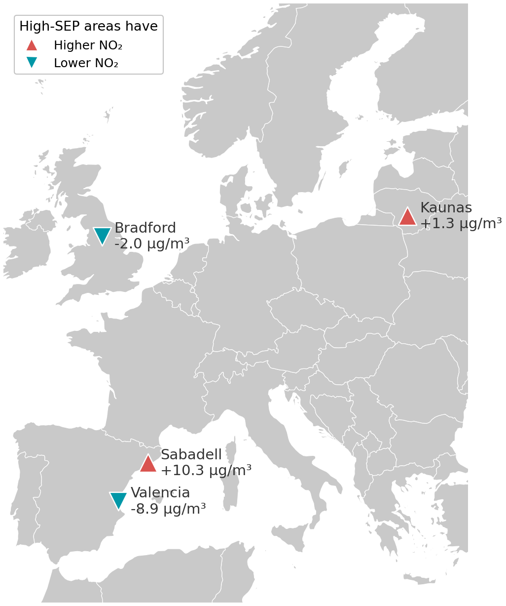

# IHEN exposome tools introduction
Possibilities and directions

  
<strong>Juan Carlos Rivillas, Tim Cadman & Hüseyin Küçükali</strong>

  
  

---
layout: content-two-cols
heading: Contents
---

<template #left>

1. Introduction
   - FAIR data
   - Exposome tools
2. Catalogue
3. Federated analysis
4. Other

</template>

<template #right>

</template>

---
layout: section
---

# Introduction

---
src: ../../library/combining-data/why.md
section: 'Introduction'
---

---
layout: content
heading: Combining data
subheading: Increased exposure contrast
section: Introduction
---

- A single location may only cover part of the range of exposure values
- For example, one cohort may only provide information on low or on high exposure

<svg viewBox="0 0 720 330" style="width: 100%; max-width: 620px; height: auto; display: block; margin-top: 0.5rem;" role="img" aria-label="NO2 distributions by cohort cover different parts of the exposure range">
  <line x1="90" y1="30" x2="690" y2="30" stroke="#eee" />
  <line x1="90" y1="90" x2="690" y2="90" stroke="#eee" />
  <line x1="90" y1="150" x2="690" y2="150" stroke="#eee" />
  <line x1="90" y1="210" x2="690" y2="210" stroke="#eee" />
  <line x1="90" y1="30" x2="90" y2="270" stroke="#999" stroke-width="1.5" />
  <line x1="90" y1="270" x2="690" y2="270" stroke="#999" stroke-width="1.5" />
  <text style="font-size: 12px" x="82" y="274" fill="#666" text-anchor="end">0.0</text>
  <text style="font-size: 12px" x="82" y="214" fill="#666" text-anchor="end">0.1</text>
  <text style="font-size: 12px" x="82" y="154" fill="#666" text-anchor="end">0.2</text>
  <text style="font-size: 12px" x="82" y="94" fill="#666" text-anchor="end">0.3</text>
  <text style="font-size: 12px" x="82" y="34" fill="#666" text-anchor="end">0.4</text>
  <text style="font-size: 12px" x="140" y="288" fill="#666" text-anchor="middle">10</text>
  <text style="font-size: 12px" x="240" y="288" fill="#666" text-anchor="middle">20</text>
  <text style="font-size: 12px" x="340" y="288" fill="#666" text-anchor="middle">30</text>
  <text style="font-size: 12px" x="440" y="288" fill="#666" text-anchor="middle">40</text>
  <text style="font-size: 12px" x="540" y="288" fill="#666" text-anchor="middle">50</text>
  <text style="font-size: 12px" x="640" y="288" fill="#666" text-anchor="middle">60</text>
  <text style="font-size: 14px" x="390" y="312" fill="#555" text-anchor="middle">NO₂ (µg/m³)</text>
  <text style="font-size: 14px" x="0" y="0" fill="#555" text-anchor="middle" transform="translate(30,150) rotate(-90)">Density</text>
  <g>
    <path d="M90.0,270.0 L95.0,270.0 L100.0,270.0 L105.0,270.0 L110.0,270.0 L115.0,269.8 L120.0,268.8 L125.0,265.3 L130.0,254.8 L135.0,230.1 L140.0,185.5 L145.0,125.6 L150.0,70.9 L155.0,48.4 L160.0,70.9 L165.0,125.6 L170.0,185.5 L175.0,230.1 L180.0,254.8 L185.0,265.3 L190.0,268.8 L195.0,269.8 L200.0,270.0 L205.0,270.0 L210.0,270.0 L215.0,270.0 L220.0,270.0 L225.0,270.0 L230.0,270.0 L235.0,270.0 L240.0,270.0 L245.0,270.0 L250.0,270.0 L255.0,270.0 L260.0,270.0 L265.0,270.0 L270.0,270.0 L275.0,270.0 L280.0,270.0 L285.0,270.0 L290.0,270.0 L295.0,270.0 L300.0,270.0 L305.0,270.0 L310.0,270.0 L315.0,270.0 L320.0,270.0 L325.0,270.0 L330.0,270.0 L335.0,270.0 L340.0,270.0 L345.0,270.0 L350.0,270.0 L355.0,270.0 L360.0,270.0 L365.0,270.0 L370.0,270.0 L375.0,270.0 L380.0,270.0 L385.0,270.0 L390.0,270.0 L395.0,270.0 L400.0,270.0 L405.0,270.0 L410.0,270.0 L415.0,270.0 L420.0,270.0 L425.0,270.0 L430.0,270.0 L435.0,270.0 L440.0,270.0 L445.0,270.0 L450.0,270.0 L455.0,270.0 L460.0,270.0 L465.0,270.0 L470.0,270.0 L475.0,270.0 L480.0,270.0 L485.0,270.0 L490.0,270.0 L495.0,270.0 L500.0,270.0 L505.0,270.0 L510.0,270.0 L515.0,270.0 L520.0,270.0 L525.0,270.0 L530.0,270.0 L535.0,270.0 L540.0,270.0 L545.0,270.0 L550.0,270.0 L555.0,270.0 L560.0,270.0 L565.0,270.0 L570.0,270.0 L575.0,270.0 L580.0,270.0 L585.0,270.0 L590.0,270.0 L595.0,270.0 L600.0,270.0 L605.0,270.0 L610.0,270.0 L615.0,270.0 L620.0,270.0 L625.0,270.0 L630.0,270.0 L635.0,270.0 L640.0,270.0 L645.0,270.0 L650.0,270.0 L655.0,270.0 L660.0,270.0 L665.0,270.0 L670.0,270.0 L675.0,270.0 L680.0,270.0 L685.0,270.0 L690.0,270.0 Z" fill="#0097A7" fill-opacity="0.35" stroke="#0097A7" stroke-width="1.5" />
    <text style="font-size: 13px" x="168" y="60" fill="#333">Rhea</text>
  </g>
  <g v-click>
    <path d="M90.0,270.0 L95.0,270.0 L100.0,270.0 L105.0,270.0 L110.0,270.0 L115.0,270.0 L120.0,270.0 L125.0,270.0 L130.0,270.0 L135.0,270.0 L140.0,270.0 L145.0,270.0 L150.0,270.0 L155.0,270.0 L160.0,270.0 L165.0,270.0 L170.0,270.0 L175.0,270.0 L180.0,270.0 L185.0,270.0 L190.0,270.0 L195.0,270.0 L200.0,270.0 L205.0,270.0 L210.0,270.0 L215.0,270.0 L220.0,270.0 L225.0,270.0 L230.0,270.0 L235.0,270.0 L240.0,270.0 L245.0,270.0 L250.0,270.0 L255.0,270.0 L260.0,270.0 L265.0,270.0 L270.0,270.0 L275.0,270.0 L280.0,270.0 L285.0,270.0 L290.0,270.0 L295.0,270.0 L300.0,270.0 L305.0,270.0 L310.0,270.0 L315.0,270.0 L320.0,270.0 L325.0,270.0 L330.0,270.0 L335.0,270.0 L340.0,270.0 L345.0,270.0 L350.0,270.0 L355.0,270.0 L360.0,270.0 L365.0,270.0 L370.0,270.0 L375.0,270.0 L380.0,270.0 L385.0,270.0 L390.0,270.0 L395.0,270.0 L400.0,270.0 L405.0,270.0 L410.0,270.0 L415.0,270.0 L420.0,270.0 L425.0,270.0 L430.0,269.9 L435.0,269.8 L440.0,269.5 L445.0,268.9 L450.0,267.7 L455.0,265.3 L460.0,261.2 L465.0,254.4 L470.0,244.3 L475.0,230.4 L480.0,213.1 L485.0,193.6 L490.0,174.2 L495.0,157.8 L500.0,147.4 L505.0,144.8 L510.0,150.7 L515.0,163.8 L520.0,181.8 L525.0,201.5 L530.0,220.4 L535.0,236.4 L540.0,248.8 L545.0,257.5 L550.0,263.1 L555.0,266.5 L560.0,268.3 L565.0,269.2 L570.0,269.7 L575.0,269.9 L580.0,270.0 L585.0,270.0 L590.0,270.0 L595.0,270.0 L600.0,270.0 L605.0,270.0 L610.0,270.0 L615.0,270.0 L620.0,270.0 L625.0,270.0 L630.0,270.0 L635.0,270.0 L640.0,270.0 L645.0,270.0 L650.0,270.0 L655.0,270.0 L660.0,270.0 L665.0,270.0 L670.0,270.0 L675.0,270.0 L680.0,270.0 L685.0,270.0 L690.0,270.0 Z" fill="#D9534F" fill-opacity="0.35" stroke="#D9534F" stroke-width="1.5" />
    <text style="font-size: 13px" x="520" y="140" fill="#333">DNBC</text>
  </g>
  <g v-click>
    <path d="M90.0,270.0 L95.0,270.0 L100.0,270.0 L105.0,270.0 L110.0,270.0 L115.0,270.0 L120.0,270.0 L125.0,270.0 L130.0,270.0 L135.0,270.0 L140.0,270.0 L145.0,270.0 L150.0,270.0 L155.0,270.0 L160.0,270.0 L165.0,270.0 L170.0,270.0 L175.0,270.0 L180.0,270.0 L185.0,270.0 L190.0,270.0 L195.0,270.0 L200.0,270.0 L205.0,269.8 L210.0,269.0 L215.0,265.9 L220.0,256.0 L225.0,231.9 L230.0,187.0 L235.0,125.3 L240.0,68.0 L245.0,44.2 L250.0,68.0 L255.0,125.3 L260.0,187.0 L265.0,231.9 L270.0,256.0 L275.0,265.9 L280.0,269.0 L285.0,269.8 L290.0,270.0 L295.0,270.0 L300.0,270.0 L305.0,270.0 L310.0,270.0 L315.0,270.0 L320.0,270.0 L325.0,270.0 L330.0,270.0 L335.0,270.0 L340.0,270.0 L345.0,270.0 L350.0,270.0 L355.0,270.0 L360.0,270.0 L365.0,270.0 L370.0,270.0 L375.0,270.0 L380.0,270.0 L385.0,270.0 L390.0,270.0 L395.0,270.0 L400.0,270.0 L405.0,270.0 L410.0,270.0 L415.0,270.0 L420.0,270.0 L425.0,270.0 L430.0,270.0 L435.0,270.0 L440.0,270.0 L445.0,270.0 L450.0,270.0 L455.0,270.0 L460.0,270.0 L465.0,270.0 L470.0,270.0 L475.0,270.0 L480.0,270.0 L485.0,270.0 L490.0,270.0 L495.0,270.0 L500.0,270.0 L505.0,270.0 L510.0,270.0 L515.0,270.0 L520.0,270.0 L525.0,270.0 L530.0,270.0 L535.0,270.0 L540.0,270.0 L545.0,270.0 L550.0,270.0 L555.0,270.0 L560.0,270.0 L565.0,270.0 L570.0,270.0 L575.0,270.0 L580.0,270.0 L585.0,270.0 L590.0,270.0 L595.0,270.0 L600.0,270.0 L605.0,270.0 L610.0,270.0 L615.0,270.0 L620.0,270.0 L625.0,270.0 L630.0,270.0 L635.0,270.0 L640.0,270.0 L645.0,270.0 L650.0,270.0 L655.0,270.0 L660.0,270.0 L665.0,270.0 L670.0,270.0 L675.0,270.0 L680.0,270.0 L685.0,270.0 L690.0,270.0 Z" fill="#E6B96A" fill-opacity="0.35" stroke="#E6B96A" stroke-width="1.5" />
    <text style="font-size: 13px" x="258" y="55" fill="#333">BiB</text>
  </g>
  <g v-click>
    <path d="M90.0,270.0 L95.0,270.0 L100.0,270.0 L105.0,270.0 L110.0,270.0 L115.0,270.0 L120.0,270.0 L125.0,270.0 L130.0,270.0 L135.0,270.0 L140.0,270.0 L145.0,270.0 L150.0,270.0 L155.0,270.0 L160.0,270.0 L165.0,269.9 L170.0,269.8 L175.0,269.6 L180.0,269.1 L185.0,268.0 L190.0,266.0 L195.0,262.6 L200.0,257.0 L205.0,248.6 L210.0,237.0 L215.0,222.1 L220.0,204.7 L225.0,186.5 L230.0,169.7 L235.0,156.9 L240.0,150.3 L245.0,151.1 L250.0,159.1 L255.0,172.8 L260.0,190.1 L265.0,208.3 L270.0,225.3 L275.0,239.6 L280.0,250.6 L285.0,258.3 L290.0,263.4 L295.0,266.5 L300.0,268.3 L305.0,269.2 L310.0,269.6 L315.0,269.9 L320.0,269.9 L325.0,270.0 L330.0,270.0 L335.0,270.0 L340.0,270.0 L345.0,270.0 L350.0,270.0 L355.0,270.0 L360.0,270.0 L365.0,270.0 L370.0,270.0 L375.0,270.0 L380.0,270.0 L385.0,270.0 L390.0,270.0 L395.0,270.0 L400.0,270.0 L405.0,270.0 L410.0,270.0 L415.0,270.0 L420.0,270.0 L425.0,270.0 L430.0,270.0 L435.0,270.0 L440.0,270.0 L445.0,270.0 L450.0,270.0 L455.0,270.0 L460.0,270.0 L465.0,270.0 L470.0,270.0 L475.0,270.0 L480.0,270.0 L485.0,270.0 L490.0,270.0 L495.0,270.0 L500.0,270.0 L505.0,270.0 L510.0,270.0 L515.0,270.0 L520.0,270.0 L525.0,270.0 L530.0,270.0 L535.0,270.0 L540.0,270.0 L545.0,270.0 L550.0,270.0 L555.0,270.0 L560.0,270.0 L565.0,270.0 L570.0,270.0 L575.0,270.0 L580.0,270.0 L585.0,270.0 L590.0,270.0 L595.0,270.0 L600.0,270.0 L605.0,270.0 L610.0,270.0 L615.0,270.0 L620.0,270.0 L625.0,270.0 L630.0,270.0 L635.0,270.0 L640.0,270.0 L645.0,270.0 L650.0,270.0 L655.0,270.0 L660.0,270.0 L665.0,270.0 L670.0,270.0 L675.0,270.0 L680.0,270.0 L685.0,270.0 L690.0,270.0 Z" fill="#9AA0A6" fill-opacity="0.35" stroke="#9AA0A6" stroke-width="1.5" />
    <path d="M90.0,270.0 L95.0,270.0 L100.0,270.0 L105.0,270.0 L110.0,270.0 L115.0,270.0 L120.0,270.0 L125.0,270.0 L130.0,270.0 L135.0,270.0 L140.0,269.9 L145.0,269.9 L150.0,269.8 L155.0,269.7 L160.0,269.4 L165.0,269.0 L170.0,268.3 L175.0,267.2 L180.0,265.7 L185.0,263.4 L190.0,260.4 L195.0,256.3 L200.0,251.1 L205.0,244.7 L210.0,237.3 L215.0,228.9 L220.0,220.0 L225.0,211.0 L230.0,202.5 L235.0,195.2 L240.0,189.6 L245.0,186.3 L250.0,185.5 L255.0,187.3 L260.0,191.6 L265.0,197.9 L270.0,205.8 L275.0,214.5 L280.0,223.6 L285.0,232.3 L290.0,240.4 L295.0,247.4 L300.0,253.3 L305.0,258.1 L310.0,261.7 L315.0,264.4 L320.0,266.4 L325.0,267.7 L330.0,268.6 L335.0,269.2 L340.0,269.5 L345.0,269.7 L350.0,269.9 L355.0,269.9 L360.0,270.0 L365.0,270.0 L370.0,270.0 L375.0,270.0 L380.0,270.0 L385.0,270.0 L390.0,270.0 L395.0,270.0 L400.0,270.0 L405.0,270.0 L410.0,270.0 L415.0,270.0 L420.0,270.0 L425.0,270.0 L430.0,270.0 L435.0,270.0 L440.0,270.0 L445.0,270.0 L450.0,270.0 L455.0,270.0 L460.0,270.0 L465.0,270.0 L470.0,270.0 L475.0,270.0 L480.0,270.0 L485.0,270.0 L490.0,270.0 L495.0,270.0 L500.0,270.0 L505.0,270.0 L510.0,270.0 L515.0,270.0 L520.0,270.0 L525.0,270.0 L530.0,270.0 L535.0,270.0 L540.0,270.0 L545.0,270.0 L550.0,270.0 L555.0,270.0 L560.0,270.0 L565.0,270.0 L570.0,270.0 L575.0,270.0 L580.0,270.0 L585.0,270.0 L590.0,270.0 L595.0,270.0 L600.0,270.0 L605.0,270.0 L610.0,270.0 L615.0,270.0 L620.0,270.0 L625.0,270.0 L630.0,270.0 L635.0,270.0 L640.0,270.0 L645.0,270.0 L650.0,270.0 L655.0,270.0 L660.0,270.0 L665.0,270.0 L670.0,270.0 L675.0,270.0 L680.0,270.0 L685.0,270.0 L690.0,270.0 Z" fill="#9AA0A6" fill-opacity="0.35" stroke="#9AA0A6" stroke-width="1.5" />
    <path d="M90.0,270.0 L95.0,270.0 L100.0,270.0 L105.0,270.0 L110.0,270.0 L115.0,270.0 L120.0,270.0 L125.0,270.0 L130.0,270.0 L135.0,270.0 L140.0,270.0 L145.0,270.0 L150.0,270.0 L155.0,270.0 L160.0,270.0 L165.0,270.0 L170.0,270.0 L175.0,270.0 L180.0,270.0 L185.0,270.0 L190.0,270.0 L195.0,270.0 L200.0,270.0 L205.0,270.0 L210.0,270.0 L215.0,270.0 L220.0,270.0 L225.0,270.0 L230.0,270.0 L235.0,270.0 L240.0,270.0 L245.0,270.0 L250.0,270.0 L255.0,270.0 L260.0,269.9 L265.0,269.6 L270.0,268.7 L275.0,266.3 L280.0,260.7 L285.0,249.5 L290.0,230.1 L295.0,201.5 L300.0,166.3 L305.0,131.5 L310.0,106.9 L315.0,100.7 L320.0,114.9 L325.0,144.8 L330.0,180.8 L335.0,214.0 L340.0,239.0 L345.0,254.9 L350.0,263.5 L355.0,267.5 L360.0,269.2 L365.0,269.8 L370.0,269.9 L375.0,270.0 L380.0,270.0 L385.0,270.0 L390.0,270.0 L395.0,270.0 L400.0,270.0 L405.0,270.0 L410.0,270.0 L415.0,270.0 L420.0,270.0 L425.0,270.0 L430.0,270.0 L435.0,270.0 L440.0,270.0 L445.0,270.0 L450.0,270.0 L455.0,270.0 L460.0,270.0 L465.0,270.0 L470.0,270.0 L475.0,270.0 L480.0,270.0 L485.0,270.0 L490.0,270.0 L495.0,270.0 L500.0,270.0 L505.0,270.0 L510.0,270.0 L515.0,270.0 L520.0,270.0 L525.0,270.0 L530.0,270.0 L535.0,270.0 L540.0,270.0 L545.0,270.0 L550.0,270.0 L555.0,270.0 L560.0,270.0 L565.0,270.0 L570.0,270.0 L575.0,270.0 L580.0,270.0 L585.0,270.0 L590.0,270.0 L595.0,270.0 L600.0,270.0 L605.0,270.0 L610.0,270.0 L615.0,270.0 L620.0,270.0 L625.0,270.0 L630.0,270.0 L635.0,270.0 L640.0,270.0 L645.0,270.0 L650.0,270.0 L655.0,270.0 L660.0,270.0 L665.0,270.0 L670.0,270.0 L675.0,270.0 L680.0,270.0 L685.0,270.0 L690.0,270.0 Z" fill="#9AA0A6" fill-opacity="0.35" stroke="#9AA0A6" stroke-width="1.5" />
    <path d="M90.0,270.0 L95.0,270.0 L100.0,270.0 L105.0,270.0 L110.0,270.0 L115.0,270.0 L120.0,270.0 L125.0,270.0 L130.0,270.0 L135.0,270.0 L140.0,270.0 L145.0,270.0 L150.0,270.0 L155.0,270.0 L160.0,270.0 L165.0,270.0 L170.0,270.0 L175.0,270.0 L180.0,270.0 L185.0,270.0 L190.0,270.0 L195.0,270.0 L200.0,270.0 L205.0,270.0 L210.0,270.0 L215.0,270.0 L220.0,270.0 L225.0,270.0 L230.0,269.9 L235.0,269.8 L240.0,269.6 L245.0,269.0 L250.0,268.0 L255.0,266.2 L260.0,263.0 L265.0,257.9 L270.0,250.4 L275.0,240.0 L280.0,226.7 L285.0,211.0 L290.0,194.1 L295.0,178.0 L300.0,164.8 L305.0,156.5 L310.0,154.5 L315.0,159.1 L320.0,169.6 L325.0,184.2 L330.0,200.9 L335.0,217.5 L340.0,232.3 L345.0,244.5 L350.0,253.7 L355.0,260.2 L360.0,264.4 L365.0,267.0 L370.0,268.5 L375.0,269.3 L380.0,269.7 L385.0,269.9 L390.0,269.9 L395.0,270.0 L400.0,270.0 L405.0,270.0 L410.0,270.0 L415.0,270.0 L420.0,270.0 L425.0,270.0 L430.0,270.0 L435.0,270.0 L440.0,270.0 L445.0,270.0 L450.0,270.0 L455.0,270.0 L460.0,270.0 L465.0,270.0 L470.0,270.0 L475.0,270.0 L480.0,270.0 L485.0,270.0 L490.0,270.0 L495.0,270.0 L500.0,270.0 L505.0,270.0 L510.0,270.0 L515.0,270.0 L520.0,270.0 L525.0,270.0 L530.0,270.0 L535.0,270.0 L540.0,270.0 L545.0,270.0 L550.0,270.0 L555.0,270.0 L560.0,270.0 L565.0,270.0 L570.0,270.0 L575.0,270.0 L580.0,270.0 L585.0,270.0 L590.0,270.0 L595.0,270.0 L600.0,270.0 L605.0,270.0 L610.0,270.0 L615.0,270.0 L620.0,270.0 L625.0,270.0 L630.0,270.0 L635.0,270.0 L640.0,270.0 L645.0,270.0 L650.0,270.0 L655.0,270.0 L660.0,270.0 L665.0,270.0 L670.0,270.0 L675.0,270.0 L680.0,270.0 L685.0,270.0 L690.0,270.0 Z" fill="#9AA0A6" fill-opacity="0.35" stroke="#9AA0A6" stroke-width="1.5" />
    <path d="M90.0,270.0 L95.0,270.0 L100.0,270.0 L105.0,270.0 L110.0,270.0 L115.0,270.0 L120.0,270.0 L125.0,270.0 L130.0,270.0 L135.0,270.0 L140.0,270.0 L145.0,270.0 L150.0,270.0 L155.0,270.0 L160.0,270.0 L165.0,270.0 L170.0,270.0 L175.0,270.0 L180.0,270.0 L185.0,270.0 L190.0,270.0 L195.0,270.0 L200.0,270.0 L205.0,270.0 L210.0,270.0 L215.0,270.0 L220.0,270.0 L225.0,270.0 L230.0,270.0 L235.0,270.0 L240.0,270.0 L245.0,270.0 L250.0,270.0 L255.0,270.0 L260.0,270.0 L265.0,270.0 L270.0,270.0 L275.0,270.0 L280.0,270.0 L285.0,270.0 L290.0,270.0 L295.0,270.0 L300.0,270.0 L305.0,270.0 L310.0,270.0 L315.0,270.0 L320.0,270.0 L325.0,270.0 L330.0,269.9 L335.0,269.8 L340.0,269.5 L345.0,269.0 L350.0,268.1 L355.0,266.4 L360.0,263.5 L365.0,258.9 L370.0,252.2 L375.0,242.8 L380.0,230.8 L385.0,216.5 L390.0,200.9 L395.0,185.4 L400.0,172.0 L405.0,162.5 L410.0,158.3 L415.0,160.1 L420.0,167.6 L425.0,179.7 L430.0,194.6 L435.0,210.4 L440.0,225.3 L445.0,238.3 L450.0,248.7 L455.0,256.5 L460.0,261.9 L465.0,265.4 L470.0,267.5 L475.0,268.7 L480.0,269.4 L485.0,269.7 L490.0,269.9 L495.0,269.9 L500.0,270.0 L505.0,270.0 L510.0,270.0 L515.0,270.0 L520.0,270.0 L525.0,270.0 L530.0,270.0 L535.0,270.0 L540.0,270.0 L545.0,270.0 L550.0,270.0 L555.0,270.0 L560.0,270.0 L565.0,270.0 L570.0,270.0 L575.0,270.0 L580.0,270.0 L585.0,270.0 L590.0,270.0 L595.0,270.0 L600.0,270.0 L605.0,270.0 L610.0,270.0 L615.0,270.0 L620.0,270.0 L625.0,270.0 L630.0,270.0 L635.0,270.0 L640.0,270.0 L645.0,270.0 L650.0,270.0 L655.0,270.0 L660.0,270.0 L665.0,270.0 L670.0,270.0 L675.0,270.0 L680.0,270.0 L685.0,270.0 L690.0,270.0 Z" fill="#9AA0A6" fill-opacity="0.35" stroke="#9AA0A6" stroke-width="1.5" />
    <path d="M90.0,270.0 L95.0,270.0 L100.0,270.0 L105.0,270.0 L110.0,270.0 L115.0,270.0 L120.0,270.0 L125.0,270.0 L130.0,270.0 L135.0,270.0 L140.0,270.0 L145.0,270.0 L150.0,270.0 L155.0,270.0 L160.0,270.0 L165.0,270.0 L170.0,270.0 L175.0,270.0 L180.0,270.0 L185.0,270.0 L190.0,270.0 L195.0,270.0 L200.0,270.0 L205.0,270.0 L210.0,270.0 L215.0,270.0 L220.0,270.0 L225.0,270.0 L230.0,270.0 L235.0,270.0 L240.0,270.0 L245.0,270.0 L250.0,270.0 L255.0,270.0 L260.0,270.0 L265.0,270.0 L270.0,270.0 L275.0,270.0 L280.0,270.0 L285.0,270.0 L290.0,270.0 L295.0,270.0 L300.0,270.0 L305.0,270.0 L310.0,270.0 L315.0,270.0 L320.0,270.0 L325.0,270.0 L330.0,270.0 L335.0,270.0 L340.0,270.0 L345.0,270.0 L350.0,269.9 L355.0,269.8 L360.0,269.5 L365.0,268.8 L370.0,267.3 L375.0,264.7 L380.0,260.1 L385.0,252.7 L390.0,241.8 L395.0,227.2 L400.0,209.3 L405.0,189.6 L410.0,170.6 L415.0,155.2 L420.0,146.2 L425.0,145.4 L430.0,152.8 L435.0,167.1 L440.0,185.7 L445.0,205.4 L450.0,223.9 L455.0,239.2 L460.0,250.8 L465.0,258.8 L470.0,263.9 L475.0,266.9 L480.0,268.5 L485.0,269.4 L490.0,269.7 L495.0,269.9 L500.0,270.0 L505.0,270.0 L510.0,270.0 L515.0,270.0 L520.0,270.0 L525.0,270.0 L530.0,270.0 L535.0,270.0 L540.0,270.0 L545.0,270.0 L550.0,270.0 L555.0,270.0 L560.0,270.0 L565.0,270.0 L570.0,270.0 L575.0,270.0 L580.0,270.0 L585.0,270.0 L590.0,270.0 L595.0,270.0 L600.0,270.0 L605.0,270.0 L610.0,270.0 L615.0,270.0 L620.0,270.0 L625.0,270.0 L630.0,270.0 L635.0,270.0 L640.0,270.0 L645.0,270.0 L650.0,270.0 L655.0,270.0 L660.0,270.0 L665.0,270.0 L670.0,270.0 L675.0,270.0 L680.0,270.0 L685.0,270.0 L690.0,270.0 Z" fill="#9AA0A6" fill-opacity="0.35" stroke="#9AA0A6" stroke-width="1.5" />
    <path d="M90.0,270.0 L95.0,270.0 L100.0,270.0 L105.0,270.0 L110.0,270.0 L115.0,270.0 L120.0,270.0 L125.0,270.0 L130.0,270.0 L135.0,270.0 L140.0,270.0 L145.0,270.0 L150.0,270.0 L155.0,270.0 L160.0,270.0 L165.0,270.0 L170.0,270.0 L175.0,270.0 L180.0,270.0 L185.0,270.0 L190.0,270.0 L195.0,270.0 L200.0,270.0 L205.0,270.0 L210.0,270.0 L215.0,270.0 L220.0,270.0 L225.0,270.0 L230.0,270.0 L235.0,270.0 L240.0,270.0 L245.0,270.0 L250.0,270.0 L255.0,270.0 L260.0,270.0 L265.0,270.0 L270.0,270.0 L275.0,270.0 L280.0,270.0 L285.0,270.0 L290.0,270.0 L295.0,270.0 L300.0,270.0 L305.0,270.0 L310.0,270.0 L315.0,270.0 L320.0,269.9 L325.0,269.9 L330.0,269.9 L335.0,269.8 L340.0,269.7 L345.0,269.6 L350.0,269.5 L355.0,269.3 L360.0,269.1 L365.0,268.8 L370.0,268.4 L375.0,267.9 L380.0,267.3 L385.0,266.6 L390.0,265.8 L395.0,264.8 L400.0,263.6 L405.0,262.2 L410.0,260.6 L415.0,258.8 L420.0,256.7 L425.0,254.5 L430.0,252.1 L435.0,249.5 L440.0,246.7 L445.0,243.9 L450.0,241.0 L455.0,238.1 L460.0,235.2 L465.0,232.5 L470.0,230.0 L475.0,227.7 L480.0,225.7 L485.0,224.2 L490.0,223.0 L495.0,222.3 L500.0,222.0 L505.0,222.3 L510.0,223.0 L515.0,224.2 L520.0,225.7 L525.0,227.7 L530.0,230.0 L535.0,232.5 L540.0,235.2 L545.0,238.1 L550.0,241.0 L555.0,243.9 L560.0,246.7 L565.0,249.5 L570.0,252.1 L575.0,254.5 L580.0,256.7 L585.0,258.8 L590.0,260.6 L595.0,262.2 L600.0,263.6 L605.0,264.8 L610.0,265.8 L615.0,266.6 L620.0,267.3 L625.0,267.9 L630.0,268.4 L635.0,268.8 L640.0,269.1 L645.0,269.3 L650.0,269.5 L655.0,269.6 L660.0,269.7 L665.0,269.8 L670.0,269.9 L675.0,269.9 L680.0,269.9 L685.0,270.0 L690.0,270.0 Z" fill="#9AA0A6" fill-opacity="0.35" stroke="#9AA0A6" stroke-width="1.5" />
    <text style="font-size: 13px" x="417" y="132" fill="#333" text-anchor="middle">Seven other cohorts</text>
  </g>
</svg>

Cadman et al. (2024a) Environ Int 185:108453

---
layout: content
heading: Combining data
subheading: Increased power
section: Introduction
---

- Many exposures are rare, and single cohorts lack the power to detect associations

<svg viewBox="0 0 720 330" style="width: 100%; max-width: 620px; height: auto; display: block; margin-top: 0.5rem;" role="img" aria-label="Power to detect an association with NO2 rises as cohorts are added">
  <line x1="90" y1="30" x2="690" y2="30" stroke="#eee" />
  <line x1="90" y1="90" x2="690" y2="90" stroke="#eee" />
  <line x1="90" y1="150" x2="690" y2="150" stroke="#eee" />
  <line x1="90" y1="210" x2="690" y2="210" stroke="#eee" />
  <line x1="90" y1="78" x2="690" y2="78" stroke="#9AA0A6" stroke-width="1.5" stroke-dasharray="6 5" />
  <text style="font-size: 12px" x="690" y="72" fill="#9AA0A6" text-anchor="end">80% power</text>

  <line x1="90" y1="30" x2="90" y2="270" stroke="#999" stroke-width="1.5" />
  <line x1="90" y1="270" x2="690" y2="270" stroke="#999" stroke-width="1.5" />
  <text style="font-size: 12px" x="82" y="274" fill="#666" text-anchor="end">0%</text>
  <text style="font-size: 12px" x="82" y="214" fill="#666" text-anchor="end">25%</text>
  <text style="font-size: 12px" x="82" y="154" fill="#666" text-anchor="end">50%</text>
  <text style="font-size: 12px" x="82" y="94" fill="#666" text-anchor="end">75%</text>
  <text style="font-size: 12px" x="82" y="34" fill="#666" text-anchor="end">100%</text>
  <text style="font-size: 12px" x="90" y="288" fill="#666" text-anchor="middle">0</text>
  <text style="font-size: 12px" x="277.5" y="288" fill="#666" text-anchor="middle">10,000</text>
  <text style="font-size: 12px" x="465" y="288" fill="#666" text-anchor="middle">20,000</text>
  <text style="font-size: 12px" x="652.5" y="288" fill="#666" text-anchor="middle">30,000</text>
  <text style="font-size: 14px" x="390" y="312" fill="#555" text-anchor="middle">Cumulative sample size</text>
  <text style="font-size: 14px" x="0" y="0" fill="#555" text-anchor="middle" transform="translate(30,150) rotate(-90)">Power (OR 1.10 per IQR NO₂)</text>

  <g>
    <circle cx="112.1" cy="249.8" r="5" fill="#4285F4" />
    <text style="font-size: 13px" x="124" y="262" fill="#333">One cohort</text>
  </g>
  <g v-click>
    <polyline points="112.1,249.8 117.6,240.7 135.2,214.1 162.2,186.7 219.4,150.5" fill="none" stroke="#4285F4" stroke-width="3" />
    <circle cx="117.6" cy="240.7" r="5" fill="#4285F4" />
    <circle cx="135.2" cy="214.1" r="5" fill="#4285F4" />
    <circle cx="162.2" cy="186.7" r="5" fill="#4285F4" />
    <circle cx="219.4" cy="150.5" r="5" fill="#4285F4" />
    <text style="font-size: 13px" x="230" y="166" fill="#333">Five cohorts</text>
  </g>
  <g v-click>
    <polyline points="219.4,150.5 238.1,116.2 372.4,62.2" fill="none" stroke="#4285F4" stroke-width="3" />
    <circle cx="238.1" cy="116.2" r="5" fill="#4285F4" />
    <circle cx="372.4" cy="62.2" r="5" fill="#4285F4" />
    <text style="font-size: 13px" x="362" y="52" fill="#333" text-anchor="end">Seven cohorts</text>
  </g>
  <g v-click>
    <polyline points="372.4,62.2 493.5,39.6 578.1,31.4 666.8,30" fill="none" stroke="#4285F4" stroke-width="3" />
    <circle cx="493.5" cy="39.6" r="5" fill="#4285F4" />
    <circle cx="578.1" cy="31.4" r="5" fill="#4285F4" />
    <circle cx="666.8" cy="30" r="5" fill="#4285F4" />
    <text style="font-size: 13px" x="670" y="52" fill="#333" text-anchor="end">Ten cohorts</text>
  </g>
</svg>

Example: air pollution and postpartum depression. Cadman et al. (2024a) Environ Int 185:108453

---
layout: content
heading: Combining data
subheading: Lifecourse epidemiology
section: Introduction
---

  
Example research question: "How does early life chemical exposure affect later life cognitive decline?"

---
layout: content
heading: Combining data
subheading: "Example 1: One birth cohort"
section: Introduction
---

<svg width="655" height="320" viewBox="65 0 655 320" style="width: 100%; max-width: 560px; height: auto; margin: 0; display: block;">
  <!-- participant-count size legend, right-aligned -->
  <text style="font-size: 12px" x="300" y="22" fill="#555">Participants:</text>
  <circle cx="380" cy="18" r="4" fill="#888" fill-opacity="0.6" />
  <text style="font-size: 11px" x="388" y="22" fill="#555">&lt;1,000</text>
  <circle cx="470" cy="18" r="7" fill="#888" fill-opacity="0.6" />
  <text style="font-size: 11px" x="481" y="22" fill="#555">1,000–5,000</text>
  <circle cx="600" cy="18" r="10" fill="#888" fill-opacity="0.6" />
  <text style="font-size: 11px" x="614" y="22" fill="#555">&gt;5,000</text>

  <!-- row separator lines -->
  <line x1="140" y1="40" x2="700" y2="40" stroke="#eee" stroke-width="1" />
  <line x1="140" y1="84" x2="700" y2="84" stroke="#eee" stroke-width="1" />
  <line x1="140" y1="128" x2="700" y2="128" stroke="#eee" stroke-width="1" />
  <line x1="140" y1="172" x2="700" y2="172" stroke="#eee" stroke-width="1" />
  <line x1="140" y1="216" x2="700" y2="216" stroke="#eee" stroke-width="1" />
  <line x1="140" y1="260" x2="700" y2="260" stroke="#eee" stroke-width="1" />

  <!-- row labels — Cohorts 2-5 recoloured to match the background (present for
       alignment, not visible yet) so Cohort 1 sits in exactly the same place
       as it does once all 5 cohorts are shown -->
  <text style="font-size: 14px" x="130" y="66" fill="#0097A7" text-anchor="end">Cohort 1</text>
  <text style="font-size: 14px" x="130" y="110" fill="#ffffff" text-anchor="end">Cohort 2</text>
  <text style="font-size: 14px" x="130" y="154" fill="#ffffff" text-anchor="end">Cohort 3</text>
  <text style="font-size: 14px" x="130" y="198" fill="#ffffff" text-anchor="end">Cohort 4</text>
  <text style="font-size: 14px" x="130" y="242" fill="#ffffff" text-anchor="end">Cohort 5</text>

  <!-- Cohort 1 (teal): narrow, young adulthood -->
  <circle cx="252" cy="62" r="7" fill="#0097A7" fill-opacity="0.65" />
  <circle cx="277" cy="62" r="6" fill="#0097A7" fill-opacity="0.65" />
  <circle cx="308" cy="62" r="7" fill="#0097A7" fill-opacity="0.65" />
  <circle cx="345" cy="62" r="5" fill="#0097A7" fill-opacity="0.65" />

  <!-- Cohort 2 — hidden (matches background) -->
  <circle cx="152" cy="106" r="9" fill="#ffffff" />
  <circle cx="165" cy="106" r="10" fill="#ffffff" />
  <circle cx="177" cy="106" r="8" fill="#ffffff" />
  <circle cx="196" cy="106" r="7" fill="#ffffff" />
  <circle cx="215" cy="106" r="7" fill="#ffffff" />

  <!-- Cohort 3 — hidden (matches background) -->
  <circle cx="171" cy="150" r="9" fill="#ffffff" />
  <circle cx="202" cy="150" r="10" fill="#ffffff" />
  <circle cx="264" cy="150" r="7" fill="#ffffff" />
  <circle cx="327" cy="150" r="8" fill="#ffffff" />

  <!-- Cohort 4 — hidden (matches background), shifted to age 60-90 -->
  <circle cx="513" cy="194" r="5" fill="#ffffff" />
  <circle cx="563" cy="194" r="4" fill="#ffffff" />
  <circle cx="607" cy="194" r="5" fill="#ffffff" />
  <circle cx="650" cy="194" r="3" fill="#ffffff" />
  <circle cx="700" cy="194" r="4" fill="#ffffff" />

  <!-- Cohort 5 — hidden (matches background) -->
  <circle cx="233" cy="238" r="8" fill="#ffffff" />
  <circle cx="296" cy="238" r="6" fill="#ffffff" />
  <circle cx="376" cy="238" r="7" fill="#ffffff" />
  <circle cx="451" cy="238" r="5" fill="#ffffff" />
  <circle cx="526" cy="238" r="4" fill="#ffffff" />
  <circle cx="576" cy="238" r="3" fill="#ffffff" />

  <!-- x axis (age 0-90) -->
  <line x1="140" y1="270" x2="700" y2="270" stroke="#999" stroke-width="1.5" />
  <line x1="140" y1="270" x2="140" y2="275" stroke="#999" stroke-width="1.5" />
  <line x1="202" y1="270" x2="202" y2="275" stroke="#999" stroke-width="1.5" />
  <line x1="264" y1="270" x2="264" y2="275" stroke="#999" stroke-width="1.5" />
  <line x1="327" y1="270" x2="327" y2="275" stroke="#999" stroke-width="1.5" />
  <line x1="389" y1="270" x2="389" y2="275" stroke="#999" stroke-width="1.5" />
  <line x1="451" y1="270" x2="451" y2="275" stroke="#999" stroke-width="1.5" />
  <line x1="513" y1="270" x2="513" y2="275" stroke="#999" stroke-width="1.5" />
  <line x1="576" y1="270" x2="576" y2="275" stroke="#999" stroke-width="1.5" />
  <line x1="638" y1="270" x2="638" y2="275" stroke="#999" stroke-width="1.5" />
  <line x1="700" y1="270" x2="700" y2="275" stroke="#999" stroke-width="1.5" />
  <text style="font-size: 12px" x="140" y="286" fill="#666" text-anchor="middle">0</text>
  <text style="font-size: 12px" x="202" y="286" fill="#666" text-anchor="middle">10</text>
  <text style="font-size: 12px" x="264" y="286" fill="#666" text-anchor="middle">20</text>
  <text style="font-size: 12px" x="327" y="286" fill="#666" text-anchor="middle">30</text>
  <text style="font-size: 12px" x="389" y="286" fill="#666" text-anchor="middle">40</text>
  <text style="font-size: 12px" x="451" y="286" fill="#666" text-anchor="middle">50</text>
  <text style="font-size: 12px" x="513" y="286" fill="#666" text-anchor="middle">60</text>
  <text style="font-size: 12px" x="576" y="286" fill="#666" text-anchor="middle">70</text>
  <text style="font-size: 12px" x="638" y="286" fill="#666" text-anchor="middle">80</text>
  <text style="font-size: 12px" x="700" y="286" fill="#666" text-anchor="middle">90</text>
  <text style="font-size: 14px" x="420" y="304" fill="#555" text-anchor="middle">Age (years)</text>
</svg>

---
layout: content
heading: Combining data
subheading: "Example 1: One birth cohort"
section: Introduction
---

<svg width="655" height="320" viewBox="65 0 655 320" style="width: 100%; max-width: 560px; height: auto; margin: 0; display: block;">
  <!-- underlying cohort data points — only where Cohort 1 has observations (age 18-33) -->
  <circle cx="264" cy="105" r="3.5" fill="#999" fill-opacity="0.4" />
  <circle cx="296" cy="112" r="3.5" fill="#999" fill-opacity="0.4" />
  <circle cx="327" cy="102" r="3.5" fill="#999" fill-opacity="0.4" />

  <!-- fitted trajectories: only drawn over the observed period (age 18-33) -->
  <path d="M252,85 L345,89" fill="none" stroke="#0097A7" stroke-width="3" stroke-linecap="round" />
  <path d="M252,97 L345,109" fill="none" stroke="#E6B96A" stroke-width="3" stroke-linecap="round" />
  <path d="M252,114 L345,136" fill="none" stroke="#D9534F" stroke-width="3" stroke-linecap="round" />

  <!-- axes -->
  <line x1="140" y1="40" x2="140" y2="260" stroke="#999" stroke-width="1.5" />
  <line x1="140" y1="260" x2="700" y2="260" stroke="#999" stroke-width="1.5" />
  <line x1="140" y1="260" x2="140" y2="265" stroke="#999" stroke-width="1.5" />
  <line x1="202" y1="260" x2="202" y2="265" stroke="#999" stroke-width="1.5" />
  <line x1="264" y1="260" x2="264" y2="265" stroke="#999" stroke-width="1.5" />
  <line x1="327" y1="260" x2="327" y2="265" stroke="#999" stroke-width="1.5" />
  <line x1="389" y1="260" x2="389" y2="265" stroke="#999" stroke-width="1.5" />
  <line x1="451" y1="260" x2="451" y2="265" stroke="#999" stroke-width="1.5" />
  <line x1="513" y1="260" x2="513" y2="265" stroke="#999" stroke-width="1.5" />
  <line x1="576" y1="260" x2="576" y2="265" stroke="#999" stroke-width="1.5" />
  <line x1="638" y1="260" x2="638" y2="265" stroke="#999" stroke-width="1.5" />
  <line x1="700" y1="260" x2="700" y2="265" stroke="#999" stroke-width="1.5" />
  <text style="font-size: 12px" x="140" y="276" fill="#666" text-anchor="middle">0</text>
  <text style="font-size: 12px" x="202" y="276" fill="#666" text-anchor="middle">10</text>
  <text style="font-size: 12px" x="264" y="276" fill="#666" text-anchor="middle">20</text>
  <text style="font-size: 12px" x="327" y="276" fill="#666" text-anchor="middle">30</text>
  <text style="font-size: 12px" x="389" y="276" fill="#666" text-anchor="middle">40</text>
  <text style="font-size: 12px" x="451" y="276" fill="#666" text-anchor="middle">50</text>
  <text style="font-size: 12px" x="513" y="276" fill="#666" text-anchor="middle">60</text>
  <text style="font-size: 12px" x="576" y="276" fill="#666" text-anchor="middle">70</text>
  <text style="font-size: 12px" x="638" y="276" fill="#666" text-anchor="middle">80</text>
  <text style="font-size: 12px" x="700" y="276" fill="#666" text-anchor="middle">90</text>
  <text style="font-size: 14px" x="420" y="294" fill="#555" text-anchor="middle">Age (years)</text>
  <text style="font-size: 14px" x="0" y="0" fill="#555" text-anchor="middle" transform="translate(120,150) rotate(-90)">Cognitive function</text>

  <!-- legend -->
  <line x1="270" y1="20" x2="290" y2="20" stroke="#0097A7" stroke-width="4" stroke-linecap="round" />
  <text style="font-size: 13px" x="296" y="24" fill="#333">Low exposure</text>
  <line x1="400" y1="20" x2="420" y2="20" stroke="#E6B96A" stroke-width="4" stroke-linecap="round" />
  <text style="font-size: 13px" x="426" y="24" fill="#333">Medium exposure</text>
  <line x1="560" y1="20" x2="580" y2="20" stroke="#D9534F" stroke-width="4" stroke-linecap="round" />
  <text style="font-size: 13px" x="586" y="24" fill="#333">High exposure</text>
</svg>

---
layout: content
heading: Combining data
subheading: "Example 1: Combining data from birth cohorts"
section: Introduction
---

<svg width="655" height="320" viewBox="65 0 655 320" style="width: 100%; max-width: 560px; height: auto; margin: 0; display: block;">
  <!-- participant-count size legend, right-aligned -->
  <text style="font-size: 12px" x="300" y="22" fill="#555">Participants:</text>
  <circle cx="380" cy="18" r="4" fill="#888" fill-opacity="0.6" />
  <text style="font-size: 11px" x="388" y="22" fill="#555">&lt;1,000</text>
  <circle cx="470" cy="18" r="7" fill="#888" fill-opacity="0.6" />
  <text style="font-size: 11px" x="481" y="22" fill="#555">1,000–5,000</text>
  <circle cx="600" cy="18" r="10" fill="#888" fill-opacity="0.6" />
  <text style="font-size: 11px" x="614" y="22" fill="#555">&gt;5,000</text>

  <!-- row separator lines -->
  <line x1="140" y1="40" x2="700" y2="40" stroke="#eee" stroke-width="1" />
  <line x1="140" y1="84" x2="700" y2="84" stroke="#eee" stroke-width="1" />
  <line x1="140" y1="128" x2="700" y2="128" stroke="#eee" stroke-width="1" />
  <line x1="140" y1="172" x2="700" y2="172" stroke="#eee" stroke-width="1" />
  <line x1="140" y1="216" x2="700" y2="216" stroke="#eee" stroke-width="1" />
  <line x1="140" y1="260" x2="700" y2="260" stroke="#eee" stroke-width="1" />

  <!-- row labels, coloured per cohort (deck palette) -->
  <text style="font-size: 14px" x="130" y="66" fill="#0097A7" text-anchor="end">Cohort 1</text>
  <text style="font-size: 14px" x="130" y="110" fill="#B9852A" text-anchor="end">Cohort 2</text>
  <text style="font-size: 14px" x="130" y="154" fill="#D9534F" text-anchor="end">Cohort 3</text>
  <text style="font-size: 14px" x="130" y="198" fill="#6A4C93" text-anchor="end">Cohort 4</text>
  <text style="font-size: 14px" x="130" y="242" fill="#4285F4" text-anchor="end">Cohort 5</text>

  <!-- Cohort 1 (teal): narrow, young adulthood -->
  <circle cx="252" cy="62" r="7" fill="#0097A7" fill-opacity="0.65" />
  <circle cx="277" cy="62" r="6" fill="#0097A7" fill-opacity="0.65" />
  <circle cx="308" cy="62" r="7" fill="#0097A7" fill-opacity="0.65" />
  <circle cx="345" cy="62" r="5" fill="#0097A7" fill-opacity="0.65" />

  <!-- Cohort 2 (gold): narrow, skewed young (childhood only) -->
  <circle cx="152" cy="106" r="9" fill="#E6B96A" fill-opacity="0.8" />
  <circle cx="165" cy="106" r="10" fill="#E6B96A" fill-opacity="0.8" />
  <circle cx="177" cy="106" r="8" fill="#E6B96A" fill-opacity="0.8" />
  <circle cx="196" cy="106" r="7" fill="#E6B96A" fill-opacity="0.8" />
  <circle cx="215" cy="106" r="7" fill="#E6B96A" fill-opacity="0.8" />

  <!-- Cohort 3 (red): young/early adulthood -->
  <circle cx="171" cy="150" r="9" fill="#D9534F" fill-opacity="0.65" />
  <circle cx="202" cy="150" r="10" fill="#D9534F" fill-opacity="0.65" />
  <circle cx="264" cy="150" r="7" fill="#D9534F" fill-opacity="0.65" />
  <circle cx="327" cy="150" r="8" fill="#D9534F" fill-opacity="0.65" />

  <!-- Cohort 4 (purple): skewed older, age 60-90 -->
  <circle cx="513" cy="194" r="5" fill="#6A4C93" fill-opacity="0.65" />
  <circle cx="563" cy="194" r="4" fill="#6A4C93" fill-opacity="0.65" />
  <circle cx="607" cy="194" r="5" fill="#6A4C93" fill-opacity="0.65" />
  <circle cx="650" cy="194" r="3" fill="#6A4C93" fill-opacity="0.65" />
  <circle cx="700" cy="194" r="4" fill="#6A4C93" fill-opacity="0.65" />

  <!-- Cohort 5 (blue): wide-ish, sparser, older-skewed -->
  <circle cx="233" cy="238" r="8" fill="#4285F4" fill-opacity="0.65" />
  <circle cx="296" cy="238" r="6" fill="#4285F4" fill-opacity="0.65" />
  <circle cx="376" cy="238" r="7" fill="#4285F4" fill-opacity="0.65" />
  <circle cx="451" cy="238" r="5" fill="#4285F4" fill-opacity="0.65" />
  <circle cx="526" cy="238" r="4" fill="#4285F4" fill-opacity="0.65" />
  <circle cx="576" cy="238" r="3" fill="#4285F4" fill-opacity="0.65" />

  <!-- x axis (age 0-90) -->
  <line x1="140" y1="270" x2="700" y2="270" stroke="#999" stroke-width="1.5" />
  <line x1="140" y1="270" x2="140" y2="275" stroke="#999" stroke-width="1.5" />
  <line x1="202" y1="270" x2="202" y2="275" stroke="#999" stroke-width="1.5" />
  <line x1="264" y1="270" x2="264" y2="275" stroke="#999" stroke-width="1.5" />
  <line x1="327" y1="270" x2="327" y2="275" stroke="#999" stroke-width="1.5" />
  <line x1="389" y1="270" x2="389" y2="275" stroke="#999" stroke-width="1.5" />
  <line x1="451" y1="270" x2="451" y2="275" stroke="#999" stroke-width="1.5" />
  <line x1="513" y1="270" x2="513" y2="275" stroke="#999" stroke-width="1.5" />
  <line x1="576" y1="270" x2="576" y2="275" stroke="#999" stroke-width="1.5" />
  <line x1="638" y1="270" x2="638" y2="275" stroke="#999" stroke-width="1.5" />
  <line x1="700" y1="270" x2="700" y2="275" stroke="#999" stroke-width="1.5" />
  <text style="font-size: 12px" x="140" y="286" fill="#666" text-anchor="middle">0</text>
  <text style="font-size: 12px" x="202" y="286" fill="#666" text-anchor="middle">10</text>
  <text style="font-size: 12px" x="264" y="286" fill="#666" text-anchor="middle">20</text>
  <text style="font-size: 12px" x="327" y="286" fill="#666" text-anchor="middle">30</text>
  <text style="font-size: 12px" x="389" y="286" fill="#666" text-anchor="middle">40</text>
  <text style="font-size: 12px" x="451" y="286" fill="#666" text-anchor="middle">50</text>
  <text style="font-size: 12px" x="513" y="286" fill="#666" text-anchor="middle">60</text>
  <text style="font-size: 12px" x="576" y="286" fill="#666" text-anchor="middle">70</text>
  <text style="font-size: 12px" x="638" y="286" fill="#666" text-anchor="middle">80</text>
  <text style="font-size: 12px" x="700" y="286" fill="#666" text-anchor="middle">90</text>
  <text style="font-size: 14px" x="420" y="304" fill="#555" text-anchor="middle">Age (years)</text>
</svg>

---
layout: content
heading: Combining data
subheading: "Example 1: Combining data from birth cohorts"
section: Introduction
---

<svg width="655" height="320" viewBox="65 0 655 320" style="width: 100%; max-width: 560px; height: auto; margin: 0; display: block;">
  <!-- underlying cohort data points (raw measurements feeding the model), age 0-90 -->
  <circle cx="140" cy="78" r="3.5" fill="#999" fill-opacity="0.4" />
  <circle cx="152" cy="92" r="3.5" fill="#999" fill-opacity="0.4" />
  <circle cx="177" cy="86" r="3.5" fill="#999" fill-opacity="0.4" />
  <circle cx="202" cy="100" r="3.5" fill="#999" fill-opacity="0.4" />
  <circle cx="233" cy="95" r="3.5" fill="#999" fill-opacity="0.4" />
  <circle cx="264" cy="110" r="3.5" fill="#999" fill-opacity="0.4" />
  <circle cx="296" cy="120" r="3.5" fill="#999" fill-opacity="0.4" />
  <circle cx="327" cy="105" r="3.5" fill="#999" fill-opacity="0.4" />
  <circle cx="358" cy="135" r="3.5" fill="#999" fill-opacity="0.4" />
  <circle cx="389" cy="125" r="3.5" fill="#999" fill-opacity="0.4" />
  <circle cx="420" cy="150" r="3.5" fill="#999" fill-opacity="0.4" />
  <circle cx="451" cy="140" r="3.5" fill="#999" fill-opacity="0.4" />
  <circle cx="482" cy="165" r="3.5" fill="#999" fill-opacity="0.4" />
  <circle cx="513" cy="155" r="3.5" fill="#999" fill-opacity="0.4" />
  <circle cx="544" cy="180" r="3.5" fill="#999" fill-opacity="0.4" />
  <circle cx="576" cy="170" r="3.5" fill="#999" fill-opacity="0.4" />
  <circle cx="625" cy="195" r="3.5" fill="#999" fill-opacity="0.4" />
  <circle cx="681" cy="205" r="3.5" fill="#999" fill-opacity="0.4" />

  <!-- fitted trajectory curves, one per exposure level, age 0-90 -->
  <path d="M140,80 C202,80 265,88 327,88 C378,88 431,100 482,100 C513,100 545,108 576,108 C617,108 659,114 700,114"
        fill="none" stroke="#0097A7" stroke-width="3" stroke-linecap="round" />
  <path d="M140,85 C202,85 265,105 327,105 C378,105 431,140 482,140 C513,140 545,160 576,160 C617,160 659,180 700,180"
        fill="none" stroke="#E6B96A" stroke-width="3" stroke-linecap="round" />
  <path d="M140,90 C202,90 265,130 327,130 C378,130 431,185 482,185 C513,185 545,215 576,215 C617,215 659,250 700,250"
        fill="none" stroke="#D9534F" stroke-width="3" stroke-linecap="round" />

  <!-- axes -->
  <line x1="140" y1="40" x2="140" y2="260" stroke="#999" stroke-width="1.5" />
  <line x1="140" y1="260" x2="700" y2="260" stroke="#999" stroke-width="1.5" />
  <line x1="140" y1="260" x2="140" y2="265" stroke="#999" stroke-width="1.5" />
  <line x1="202" y1="260" x2="202" y2="265" stroke="#999" stroke-width="1.5" />
  <line x1="264" y1="260" x2="264" y2="265" stroke="#999" stroke-width="1.5" />
  <line x1="327" y1="260" x2="327" y2="265" stroke="#999" stroke-width="1.5" />
  <line x1="389" y1="260" x2="389" y2="265" stroke="#999" stroke-width="1.5" />
  <line x1="451" y1="260" x2="451" y2="265" stroke="#999" stroke-width="1.5" />
  <line x1="513" y1="260" x2="513" y2="265" stroke="#999" stroke-width="1.5" />
  <line x1="576" y1="260" x2="576" y2="265" stroke="#999" stroke-width="1.5" />
  <line x1="638" y1="260" x2="638" y2="265" stroke="#999" stroke-width="1.5" />
  <line x1="700" y1="260" x2="700" y2="265" stroke="#999" stroke-width="1.5" />
  <text style="font-size: 12px" x="140" y="276" fill="#666" text-anchor="middle">0</text>
  <text style="font-size: 12px" x="202" y="276" fill="#666" text-anchor="middle">10</text>
  <text style="font-size: 12px" x="264" y="276" fill="#666" text-anchor="middle">20</text>
  <text style="font-size: 12px" x="327" y="276" fill="#666" text-anchor="middle">30</text>
  <text style="font-size: 12px" x="389" y="276" fill="#666" text-anchor="middle">40</text>
  <text style="font-size: 12px" x="451" y="276" fill="#666" text-anchor="middle">50</text>
  <text style="font-size: 12px" x="513" y="276" fill="#666" text-anchor="middle">60</text>
  <text style="font-size: 12px" x="576" y="276" fill="#666" text-anchor="middle">70</text>
  <text style="font-size: 12px" x="638" y="276" fill="#666" text-anchor="middle">80</text>
  <text style="font-size: 12px" x="700" y="276" fill="#666" text-anchor="middle">90</text>
  <text style="font-size: 14px" x="420" y="294" fill="#555" text-anchor="middle">Age (years)</text>
  <text style="font-size: 14px" x="0" y="0" fill="#555" text-anchor="middle" transform="translate(120,150) rotate(-90)">Cognitive function</text>

  <!-- legend -->
  <line x1="270" y1="20" x2="290" y2="20" stroke="#0097A7" stroke-width="4" stroke-linecap="round" />
  <text style="font-size: 13px" x="296" y="24" fill="#333">Low exposure</text>
  <line x1="400" y1="20" x2="420" y2="20" stroke="#E6B96A" stroke-width="4" stroke-linecap="round" />
  <text style="font-size: 13px" x="426" y="24" fill="#333">Medium exposure</text>
  <line x1="560" y1="20" x2="580" y2="20" stroke="#D9534F" stroke-width="4" stroke-linecap="round" />
  <text style="font-size: 13px" x="586" y="24" fill="#333">High exposure</text>
</svg>

---
layout: chart-full
heading: "Example 2: Different confounding structures"
section: Introduction
---

  
  

    <ul style="padding-left: 1.5rem; margin: 0;">
      <li style="font-size: 18px; margin-bottom: 0.5rem; line-height: 1.5;">NO₂ exposure in pregnancy: women in high- vs lower-SEP areas</li>
      <li style="font-size: 18px; margin-bottom: 0.5rem; line-height: 1.5;">The direction differs by city, even within Spain</li>
    </ul>
    
Robinson et al. (2018) Environ Health Perspect 126(7):077005. Area-level SEP; adjusted for age, ethnicity and marital status.

  

---
layout: content
heading: Combining data
subheading: "Example 2: Different confounding structures"
section: Introduction
---

- Area-level SEP confounds associations between urban exposures and health
- Its direction differs by city: high-SEP areas have **more** NO₂ in Sabadell and Kaunas, **less** in Valencia and Bradford
- Within one cohort, confounding and a true effect cannot be told apart
- Across countries with different confounding structures, a **consistent** exposure–outcome association is hard to explain by confounding
- Combining data from multiple countries therefore **strengthens causal inference**

---
src: ../../library/datashield/fair-cycle.md
section: 'Introduction'
---

