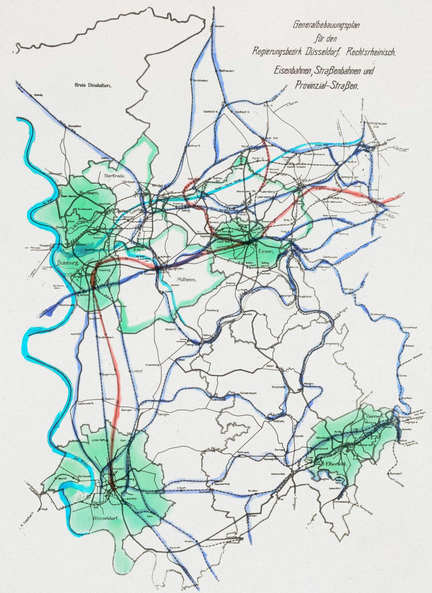

<template #left>

- Large quantities of existing data already exist (e.g. cohort studies, biobanks)

- Combining data sources allows:
  - **Exposure contrast**
  - **Statistical power**
  - **Replication** across settings
  - **Extended coverage** of the lifecourse
  - **Generalisability** to other populations and settings
  - **Different confounding structures**, to test whether associations hold where confounders differ

</template>

<template #right>

</template>
