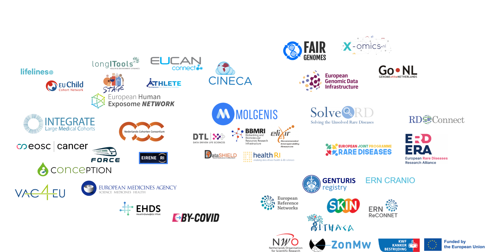
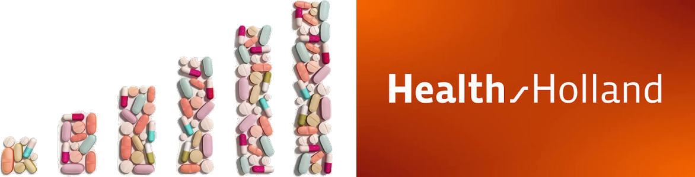
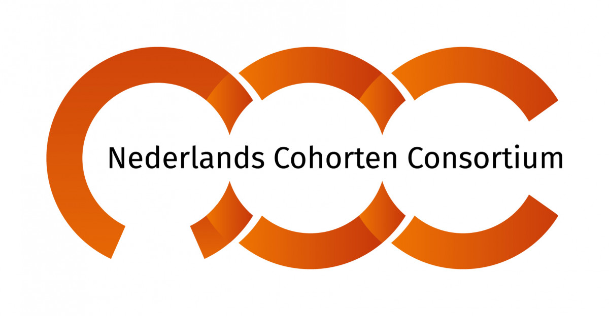
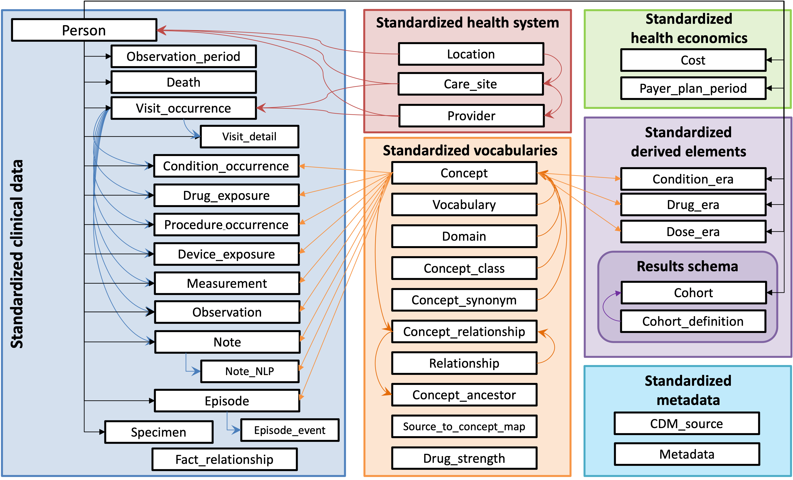

# MOLGENIS Armadillo
Secure Federated Analysis

  
<strong>Tim Cadman & Mariska Slofstra</strong>

  
  
  

---
layout: contents
image: ./public/contents-notebook-coffee.jpg
---

1. **Background**
2. **Finding data**
3. **Reusing data**
4. **Federated analysis**
5. **Example projects**
6. **Getting started**
7. **Summary**

---
layout: section
---

# Background

---
layout: content-img-bleed
heading: MOLGENIS open-source software
section: 'Background'
subheading: Who are we
image: ./public/team_2025.png
imageWidth: '40'
bleed: false
imagePosition: center 35%
transition: slide-up
---

- Team based in the **Department of Genetics, UMCG**
- We develop the **MOLGENIS** software suite
- Tools that accelerate **multi-centre research collaborations**
- **35 FTE**: developers, data managers, project managers, PhDs, postdocs and a support team

---
layout: content-two-cols
heading: About us
section: 'Background'
transition: slide-up
---

<template #left>

  
  
Tim Cadman

- Clinical Psychologist (UK)
- Post-doc, multi-centre EU epidemiology projects
- Data scientist implementing federated analysis

</template>

<template #right>

  
  
Mariska Slofstra

- Background in bioinformatics
- Lead developer of MOLGENIS Armadillo

</template>

---
layout: content
heading: Four products for collaborative research
section: 'Background'
clicks: 4
transition: slide-up
---

  
 0 && $clicks !== 1 }">
    <h3><carbon-data-base />EMX2</h3>
    
Flexible database for research and clinical data

  

  
 0 && $clicks !== 2 }">
    <h3><carbon-search />Health Research Metadata catalogue</h3>
    
A searchable list of research datasets and what they contain

  

  
 0 && $clicks !== 3 }">
    <h3>Armadillo</h3>
    
Data portal for sharing datasets and federated analysis with DataSHIELD

  

  
 0 && $clicks !== 4 }">
    <h3><carbon-dna />VIP</h3>
    
Flexible human Variant Interpretation Pipeline for rare disease

  

---
layout: content
heading: Our projects
section: 'Background'
---

  

---
layout: section
---

# The value of existing data

---
src: ../library/combining-data/why.md
heading: Reusing data
benefits: [power, replication, coverage, confounding]
examples: cohort studies, clinical trials
section: 'Background'
transition: slide-up
---

---
layout: content
heading: Combining data
subheading: Example research question
section: 'Background'
transition: slide-up
---

<ResearchQuestion
  question="Does exposure to air pollution in pregnancy predict maternal perinatal depression?"
  reference="Cadman et al. (2024) Environ Int 185:108453" />

---
layout: figure-cite
heading: Example 1
subheading: Increased power
section: 'Background'
transition: slide-up
citation: 'Cadman et al. (2024) Environ Int 185:108453'
---

<template #side>

- Many outcomes are rare, or effects we are studying are small
- Single studies lack the power to detect associations

</template>

<template #default>

<PowerCurve unit="study" units="studies" />

</template>

---
layout: figure-cite
heading: Example 2
subheading: Test if effects generalise
section: 'Background'
transition: slide-up
citation: 'Cadman et al. (2024) Environ Int 185:108453'
---

<template #side>

- Increased noise exposure associated with higher depression

- But in other locations the opposite effect was found

</template>

<template #default>

<CohortForest
  row-header="City"
  :studies="[
    { label: 'Nancy', n: 344, or: 2.39, lo: 0.91, hi: 6.31, weight: 2.1, at: 1 },
    { label: 'Rotterdam', n: 2952, or: 1.59, lo: 1.05, hi: 2.42, weight: 11.34, at: 1 },
    { label: 'Bristol', n: 4795, or: 0.58, lo: 0.21, hi: 1.61, weight: 1.93, at: 2 },
    { label: 'Poitiers', n: 231, or: 0.24, lo: 0.05, hi: 1.09, weight: 0.88, at: 2 },
  ]"
  axis-label="Odds ratio for noise exposure ≥65 dB" />

</template>

---
layout: section
---

# Challenges with reusing data

---
layout: content
heading: Challenges with reusing data
subheading: Example research question
section: 'Background'
transition: slide-up
---

<ResearchQuestion
  question="Is Acceptance and Commitment Therapy (ACT) effective for teenagers, and does the effect differ across age, sex and country?" />

---
layout: content
heading: What stands in the way?
section: 'Background'
clicks: 4
---

  
 0 && $clicks !== 1 }">
    <h3>Findable</h3>
    
Which trials exist, and who holds the data?

  

  
 0 && $clicks !== 2 }">
    <h3>Accessible</h3>
    
How do I request access for the data?

  

  
 0 && $clicks !== 3 }">
    <h3>Interoperable</h3>
    
Are variables measured the same way?

  

  
 0 && $clicks !== 4 }">
    <h3>Reusable</h3>
    
How can I analyse the data?

  

---
layout: section
---

# Finding data

---
layout: content
heading: MOLGENIS Health Data and Samples Catalogue
section: 'Finding data'
subheading: Making collections discoverable
transition: slide-up
---

• Open source metadata catalogue

• Search across consortia for harmonised variables and collections

• Upload variables and Common Data Model mappings

---
layout: section
transition: slide-up
---

# Catalogue demo

---
layout: section
---

# Reusing data

---
src: ../library/combining-data/options.md
approaches: [transfer, script, published, federated]
clicks: 4
section: 'Reusing data'
transition: slide-up
---

---
src: ../library/combining-data/option-transfer.md
section: 'Reusing data'
---

---
src: ../library/combining-data/option-script.md
section: 'Reusing data'
---

---
src: ../library/combining-data/option-published.md
subheading: "Option 3: Publish summary data"
section: 'Reusing data'
---

---
layout: content
heading: Analysing multiple datasets
subheading: "Option 4: Federated analysis"
transition: slide-up
section: 'Reusing data'
---

  

  <ApproachDiagram kind="federated" />
  

  

    <ul style="padding-left: 1.5rem; margin: 0;">
      <li style="font-size: 18px; margin-bottom: 0.5rem; line-height: 1.5;"><strong>Strategy:</strong> Send analysis code to the data; only aggregate results return</li>
      <li style="font-size: 18px; margin-bottom: 0.5rem; line-height: 1.5;"><strong>Pros:</strong> Data never leaves its location; owners keep control and access rights</li>
      <li style="font-size: 18px; margin-bottom: 0.5rem; line-height: 1.5;"><strong>Cons:</strong>
        <ul style="padding-left: 1.5rem; margin: 0.3rem 0 0 0;">
          <li style="font-size: 18px; margin-bottom: 0.3rem; line-height: 1.5;">Needs common infrastructure</li>
          <li style="font-size: 18px; margin-bottom: 0.3rem; line-height: 1.5;">Fewer analysis options compared to running locally</li>
        </ul>
      </li>
    </ul>
  

---
src: ../library/combining-data/options-comparison.md
approaches: [transfer, script, published, federated]
omit: [methods]
include: [unlimited]
labels:
  pooled: 1-stage IPD
section: 'Reusing data'
---

---
layout: section
---

# Federated analysis with DataSHIELD

---
layout: content-two-cols
heading: DataSHIELD
subheading: What is it?
leftWidth: '34'
section: 'Federated analysis'
transition: slide-up
---

::left::

- R Studio based federated analysis platform

<v-clicks>

- Developed over 15 years in EU research projects
- Range of packages for different analysis needs

</v-clicks>

::right::

<Terminal light title="Plots"><ForestPlot style="margin: 0 auto; align-self: flex-start" /></Terminal>

---
layout: content
heading: DataSHIELD
subheading: Key ideas
clicks: 3
section: 'Federated analysis'
transition: slide-up
---

<FocusCards :items="[
  { title: 'Remote analysis', color: 'var(--c-blue)', body: ['One model across data held at several sites'] },
  { title: 'Code travels, not data', color: 'var(--c-teal)', body: ['Code is sent to the data; each site computes <strong>locally</strong>'] },
  { title: 'Aggregate results returned', color: 'var(--c-gold-dark)', body: ['Means, SDs, coefficients'] },
  { title: 'Disclosure controls', color: 'var(--c-purple)', body: ['Automated guards ensure individual data is never sent'] },
]" />

---
layout: figure-cite
heading: How it works
section: 'Federated analysis'
transition: slide-up
sideWidth: '36'
---

<template #side>

<ul class="fq-steps">
<li v-click="1">Connect to the servers</li>
<li v-click="2">Send analysis commands</li>
<li v-click="3">Receive aggregate results</li>
</ul>

<ExwasPlot />

</template>

<template #default>

<FederatedQuery />

</template>

---
layout: content
heading: What are 'aggregate results'
subheading: Group exercise
section: 'Federated analysis'
transition: slide-up
---

<v-clicks>

- Imagine I am a researcher who wants to know the average height of the group
- Each group represents patients in a hospital
- You are willing to share data within your hospital, but not outside
- Split into 5-6 groups of different sizes
- Within your group, calculate mean height of members in centimetres
- Tell me the mean and N of your group

</v-clicks>

---
src: ../library/datashield/pooling-means.md
section: 'Federated analysis'
transition: slide-up
---

---
layout: content
heading: Privacy-preserving statistics
subheading: 
section: 'Federated analysis'
transition: slide-up
---

<table>
<thead>
<tr><th>Result</th><th>Condition</th></tr>
</thead>
<tbody>
<tr v-click><td>Mean, SD, quantiles</td><td>Group has at least N participants</td></tr>
<tr v-click><td>Counts and tables</td><td>Minimum cell size to display</td></tr>
<tr v-click><td>Model coefficients and SEs</td><td>Model not saturated; no cell too small</td></tr>
<tr v-click><td>Correlations, covariances</td><td>Minimum N, and not a near-perfect fit</td></tr>
<tr v-click><td>Plots (histograms, heatmaps)</td><td>Binned or noise-added</td></tr>
</tbody>
</table>

---
src: ../library/datashield/analysis-options.md
subheading: 1- and 2-stage analysis options
section: 'Federated analysis'
transition: slide-up
---

---
layout: section
transition: slide-left
---

# DataSHIELD demo

---
layout: section
---

# Example projects

---
layout: content
heading: Existing DataSHIELD nodes
subheading: 
section: 'Projects'
---

<NodeMap simple legend="below" height="16rem" note="" />

---
layout: content-two-cols
heading: "Example 1: EU Child Cohort Network"
subheading: 2017–2022
section: 'Projects'
leftWidth: '55'
clicks: 2
---

::left::

<NodeMap simple project="LifeCycle" colour="#6AA2FF" map="world" zoom="auto" legend="none" note="" />

::right::

- <strong style="color: var(--slidev-theme-primary)">Aim:</strong> study early life stressors and health across the life course
- Harmonised >2000 variables from EU birth cohorts

---
layout: content-two-cols
heading: "Example 2: ATHLETE"
subheading: 2020–2024
section: 'Projects'
leftWidth: '55'
clicks: 2
---

::left::

<NodeMap simple project="Athlete" colour="#03DBE2" builds-on="LifeCycle" builds-on-colour="#6AA2FF" map="world" zoom="auto" legend="none" note="" />

::right::

- <strong style="color: var(--slidev-theme-primary)">Aim:</strong> study how chemicals and environmental exposures affect human health
- Onboarded new cohorts to the EU Child Cohort Network, adding environmental data

---
layout: content-two-cols
heading: "Example 3: NDTD"
subheading: "Netherlands Network for Difficult-to-Treat Depression (2023–2027)"
section: 'Projects'
leftWidth: '55'
clicks: 2
---

::left::

<NodeMap simple project="NDTD" colour="#7247B6" map="europe" zoom="auto" legend="none" note="" />

::right::

- <strong style="color: var(--slidev-theme-primary)">Aim:</strong> improve treatment for people who do not respond to first antidepressants
- Federated analysis across four Dutch sites

---
layout: content-two-cols
heading: "Example 4: Netherlands Cohorts Consortium"
subheading: 2026–2036
section: 'Projects'
leftWidth: '55'
clicks: 2
---

::left::

<NodeMap simple project="NCC" colour="#FF6917" map="europe" zoom="auto" legend="none" note="" />

::right::

- <strong style="color: var(--slidev-theme-primary)">Aim:</strong> align, harmonise and pool data to understand the causes of chronic diseases
- 11 population cohorts, over 440,000 participants

---
layout: content-two-cols
heading: "Example 5: FEDHAFRICA"
subheading: 2026–
section: 'Projects'
leftWidth: '55'
clicks: 2
---

::left::

<NodeMap simple project="FEDHAFRICA" colour="#FDBF2F" map="world" zoom="auto" legend="none" note="" />

::right::

- <strong style="color: var(--slidev-theme-primary)">Aim:</strong> deploy federated analysis across private-sector providers and health surveillance (HDSS) sites in sub-Saharan Africa

---
layout: content-two-cols
heading: "Example 6: JOIN-MIND"
subheading: 2026–
section: 'Projects'
leftWidth: '55'
clicks: 2
---

::left::

<NodeMap simple project="JOIN-MIND" colour="#EE7769" map="europe" zoom="auto" legend="none" note="" />

::right::

- <strong style="color: var(--slidev-theme-primary)">Aim:</strong> build a secure data infrastructure for mental health interventions in conflict-affected populations

---
layout: section
---

# Setting up DataSHIELD

---
layout: content
heading: How it works
subheading: 
section: 'Setup'
transition: slide-up
---

<DatashieldArchitecture unit="Site" />

---
layout: content-two-cols
heading: As a user
section: 'Setup'
clicks: 4
---

<template #left>

<v-clicks>

- Arrange data access agreements with providers
- Install R packages
- Connect and analyse with RStudio

</v-clicks>

</template>

<template #right>

  <Terminal light title="R" :text="`install.packages(c(&quot;DSI&quot;, &quot;DSMolgenisArmadillo&quot;, &quot;dsBaseClient&quot;))`" :start-at-click="2" :char-ms="16" />

  <Terminal light title="R" :text="`fit <- ds.glmSLMA(\n  formula = &quot;asthma ~ no2 + ses&quot;,\n  family = &quot;binomial&quot;,\n  dataName = &quot;D&quot;\n)\n\nds.forestplot(fit, variable = &quot;no2&quot;)`" :start-at-click="3" :char-ms="16" />

= 4" class="user-setup-term">
  <Terminal light title="Plots"><ForestPlot style="margin: 0 auto; align-self: flex-start" /></Terminal>

</template>

---
layout: content-two-cols
heading: As a data owner
subheading: Setup steps
section: 'Setup'
transition: slide-up
---

<template #left>

<v-clicks>

- Harmonise your data to a common data model (e.g. OMOP)
- Install and configure Armadillo
- Arrange data access agreements
- Grant researchers access in Armadillo

</v-clicks>

</template>

<template #right>

= 4" src="./public/armadillo-ui-users.png" class="user-setup-img" style="height: auto" />

</template>

---
src: ../library/infrastructure/what-is-armadillo.md
section: 'Setup'
transition: slide-up
---

---
layout: section
transition: slide-up
---

# Armadillo demo

---
layout: content
heading: Setting up Armadillo
subheading: Three options
section: 'Setup'
clicks: 2
---

<FocusCards :columns="3" :items="[
  { title: 'Run it yourself', color: 'var(--c-blue)', body: ['Install Armadillo on your own server or VM', '<strong>Requirements:</strong> Ubuntu LTS, 8–32 GB memory, Java 21, Docker, a domain', '<strong>Configure:</strong> Nginx with SSL, firewall, OIDC login', '<strong>Docs:</strong> <a href=&quot;https://molgenis.github.io/molgenis-service-armadillo/&quot; target=&quot;_blank&quot; style=&quot;color: inherit&quot;>molgenis.github.io/molgenis-service-armadillo</a>'] },
  { title: 'We run it for you', color: 'var(--c-teal)', body: ['MOLGENIS hosts Armadillo on the UMCG Azure cloud', 'Set up and maintained by the team', 'Only you can see and manage the data'] },
  { title: 'SURF', color: 'var(--c-purple)', body: ['Hosted on Dutch national research infrastructure', 'For Dutch consortia already using SURF'] },
]" />

---
layout: section
---

# Challenges

---
layout: content
heading: "Challenge 1: Harmonisation"
subheading: 
section: 'Setup'
clicks: 1
---

<ChallengeTrail :current="1" :steps="['Harmonisation', 'Armadillo setup', 'Legal']" />

- Complex and lengthy process, especially for mental health data

<v-clicks>

- Planned MOLGENIS development of AI harmonisation tools

</v-clicks>

---
layout: content
heading: "Challenge 2: Armadillo setup"
subheading: 
section: 'Setup'
clicks: 3
---

<ChallengeTrail :current="2" :steps="['Harmonisation', 'Armadillo setup', 'Legal']" />

- In theory, setup should be quick: about 30 minutes in the ideal case

<v-clicks>

- Some IT departments require a lengthy DPIA process
- Lack of knowledge can slow deployment
- Hosting by us or SURF is logistically easier, but incurs costs

</v-clicks>

---
layout: content
heading: "Challenge 3: Legal"
subheading: 
section: 'Setup'
clicks: 2
---

<ChallengeTrail :current="3" :steps="['Harmonisation', 'Armadillo setup', 'Legal']" />

- Federated analysis usually does not remove the need for Data Access Agreements

<v-clicks>

- Depending on the institution, this can be slow
- Working on developing a Netherlands-wide common federated access framework

</v-clicks>

---
layout: section
---

# Summary

---
layout: content
heading: Summary
subheading: 
section: 'Summary'
---

<v-clicks>

- Reusing data is essential for advancing research
- MOLGENIS Catalogue and Armadillo help make data findable and reusable
- Deployment can face challenges, but we're here to help

</v-clicks>

---
layout: content
heading: Next steps
subheading: 
section: 'Summary'
---

<v-clicks>

- LLMs to harmonise data and conduct analyses
- Access flow from findability to usability
- SURF and Elixir onboarding
- Streamline legal processes
- New analysis methods in DataSHIELD
- Flower integration for federated machine learning
- Continued Armadillo development

</v-clicks>

---
layout: content
heading: Further Information
subheading: ""
section: 'Summary'
---

For questions and support contact: <a class="support-link" href="mailto:support@molgenis.org"><strong>support@molgenis.org</strong></a>

**Useful links:**
- DataSHIELD wiki: https://wiki.datashield.org/
- Molgenis suite: https://molgenis.org/

<strong>Funding:</strong> European Union, via the International Human Exposome Network (IHEN) and FLEX4HEALTH (OSCARS)

  
  
  

---
layout: content
heading: References
subheading: ""
section: 'Summary'
---

**Armadillo**
Cadman T, Slofstra MK, van der Geest MA, et al. MOLGENIS Armadillo: a lightweight server for federated analysis using DataSHIELD. *Bioinformatics* 2025;41(1):btae726. https://doi.org/10.1093/bioinformatics/btae726

**One- and two-stage analysis**
Basagaña X, Pedersen M, Barrera-Gómez J, et al. Analysis of multicentre epidemiological studies: contrasting fixed or random effects modelling and meta-analysis. *Int J Epidemiol* 2018;47(4):1343-1354. https://pubmed.ncbi.nlm.nih.gov/29939274/

**EU Child Cohort Network**
Jaddoe VWV, Felix JF, Andersen AN, et al. The LifeCycle Project-EU Child Cohort Network: a federated analysis infrastructure and harmonized data of more than 250,000 children and parents. *Eur J Epidemiol* 2020;35(7):709-724. https://doi.org/10.1007/s10654-020-00662-z

Pinot de Moira A, Haakma S, Strandberg-Larsen K, et al. The EU Child Cohort Network's core data: establishing a set of findable, accessible, interoperable and re-usable (FAIR) variables. *Eur J Epidemiol* 2021;36(5):565-580. https://doi.org/10.1007/s10654-021-00733-9

