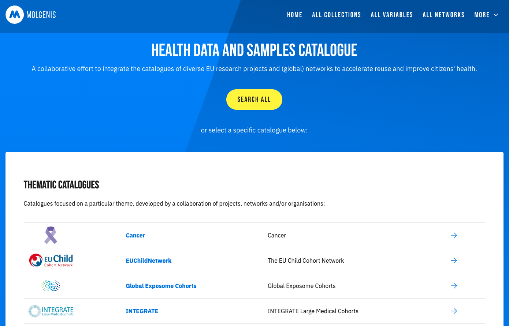
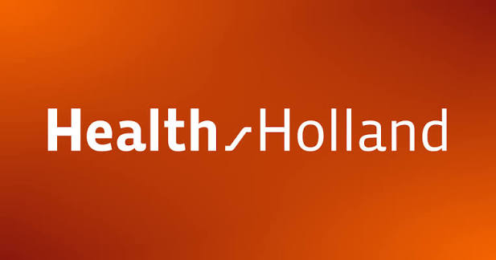
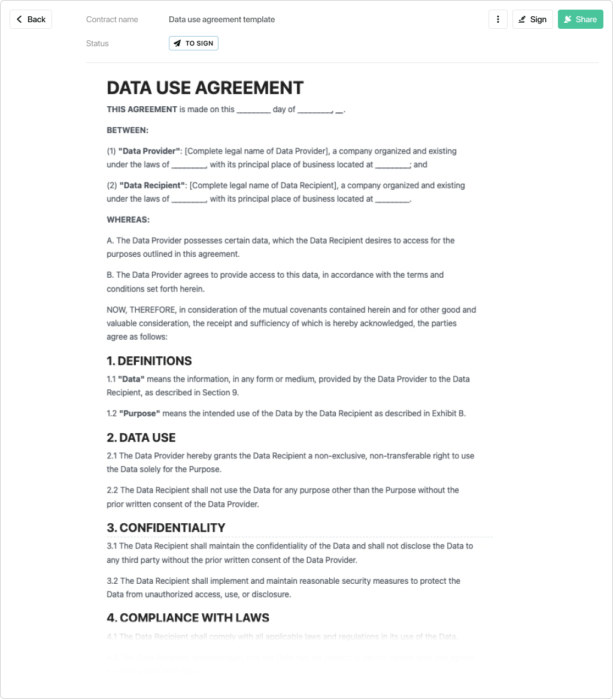

# Federated Analysis using MOLGENIS Armadillo
Securely sharing data

  
<strong>Tim Cadman & Mariska Slofstra</strong>

  
  

---
layout: contents
image: ./public/contents-notebook-coffee.jpg
---

1. **Background**
2. **Finding data**
3. **Reusing data**
4. **Federated analysis**
5. **Projects**
6. **Setup**
7. **Summary**

---
layout: section
---

# Background

---
layout: content-img-bleed
heading: MOLGENIS open-source software
section: 'Background'
subheading: Who are we
image: ./public/team_2025.png
imageWidth: '40'
bleed: false
imagePosition: center 35%
transition: slide-up
---

- Team based in the **Department of Genetics, UMCG**
- We develop the **MOLGENIS** software suite
- Tools that accelerate **multi-centre research collaborations**
- **35 FTE**: developers, data managers, project managers, PhDs and postdocs

---
layout: content-two-cols
heading: About us
section: 'Background'
transition: slide-up
---

<template #left>

  
  
Tim Cadman

- Clinical Psychologist (UK)
- Post-doc, multi-centre EU epidemiology projects
- Data scientist implementing federated analysis

</template>

<template #right>

  
  
Mariska Slofstra

- Background in bioinformatics
- Lead developer of MOLGENIS Armadillo

</template>

---
layout: content
heading: Four products for collaborative research
section: 'Background'
clicks: 4
transition: slide-up
---

  
 0 && $clicks !== 1 }">
    <h3><carbon-data-base />EMX2</h3>
    
Flexible database for research and clinical data

  

  
 0 && $clicks !== 2 }">
    <h3><carbon-search />Health Research Metadata catalogue</h3>
    
A searchable list of research datasets and what they contain

  

  
 0 && $clicks !== 3 }">
    <h3>Armadillo</h3>
    
Data portal for sharing datasets and federated analysis with DataSHIELD

  

  
 0 && $clicks !== 4 }">
    <h3><carbon-dna />VIP</h3>
    
Flexible human Variant Interpretation Pipeline for rare disease

  

---
layout: content
heading: Our projects
section: 'Background'
---

  

---
layout: section
---

# The value of existing data

---
src: ../library/combining-data/why.md
heading: Reusing data
benefits: [power, replication, coverage, confounding]
examples: cohort studies, clinical trials
section: 'Background'
---

---
layout: content
heading: Combining data
subheading: Example research question
section: 'Background'
transition: slide-up
---

<ResearchQuestion
  question="Does exposure to air pollution in pregnancy predict maternal perinatal depression?"
  reference="Cadman et al. (2024) Environ Int 185:108453" />

---
layout: figure-cite
heading: Example 1
subheading: Increased power
section: 'Background'
transition: slide-up
citation: 'Cadman et al. (2024) Environ Int 185:108453'
---

<template #side>

- Many outcomes are rare, or effects we are studying are small
- Single studies lack the power to detect associations

</template>

<template #default>

<PowerCurve unit="study" units="studies" />

</template>

---
layout: figure-cite
heading: Example 2
subheading: Test if effects generalise
section: 'Background'
transition: slide-up
citation: 'Cadman et al. (2024) Environ Int 185:108453'
---

<template #side>

- Increased noise exposure associated with higher depression

- But in other locations the opposite effect was found

</template>

<template #default>

<CohortForest
  row-header="City"
  :studies="[
    { label: 'Nancy', n: 344, or: 2.39, lo: 0.91, hi: 6.31, weight: 2.1, at: 1 },
    { label: 'Rotterdam', n: 2952, or: 1.59, lo: 1.05, hi: 2.42, weight: 11.34, at: 1 },
    { label: 'Bristol', n: 4795, or: 0.58, lo: 0.21, hi: 1.61, weight: 1.93, at: 2 },
    { label: 'Poitiers', n: 231, or: 0.24, lo: 0.05, hi: 1.09, weight: 0.88, at: 2 },
  ]"
  axis-label="Odds ratio for noise exposure ≥65 dB" />

</template>

---
layout: section
---

# Data reuse challenge

---
layout: content
heading: Data reuse challenge
subheading: Example research question
section: 'Background'
transition: slide-up
---

<ResearchQuestion
  question="Is Acceptance and Commitment Therapy (ACT) effective for teenagers, and does the effect differ across age, sex and country?" />

---
layout: content
heading: What stands in the way?
section: 'Background'
clicks: 4
---

  
 0 && $clicks !== 1 }">
    <h3>Findable</h3>
    
Which trials exist, and who holds the data?

  

  
 0 && $clicks !== 2 }">
    <h3>Accessible</h3>
    
How do I request access for the data?

  

  
 0 && $clicks !== 3 }">
    <h3>Interoperable</h3>
    
Are the variables measured the same way across studies?

  

  
 0 && $clicks !== 4 }">
    <h3>Reusable</h3>
    
How can I analyse the data?

  

---
layout: section
---

# Finding data

---
layout: content
heading: MOLGENIS Health Data and Samples Catalogue
section: 'Finding data'
subheading: Making collections discoverable
---

• Open source metadata catalogue

• Search across consortia for harmonised variables and collections

• Upload variables and Common Data Model mappings

---
layout: section
---

# Catalogue demo

---
layout: section
---

# Reusing data

---
src: ../library/combining-data/options.md
approaches: [transfer, script, published, federated]
clicks: 4
section: 'Reusing data'
---

---
src: ../library/combining-data/option-transfer.md
section: 'Reusing data'
---

---
src: ../library/combining-data/option-script.md
section: 'Reusing data'
---

---
src: ../library/combining-data/option-published.md
subheading: "Option 3: Publish summary data"
section: 'Reusing data'
---

---
src: ../library/combining-data/option-federated.md
subheading: "Option 4: Federated analysis"
section: 'Reusing data'
---

---
src: ../library/combining-data/options-comparison.md
approaches: [transfer, script, published, federated]
omit: [methods]
section: 'Reusing data'
---

---
layout: section
---

# Federated analysis with DataSHIELD

---
layout: content-two-cols
heading: DataSHIELD
subheading: What is it?
leftWidth: '34'
section: 'Federated analysis'
transition: slide-up
---

::left::

- R Studio based federated analysis platform

<v-clicks>

- Developed over 15 years in EU research projects
- Range of packages for different analysis needs

</v-clicks>

::right::

<Terminal light title="Plots"><ForestPlot style="margin: 0 auto; align-self: flex-start" /></Terminal>

---
src: ../library/datashield/what-is-datashield.md
section: 'Federated analysis'
transition: slide-up
---

---
layout: figure-cite
heading: How it works
section: 'Federated analysis'
transition: slide-up
sideWidth: '36'
---

<template #side>

<ul class="fq-steps">
<li v-click="1">Connect to the servers</li>
<li v-click="2">Send analysis commands</li>
<li v-click="3">Receive aggregate results</li>
</ul>

<ExwasPlot />

</template>

<template #default>

<FederatedQuery />

</template>

---
layout: content
heading: What are 'aggregate results'
subheading: Group exercise
section: 'Federated analysis'
transition: slide-up
---

<v-clicks>

- Imagine I am a researcher who wants to know the average height in this group, without needing to know individual heights
- Split into groups of 2-4
- Each group represents patients in a hospital
- Within your group, calculate mean height of members in centimetres
- Tell me the mean and N of your group

</v-clicks>

---
src: ../library/datashield/pooling-means.md
section: 'Federated analysis'
transition: slide-up
---

---
layout: content
heading: Privacy-preserving statistics
subheading: 
section: 'Federated analysis'
---

<table>
<thead>
<tr><th>Result</th><th>Condition</th></tr>
</thead>
<tbody>
<tr v-click><td>Mean, SD, quantiles</td><td>Group has at least N participants</td></tr>
<tr v-click><td>Counts and tables</td><td>Minimum cell size to display</td></tr>
<tr v-click><td>Model coefficients and SEs</td><td>Model not saturated; no cell too small</td></tr>
<tr v-click><td>Correlations, covariances</td><td>Minimum N, and not a near-perfect fit</td></tr>
<tr v-click><td>Plots (histograms, heatmaps)</td><td>Binned or noise-added</td></tr>
</tbody>
</table>

---
src: ../library/datashield/analysis-options.md
section: 'Federated analysis'
---

---
layout: section
---

# DataSHIELD demo

---
layout: section
---

# Example projects

---
layout: content
heading: Existing DataSHIELD nodes
subheading: 
section: 'Projects'
---

<NodeMap simple legend="below" height="16rem" note="" />

---
layout: content-two-cols
heading: "Example 1: EU Child Cohort Network"
subheading: 2017–2022
section: 'Projects'
leftWidth: '55'
clicks: 2
---

::left::

<NodeMap simple project="LifeCycle" colour="#6AA2FF" map="world" zoom="auto" legend="none" note="" />

::right::

- <strong style="color: var(--slidev-theme-primary)">Aim:</strong> study early life stressors and health across the life course
- Harmonised >2000 variables from EU birth cohorts

---
layout: content-two-cols
heading: "Example 2: ATHLETE"
subheading: 2020–2024
section: 'Projects'
leftWidth: '55'
clicks: 2
---

::left::

<NodeMap simple project="Athlete" colour="#03DBE2" builds-on="LifeCycle" builds-on-colour="#6AA2FF" map="world" zoom="auto" legend="none" note="" />

::right::

- <strong style="color: var(--slidev-theme-primary)">Aim:</strong> study how chemicals and environmental exposures affect human health
- Onboarded new cohorts to the EU Child Cohort Network and added data on environmental exposures

---
layout: content-two-cols
heading: "Example 3: NDTD"
subheading: 2023–2027
section: 'Projects'
leftWidth: '55'
clicks: 2
---

::left::

<NodeMap simple project="NDTD" colour="#7247B6" map="europe" zoom="auto" legend="none" note="" />

::right::

  
  

- <strong style="color: var(--slidev-theme-primary)">Aim:</strong> improve treatment for people who do not respond to first antidepressants
- Federated analysis across four Dutch sites

---
layout: content-two-cols
heading: "Example 4: NCC"
subheading: 
section: 'Projects'
leftWidth: '55'
clicks: 2
---

::left::

<NodeMap simple project="NCC" colour="#FF6917" map="europe" zoom="auto" legend="none" note="" />

::right::

- <strong style="color: var(--slidev-theme-primary)">Aim:</strong> align, harmonise and pool data to understand the causes of chronic diseases
- 11 population cohorts, over 440,000 participants

---
layout: content-two-cols
heading: "Example 5: FEDHAFRICA"
subheading: 2026–
section: 'Projects'
leftWidth: '55'
clicks: 2
---

::left::

<NodeMap simple project="FEDHAFRICA" colour="#FDBF2F" map="world" zoom="auto" legend="none" note="" />

::right::

- <strong style="color: var(--slidev-theme-primary)">Aim:</strong> deploy federated analysis across private-sector providers and health surveillance (HDSS) sites in sub-Saharan Africa

---
layout: content-two-cols
heading: "Example 6: JOIN-MIND"
subheading: 2026–
section: 'Projects'
leftWidth: '55'
clicks: 2
---

::left::

<NodeMap simple project="JOIN-MIND" colour="#EE7769" map="europe" zoom="auto" legend="none" note="" />

::right::

- <strong style="color: var(--slidev-theme-primary)">Aim:</strong> build a secure data infrastructure for mental health interventions in conflict-affected populations

---
layout: section
---

# Setting up DataSHIELD

---
layout: content
heading: How it works
subheading: 
section: 'Setup'
transition: slide-up
---

<DatashieldArchitecture />

---
layout: content-two-cols
heading: As a user
section: 'Setup'
clicks: 4
---

<template #left>

<v-clicks>

- Arrange data access agreements with providers
- Install R packages
- Connect and analyse with RStudio

</v-clicks>

</template>

<template #right>

  <Terminal light title="R" :text="`install.packages(c(&quot;DSI&quot;, &quot;DSMolgenisArmadillo&quot;, &quot;dsBaseClient&quot;))`" :start-at-click="2" :char-ms="16" />

  <Terminal light title="R" :text="`fit <- ds.glmSLMA(\n  formula = &quot;asthma ~ no2 + ses&quot;,\n  family = &quot;binomial&quot;,\n  dataName = &quot;D&quot;\n)\n\nds.forestplot(fit, variable = &quot;no2&quot;)`" :start-at-click="3" :char-ms="16" />

= 4" class="user-setup-term">
  <Terminal light title="Plots"><ForestPlot style="margin: 0 auto; align-self: flex-start" /></Terminal>

</template>

---
layout: content-two-cols
heading: As a data owner
subheading: Setup steps
section: 'Setup'
transition: slide-up
---

<template #left>

<v-clicks>

- Harmonise your data to a common data model (e.g. OMOP)
- Install and configure Armadillo
- Arrange data access agreements
- Grant researchers access in Armadillo

</v-clicks>

</template>

<template #right>

= 4" src="./public/armadillo-ui-users.png" class="user-setup-img" style="height: auto" />

</template>

---
src: ../library/infrastructure/what-is-armadillo.md
section: 'Setup'
---

---
layout: content
heading: Setting up Armadillo
subheading: Three options
section: 'Setup'
clicks: 2
---

<FocusCards :columns="3" :items="[
  { title: 'Run it yourself', color: 'var(--c-blue)', body: ['Install Armadillo on your own server or VM', '<strong>Requirements:</strong> Ubuntu LTS, 8–32 GB memory, Java 21, Docker, a domain', '<strong>Configure:</strong> Nginx with SSL, firewall, OIDC login', '<strong>Docs:</strong> <a href=&quot;https://molgenis.github.io/molgenis-service-armadillo/&quot; target=&quot;_blank&quot; style=&quot;color: inherit&quot;>molgenis.github.io/molgenis-service-armadillo</a>'] },
  { title: 'We run it for you', color: 'var(--c-teal)', body: ['MOLGENIS hosts Armadillo on the UMCG Azure cloud', 'Set up and maintained by the team', 'Only you can see and manage the data', 'support@molgenis.org'] },
  { title: 'SURF', color: 'var(--c-purple)', body: ['Hosted on Dutch national research infrastructure', 'For Dutch consortia already using SURF'] },
]" />

---
layout: section
---

# Challenges

---
layout: content
heading: "Challenge 1: Harmonisation"
subheading: 
section: 'Setup'
clicks: 1
---

<ChallengeTrail :current="1" :steps="['Harmonisation', 'Approvals', 'IT departments']" />

- Can be a long process

<v-clicks>

- Complex with mental health data

</v-clicks>

---
layout: content
heading: "Challenge 2: Approvals"
subheading: 
section: 'Setup'
clicks: 1
---

<ChallengeTrail :current="2" :steps="['Harmonisation', 'Approvals', 'IT departments']" />

  

    <h3>IT approval</h3>
    
Approval from IT is needed, e.g. a data protection impact assessment (DPIA)

  

  

    

    

  

  

    <h3>Legal agreements</h3>
    
Still needed with users

  

---
layout: content
heading: "Challenge 3: IT departments"
subheading: 
section: 'Setup'
clicks: 2
---

<ChallengeTrail :current="3" :steps="['Harmonisation', 'Approvals', 'IT departments']" />

- In theory, setup should be quick: about 30 minutes in the ideal case

<v-clicks>

- But it relies on a responsive IT department
- Hosting by us or SURF is logistically easier, but incurs costs

</v-clicks>

---
layout: section
---

# Summary

---
layout: content
heading: Summary
subheading: 
section: 'Summary'
---

<v-clicks>

- Existing data are a valuable resource for new research
- Catalogues make them findable
- Federated analysis lets us analyse them without moving them
- DataSHIELD and Armadillo are ready to use; harmonisation, IT approval and legal agreements take the time

</v-clicks>
