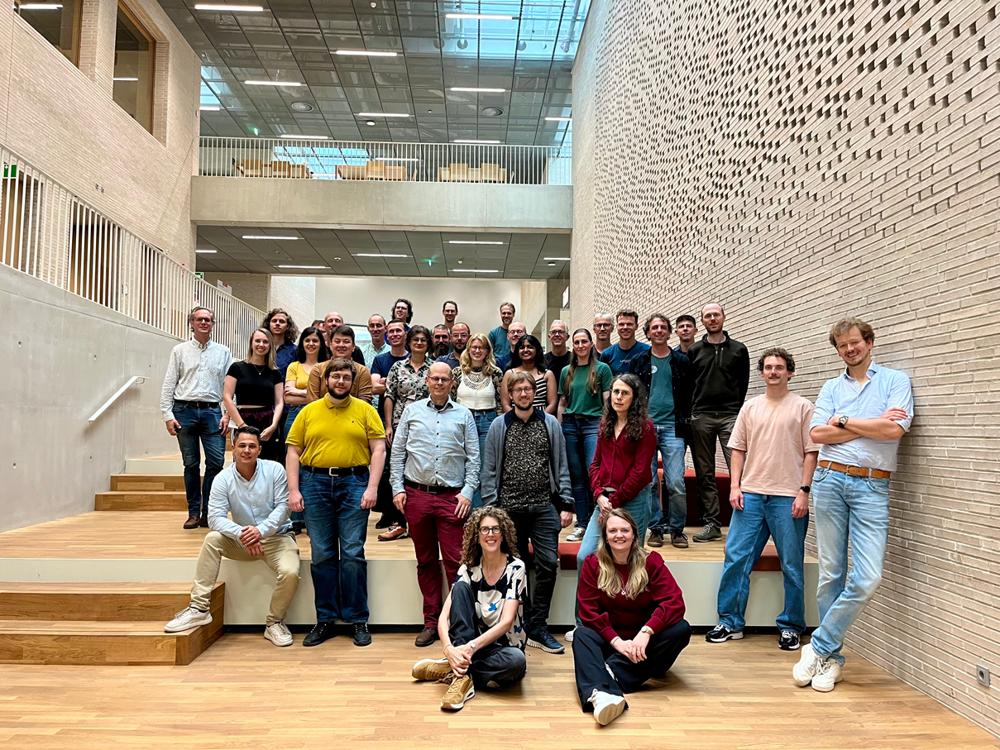
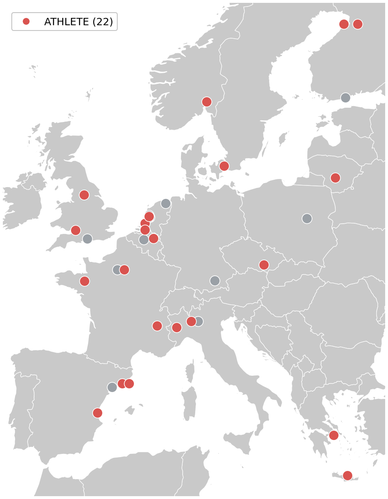
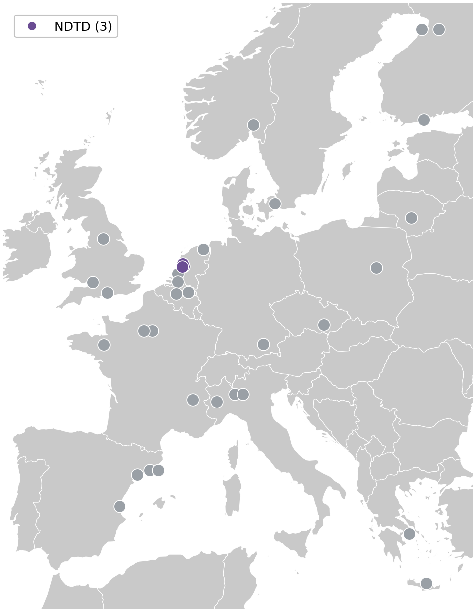

# Federated analysis with DataSHIELD and Armadillo
Sharing data without moving it

  
<strong>Tim Cadman & Mariska Slofstra</strong>

  
  

---
layout: section
---

# Who we are

---
layout: content-img-right
heading: Background
section: 'Who we are'
subheading: MOLGENIS
image: ./public/molgenis-ecosystem.png
imageScale: '100'
---

- **MOLGENIS** data infrastructure accelerates **multi-center health research collaborations** — 60 projects, 35 FTE
- Armadillo is part of the **MOLGENIS suite**, which also includes the **EMX2 data warehouse** and the **MOLGENIS catalogue**

---
layout: content
heading: Our team
section: 'Who we are'
---

Armadillo

  

    
    
Tim Cadman

    
Data Scientist

  

  

    
    
Mariska Slofstra

    
Software Developer

  

  

    
    
Dick Postma

    
Ops

  

  

    

      
    

    
Ruben Veenstra

    
Ops

  

  

    
    
Erik Zwart

    
Data Manager

  

  

    
    
Niels Kikkert

    
Team leader

  

  

    
    
Morris Swertz

    
PI

  

Wider MOLGENIS

  

---
layout: content-two-cols
heading: About us
subheading: Tim Cadman & Mariska Slofstra
section: 'Who we are'
---

<template #left>

**Tim Cadman** — Senior Data Scientist

- TODO: background
- TODO: role in DataSHIELD / Armadillo

</template>

<template #right>

**Mariska Slofstra** — Software Developer

- TODO: background
- TODO: role in Armadillo

</template>

---
layout: content-two-cols
heading: Contents
---

<template #left>

1. Why share data
2. Federated analysis
3. DataSHIELD
4. Projects
5. Demo
6. Infrastructure
7. Legal

</template>

<template #right>

</template>

---
layout: section
---

# Why share data

---
src: ../library/combining-data/why.md
section: 'Why share data'
---

---
layout: content
heading: FAIR data
subheading: The research cycle
section: 'Why share data'
---

<svg class="fair-svg" viewBox="0 0 480 420" role="img" aria-label="FAIR cycle: Findable, Accessible, Interoperable, Reusable">
  <defs>
    <marker id="fair-arrow" viewBox="0 0 10 10" refX="8" refY="5" markerWidth="7" markerHeight="7" orient="auto-start-reverse">
      <path d="M0,0 L10,5 L0,10 z" fill="#9AA0A6" />
    </marker>
  </defs>

  <g fill="none" stroke="#9AA0A6" stroke-width="3" marker-end="url(#fair-arrow)">
    <path d="M185.2,97.7 A125,125 0 0 1 294.8,97.7" />
    <path d="M352.3,155.2 A125,125 0 0 1 352.3,264.8" />
    <path d="M294.8,322.3 A125,125 0 0 1 185.2,322.3" />
    <path d="M127.7,264.8 A125,125 0 0 1 127.7,155.2" />
  </g>

  <rect x="30" y="30" width="140" height="110" rx="12" fill="#4285F4" />
  <text x="100" y="86" text-anchor="middle" font-size="48" font-weight="700" fill="#fff">F</text>
  <text x="100" y="118" text-anchor="middle" font-size="17" fill="#fff">Findable</text>

  <rect x="310" y="30" width="140" height="110" rx="12" fill="#E6B96A" />
  <text x="380" y="86" text-anchor="middle" font-size="48" font-weight="700" fill="#333333">A</text>
  <text x="380" y="118" text-anchor="middle" font-size="17" fill="#333333">Accessible</text>

  <rect x="310" y="280" width="140" height="110" rx="12" fill="#0097A7" />
  <text x="380" y="336" text-anchor="middle" font-size="48" font-weight="700" fill="#fff">I</text>
  <text x="380" y="368" text-anchor="middle" font-size="17" fill="#fff">Interoperable</text>

  <rect x="30" y="280" width="140" height="110" rx="12" fill="#6A4C93" />
  <text x="100" y="336" text-anchor="middle" font-size="48" font-weight="700" fill="#fff">R</text>
  <text x="100" y="368" text-anchor="middle" font-size="17" fill="#fff">Reusable</text>
</svg>

<ul class="fair-links">
  <li v-click>FCatalogue</li>
  <li v-click>ARDataSHIELD</li>
</ul>

---
layout: content
heading: Catalogue
section: 'Why share data'
subheading: Making collections discoverable
---

• Open source metadata catalogue — information about data, not the data itself

• Search across consortia for harmonised variables and collections

• Upload variables and Common Data Model mappings

---
layout: section
---

# Federated analysis

---
src: ../library/combining-data/options.md
section: 'Federated analysis'
---

---
layout: content
heading: How it works
subheading: 
section: 'Federated analysis'
---

<DatashieldArchitecture />

---
layout: content
heading: How it works
subheading: Across a network
section: 'Federated analysis'
---

TODO: map-based animation — same steps as the previous slide, with Armadillo nodes shown at their locations on the map

---
layout: section
---

# DataSHIELD

---
layout: content
heading: What is DataSHIELD?
section: 'DataSHIELD'
subheading: Bringing the analysis to the data
---

- Open-source, R-based platform for **privacy-preserving analysis** of biomedical, healthcare and social-science data
- Architecture consists of collection of:
    - (i) R-packages (user end) & (ii) java application installed alongside data

---
layout: content
heading: How DataSHIELD works
section: 'DataSHIELD'
---

<DatashieldArchitectureFinal />

---
layout: content
heading: Different frameworks
subheading: 
section: 'DataSHIELD'
clicks: 1
---

  

    <h3>Pipeline</h3>
    
Submit a job once, receive results

    

      

        
        Flower
      

      

        
        Vantage6
      

    

  

  
= 1 ? 'active' : 'dimmed'">
    <h3>Work interactively</h3>
    
Researcher runs analyses as if working locally

    

      

        
      

    

  

---
src: ../library/datashield/analysis-options.md
section: 'DataSHIELD'
---

---
layout: content
heading: DataSHIELD
subheading: No access to individual-level data
section: 'DataSHIELD'
---

- Researchers <strong v-mark="{ at: 1, color: '#E6B96A', type: 'highlight' }">never see</strong> individual participant records — only aggregate results come back
- Every server-side function has built-in **disclosure checks**, e.g.:
  - Minimum cell counts in tables, and minimum subset sizes
  - Summaries returned instead of raw values (e.g. quantiles, not minima and maxima)
  - Plots built from smoothed or binned data, not raw points
- Functions that would return individual values are [**blocked**]{style="color: #D9534F"}
- Data owners set the disclosure thresholds on their own server

---
layout: content
heading: Deploying DataSHIELD
section: 'DataSHIELD'
subheading: 
clicks: 1
---

To run DataSHIELD, each data owner installs a <strong>java application</strong> on a local server or VM. Two implementations exist:

  

    <h3>Armadillo</h3>
    
Lightweight server developed and maintained by UMCG as part of the <strong>MOLGENIS</strong> software suite.

  

  
= 1 ? 'active' : 'dimmed'">
    <h3>Opal</h3>
    
Multipurpose database and data harmonisation platform developed and maintained by <strong>OBiBa</strong>.

  

---
layout: section
---

# Projects

---
layout: chart-full
heading: DataSHIELD nodes managed by MOLGENIS
section: Projects
---

  
  

    
Three examples:

    <ol style="padding-left: 1.5rem; margin: 0;">
      <li style="font-size: 18px; margin-bottom: 0.5rem;">ATHLETE</li>
      <li style="font-size: 18px; margin-bottom: 0.5rem;">NDTD</li>
      <li style="font-size: 18px; margin-bottom: 0.5rem;">TODO: Africa project</li>
    </ol>
  

---
layout: chart-full
heading: "Example 1: ATHLETE"
section: Projects
---

  
  

    <ul style="padding-left: 1.5rem; margin: 0;">
      <li style="font-size: 18px; margin-bottom: 0.5rem;">H2020 project: <em>Advancing tools for exposome research</em></li>
      <li style="font-size: 18px; margin-bottom: 0.5rem;">TODO: aims, number of nodes, example analyses</li>
    </ul>
  

---
layout: chart-full
heading: "Example 2: NDTD"
section: Projects
---

  
  

    <ul style="padding-left: 1.5rem; margin: 0;">
      <li style="font-size: 18px; margin-bottom: 0.5rem;">Netherlands network for difficult-to-treat depression</li>
      <li style="font-size: 18px; margin-bottom: 0.5rem;">TODO: aims, number of nodes, example analyses</li>
    </ul>
  

---
layout: chart-full
heading: "Example 3: TODO Africa project"
section: Projects
---

  
TODO: map with Africa nodes

  

    <ul style="padding-left: 1.5rem; margin: 0;">
      <li style="font-size: 18px; margin-bottom: 0.5rem;">TODO: project name, aims, nodes</li>
    </ul>
  

---
layout: section
---

# Demo

---
layout: content
heading: Demo
subheading: Analyst perspective
section: Demo
---

---
layout: content
heading: Demo
subheading: Data manager perspective
section: Demo
---

---
layout: section
---

# Infrastructure

---
src: ../library/infrastructure/hosting.md
section: 'Infrastructure'
---

---
layout: section
---

# Legal

---
layout: content
heading: Legal
subheading: Agreements are still needed
section: Legal
---

- Data **does not leave** your institution, but you are still <strong v-mark="{ at: 1, color: '#E6B96A', type: 'highlight' }">allowing it to be processed</strong> by external researchers
- Most institutions therefore require a **legal agreement** before granting access
- TODO: types of agreement (e.g. data processing / data access agreement) and who signs

Who signs these at your institution?

