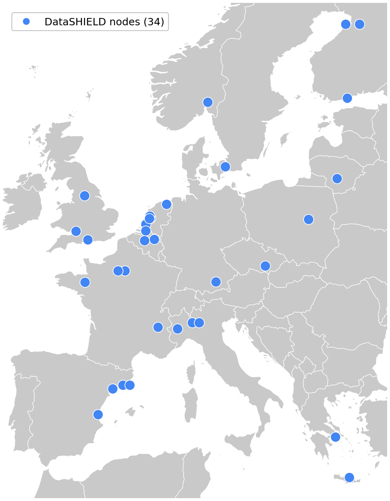
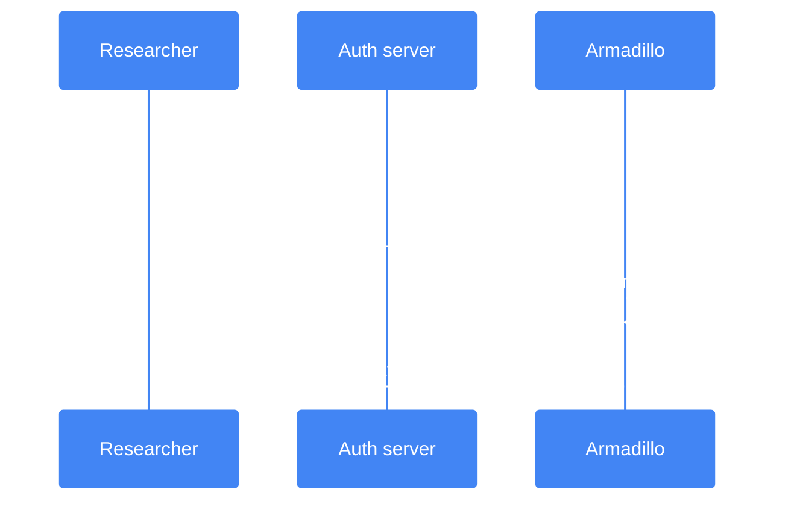
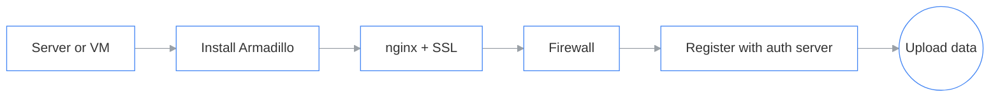
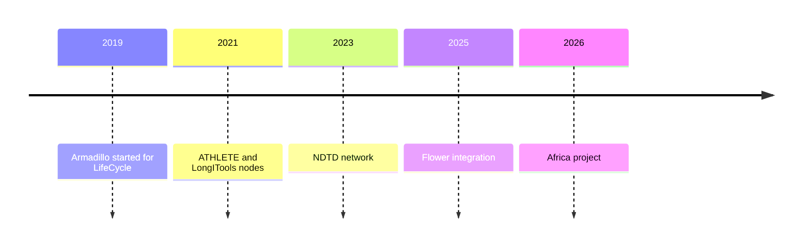
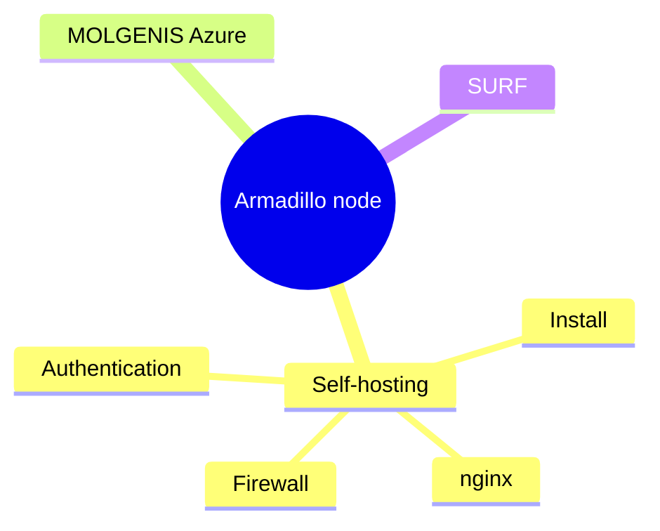
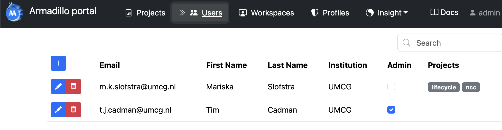
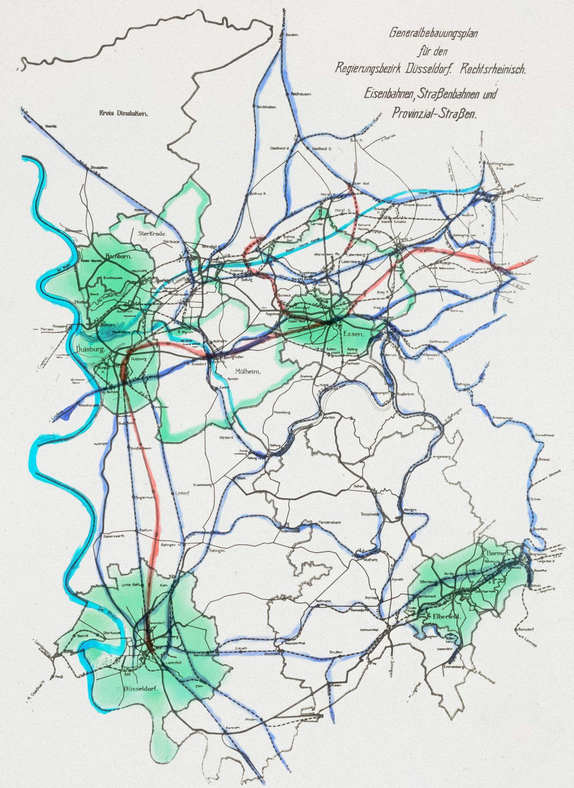

# Style examples
Slidev features and slide patterns to pick from

<div class="author-info">
  <p><strong>One example per slide — the grey note top-right says what it is and how it exports to PPTX</strong></p>
</div>

<div class="title-logos">
  
  
</div>

---
layout: content
heading: Contents
---

<div class="demo-note">Built-in &lt;Toc&gt; component: lists section slides automatically. PPTX: text only if the converter handles it, otherwise a picture.</div>

<Toc minDepth="1" maxDepth="1" columns="2" />

---
layout: section
---

# Emphasis

---
layout: content
heading: What is it
subheading: v-mark — underline on click
section: Emphasis
---

<div class="demo-note">v-mark (rough-notation), built in. Each mark appears on its own click. PPTX: should fall back to plain text (untested).</div>

- Analysis code — not raw data — is sent to where each dataset is stored
- Each site runs the computation <span v-mark="{ at: 1, color: '#E6B96A', type: 'underline' }">locally, on its own data</span>
- Only <span v-mark="{ at: 2, color: '#E6B96A', type: 'highlight' }">non-disclosive, aggregate results</span> are returned
- Data <span v-mark="{ at: 3, color: '#4285F4', type: 'circle' }">never leaves</span> its original location

---
layout: content
heading: v-mark
subheading: All the mark types
section: Emphasis
---

<div class="demo-note">Types: underline, highlight, circle, box, bracket, strike-through, crossed-off. Colours from COLOURS.md.</div>

<div style="display: grid; grid-template-columns: 1fr 1fr; gap: 1.4rem 3rem; font-size: 22px; margin-top: 1.5rem;">
  <div><span v-mark="{ at: 1, color: '#E6B96A', type: 'underline' }">underline</span></div>
  <div><span v-mark="{ at: 2, color: '#E6B96A', type: 'highlight' }">highlight</span></div>
  <div><span v-mark="{ at: 3, color: '#4285F4', type: 'circle' }">circle</span></div>
  <div><span v-mark="{ at: 4, color: '#0097A7', type: 'box' }">box</span></div>
  <div><span v-mark="{ at: 5, color: '#6A4C93', type: 'bracket', brackets: ['left', 'right'] }">bracket</span></div>
  <div><span v-mark="{ at: 6, color: '#D9534F', type: 'strike-through' }">strike-through</span></div>
  <div><span v-mark="{ at: 7, color: '#D9534F', type: 'crossed-off' }">crossed-off</span></div>
</div>

---
layout: content
heading: Inline styling
subheading: MDC syntax
section: Emphasis
---

<div class="demo-note">mdc: true in the headmatter. Style a word without writing HTML. PPTX: the converter would need to read the attributes; otherwise plain text.</div>

- Only [aggregate results]{style="color: #0097A7; font-weight: 700"} leave the server
- Data managers [stay in control]{.text-xl style="color: #4285F4"} of who has access
- [Individual-level data]{style="text-decoration: line-through; color: #9AA0A6"} is never returned

::div{.box .tip}
#### Tip
MDC also lets a component be written as a block, like this one.
::

---
layout: section
---

# Clicks

---
layout: content
heading: Progressive disclosure
subheading: v-clicks, v-after, hide
section: Clicks
---

<div class="demo-note">v-clicks reveals list items one per click; depth reveals sub-bullets separately; v-after appears with the previous click; .hide removes on click. PPTX: shows the final state.</div>

<v-clicks depth="2">

- Install Armadillo
  - Java 21 and Docker
  - Install script
- Configure nginx
- Register with an authentication server

</v-clicks>

<p v-after style="color: #0097A7; font-size: 15px;">← appears with the last bullet (v-after)</p>

<p v-click.hide style="color: #D9534F; font-size: 15px;">This line disappears on the next click (v-click.hide)</p>

---
layout: content
heading: Highlighting one card at a time
subheading: frontmatter clicks + $clicks
section: Clicks
clicks: 3
---

<div class="demo-note">clicks: 3 in frontmatter creates the steps — no hidden &lt;div v-click&gt; needed. Cards react to $clicks. PPTX: picture of the final state.</div>

<div style="display: grid; grid-template-columns: 1fr 1fr 1fr; gap: 1rem; margin-top: 1rem;">
  <div class="box" :style="{ opacity: $clicks === 1 || $clicks === 0 ? 1 : 0.3, transition: 'opacity 0.4s' }"><h4>1. Self-hosting</h4><p>Install Armadillo on your own server</p></div>
  <div class="box" :style="{ opacity: $clicks === 2 ? 1 : 0.3, transition: 'opacity 0.4s' }"><h4>2. MOLGENIS Azure</h4><p>UMCG hosts and maintains it</p></div>
  <div class="box" :style="{ opacity: $clicks === 3 ? 1 : 0.3, transition: 'opacity 0.4s' }"><h4>3. SURF</h4><p>Hosting on SURF infrastructure</p></div>
</div>

---
layout: content
heading: Swapping content in place
subheading: v-switch
section: Clicks
---

<div class="demo-note">&lt;v-switch&gt; shows one block per click range in the same spot (e.g. option 1 → 2 → 3). PPTX: only the last block.</div>

<v-switch>
  <template #0>
    <div class="box note"><h4>Option 1: Data transfer</h4><p>Copy the data to one place and analyse it there.</p></div>
  </template>
  <template #1>
    <div class="box warning"><h4>Option 2: Share script</h4><p>Each site runs the script; results are meta-analysed.</p></div>
  </template>
  <template #2>
    <div class="box tip"><h4>Option 3: Federated analysis</h4><p>Code goes to the data; only aggregates come back.</p></div>
  </template>
</v-switch>

---
layout: section
---

# Headings

---
layout: chart-full
heading: European DataSHIELD nodes
section: Headings
---

<div class="demo-note">BEFORE — topic heading. The audience has to work out the point.</div>

<div style="position: relative; width: 100%; height: 100%;">
  
</div>

---
layout: chart-full
heading: 34 cohorts across Europe already run DataSHIELD
section: Headings
---

<div class="demo-note">AFTER — assertion–evidence: the heading states the finding, the slide is the evidence. No code; exports to PPTX unchanged.</div>

<div style="position: relative; width: 100%; height: 100%;">
  
  <div style="position: absolute; left: 50%; right: 2rem; top: 2rem; font-size: 18px; color: #555;">Your cohort can join an existing network rather than start one.</div>
</div>

---
layout: section
---

# Layouts

---
layout: statement
---

<div class="demo-note">Built-in "statement" layout — one idea, centred. The theme does not style it yet. PPTX: converter has no mapping (would need a LAYOUT_MAP entry).</div>

# The data stays where it is.
Only the analysis travels.

---
layout: fact
---

<div class="demo-note">Built-in "fact" layout — one big number. Unstyled by the theme; no PPTX mapping yet.</div>

# 30
nodes maintained by the MOLGENIS team

---
layout: quote
---

<div class="demo-note">Built-in "quote" layout. Unstyled by the theme; no PPTX mapping yet.</div>

# "We could analyse eleven cohorts without a single data transfer agreement for raw data."
— placeholder quote, e.g. from a consortium PI

---
layout: intro
---

<div class="demo-note">Built-in "intro" layout — an alternative cover / speaker intro.</div>

# Tim Cadman
Senior Data Scientist, MOLGENIS team, UMCG

---
layout: center
---

<div class="demo-note">Built-in "center" layout — anything centred, e.g. a single diagram or question.</div>

# Questions?

---
layout: image-right
image: /map_athlete.png
backgroundSize: contain
---

<div class="demo-note">Built-in "image-right" (also image-left) — image fills half the slide, edge to edge.</div>

# ATHLETE

- H2020 exposome project
- Nodes highlighted on the map
- Text sits on the left

---
layout: image
image: /team_2025.png
backgroundSize: cover
---

<div class="demo-note" style="color: white; text-shadow: 0 1px 3px rgba(0,0,0,0.6);">Built-in "image" — full-bleed photo, e.g. the team.</div>

---
layout: two-cols-header
---

<div class="demo-note">Built-in "two-cols-header" — full-width title, then ::left:: and ::right:: columns.</div>

# Self-hosting vs. hosted by MOLGENIS

::left::

**Self-hosting**
- Full control
- Needs local IT support

::right::

**MOLGENIS Azure**
- We maintain it
- Still only you see the data

---
layout: iframe-right
url: https://molgenis.github.io/molgenis-service-armadillo/
---

<div class="demo-note">Built-in "iframe-right" — embeds a live web page (docs, catalogue). Needs internet; some sites refuse embedding. PPTX: not possible.</div>

# Live documentation

The right half is the live Armadillo docs site.

---
layout: section
---

# Motion

---
layout: content
heading: Fade transition
subheading: transition per slide
section: Motion
transition: fade
---

<div class="demo-note">transition: fade on this slide (could be global in the headmatter). PPTX: ignored.</div>

Press → : leaving this slide fades.

---
layout: content
heading: Slide-left transition
subheading: transition per slide
section: Motion
transition: slide-left
---

<div class="demo-note">transition: slide-left. Others: slide-up, fade-out, view-transition.</div>

Press → : leaving this slide slides left.

---
layout: content
heading: Slide-up transition
subheading: transition per slide
section: Motion
transition: slide-up
---

<div class="demo-note">transition: slide-up.</div>

Press → : leaving this slide slides up.

---
layout: content
heading: Shared-element morph
subheading: view-transition
section: Motion
transition: view-transition
---

<div class="demo-note">transition: view-transition — an element with the same view-transition-name morphs between slides (go back and forth).</div>


---
layout: content
heading: Shared-element morph
subheading: view-transition (target)
section: Motion
transition: view-transition
---

<div class="demo-note">Same view-transition-name: the logo moves and grows.</div>


---
layout: content
heading: Elements moving in
subheading: v-motion
section: Motion
---

<div class="demo-note">v-motion (@vueuse/motion): elements animate in on entry and on clicks. PPTX: final state only.</div>

<div style="display: flex; gap: 2rem; align-items: center; margin-top: 2rem;">
  
  
  
</div>

---
layout: section
---

# Diagrams

---
layout: content
heading: Login flow
subheading: Mermaid sequence diagram
section: Diagrams
---

<div class="demo-note">Mermaid, built in — diagram written as text. PPTX: would currently come out as text; needs a picture fallback.</div>



---
layout: content
heading: Setting up a node
subheading: Mermaid flowchart
section: Diagrams
---

<div class="demo-note">Mermaid flowchart — quick process diagrams without hand-drawn SVG.</div>



---
layout: content
heading: Project timeline
subheading: Mermaid timeline
section: Diagrams
---

<div class="demo-note">Mermaid timeline (also gantt, pie, mindmap, quadrant charts). Dates after 2019 are placeholders.</div>



---
layout: content
heading: Hosting options
subheading: Mermaid mindmap
section: Diagrams
---

<div class="demo-note">Mermaid mindmap — good for an overview slide.</div>



---
layout: content
heading: Component view
subheading: PlantUML
section: Diagrams
---

<div class="demo-note">PlantUML, built in — rendered by the public plantuml.com server, so it needs internet and sends the diagram text there.</div>

```plantuml {scale: 0.9}
@startuml
node "Central Analysis Server" as CAS
node "Cohort A" { [Armadillo] as A }
node "Cohort B" { [Armadillo] as B }
CAS --> A : DataSHIELD
CAS --> B : DataSHIELD
@enduml
```

---
layout: section
---

# Code & maths

---
layout: content
heading: A DataSHIELD analysis
subheading: Code with stepped line highlighting
section: Code & maths
---

<div class="demo-note">Code block with {1-2|4|6-8|all}: each click highlights the next lines. PPTX: code as text, highlight lost.</div>

```r {1-2|4|6-8|all}
library(DSI)
library(dsBaseClient)

conns <- datashield.login(logindata)

ds.glm(
  formula = "bmi ~ no2 + age", family = "gaussian"
)
```

---
layout: content
heading: Building up a model
subheading: Magic-move code
section: Code & maths
---

<div class="demo-note">Magic move: code morphs between versions on each click. PPTX: final version only.</div>

````md magic-move {lines: true}
```r
ds.glm(formula = "bmi ~ no2", family = "gaussian")
```
```r
ds.glm(formula = "bmi ~ no2 + age", family = "gaussian")
```
```r
ds.glm(formula = "bmi ~ no2 + age + sex", family = "gaussian")
```
```r
ds.glmSLMA(formula = "bmi ~ no2 + age + sex", family = "gaussian")
```
````

---
layout: content
heading: Live editing
subheading: Monaco editor
section: Code & maths
---

<div class="demo-note">{monaco}: an editable code box in the slide (presenting from the dev server). PPTX: text.</div>

```r {monaco}
ds.summary("D$bmi")
ds.table("D$sex")
```

---
layout: content
heading: What is pooled
subheading: KaTeX maths
section: Code & maths
---

<div class="demo-note">KaTeX, built in — inline and block maths, with click-stepped lines. PPTX: needs a picture fallback.</div>

Each server returns only its score vector and information matrix, $U_k$ and $I_k$:

$$ {1|2|all}
\begin{aligned}
U &= \sum_{k=1}^{K} U_k, \qquad I = \sum_{k=1}^{K} I_k \\
\hat\beta^{(t+1)} &= \hat\beta^{(t)} + I^{-1} U
\end{aligned}
$$

---
layout: section
---

# Components

---
layout: content
heading: Pointing at a screenshot
subheading: Arrow and v-drag
section: Components
---

<div class="demo-note">&lt;Arrow&gt; draws a callout; v-drag lets you reposition an element live in dev mode (double-click it) and saves the position. PPTX: picture.</div>



<Arrow x1="720" y1="180" x2="560" y2="240" color="#D9534F" width="3" v-click />

<div v-drag="[700, 140, 220, 40]" v-click style="color: #D9534F; font-weight: 700; font-size: 16px;">Grant access here</div>

---
layout: content
heading: Big number that fits its box
subheading: AutoFitText and Transform
section: Components
---

<div class="demo-note">&lt;AutoFitText&gt; scales text to fill its box; &lt;Transform :scale&gt; shrinks a whole block that is too big.</div>

<div style="display: flex; gap: 2rem; align-items: center;">
  <div style="width: 45%; height: 180px; border: 2px dashed #ddd;">
    <AutoFitText :max="200" :min="30" modelValue="30 nodes" style="color: #4285F4; font-weight: 700;" />
  </div>
  <Transform :scale="0.6" origin="top left">
    <div class="box note" style="width: 600px;"><h4>Transform at 60%</h4><p>A block designed at full size, shown smaller without restyling it.</p></div>
  </Transform>
</div>

---
layout: content
heading: Icons
subheading: Iconify icon sets (carbon, ph)
section: Components
---

<div class="demo-note">Icons as tags, e.g. &lt;carbon-data-base /&gt;; carbon and ph sets are installed. Colour with style. PPTX: the converter would need to drop or rasterise them.</div>

<div style="display: grid; grid-template-columns: repeat(4, 1fr); gap: 1.5rem; font-size: 15px; text-align: center; margin-top: 1rem;">
  <div><carbon-data-base style="font-size: 3rem; color: #4285F4;" /><br />Data</div>
  <div><carbon-security style="font-size: 3rem; color: #0097A7;" /><br />Disclosure checks</div>
  <div><ph-users-three style="font-size: 3rem; color: #E6B96A;" /><br />Researchers</div>
  <div><carbon-cloud style="font-size: 3rem; color: #6A4C93;" /><br />Hosting</div>
  <div><carbon-locked style="font-size: 3rem; color: #4285F4;" /><br />Access control</div>
  <div><carbon-chart-line style="font-size: 3rem; color: #0097A7;" /><br />Results</div>
  <div><ph-shield-check style="font-size: 3rem; color: #E6B96A;" /><br />Privacy</div>
  <div><carbon-document-signed style="font-size: 3rem; color: #6A4C93;" /><br />Agreements</div>
</div>

---
layout: content
heading: Demo
subheading: Embedded video
section: Components
---

<div class="demo-note">&lt;SlidevVideo&gt; — video that plays on a click and can autoplay. Also built in: &lt;Youtube id&gt;, &lt;Tweet&gt;. PPTX: needs a separate video embed.</div>

<SlidevVideo v-click autoplay controls style="width: 70%; border-radius: 6px;">
  <source src="/armadillo-demo.mov" type="video/mp4" />
</SlidevVideo>

---
layout: content
heading: Further information
subheading: QR code
section: Components
---

<script setup>
import { renderSVG } from 'uqr'
const qr = renderSVG('https://molgenis.github.io/molgenis-service-armadillo/', { pixelSize: 6, blackColor: '#333333' })
</script>

<div class="demo-note">QR code generated in the slide from a URL (uqr, already installed with Slidev) — no addon needed. PPTX: picture.</div>

<div style="display: flex; gap: 3rem; align-items: center;">
  <div v-html="qr" style="width: 200px;" />
  <div style="font-size: 18px; line-height: 1.8;">
    Armadillo documentation<br />
    <span style="color: #9AA0A6; font-size: 15px;">molgenis.github.io/molgenis-service-armadillo</span>
  </div>
</div>

---
layout: section
---

# Cards

---
layout: content
heading: DataSHIELD
subheading: "Cards: Current design (baseline)"
section: Cards
---

<div class="demo-note">Grey 2px border, 5px primary left bar, faint blue tint — as in the ihen and stage decks.</div>

<div class="cv-grid cv-current">
  <div class="card"><h3>Core functions & data preparation</h3><p>Data manipulation</p><p>Generalised linear models</p><p>Mixed effects</p></div>
  <div class="card"><h3>Causal & regression analysis</h3><p>Cox models</p><p>Causal mediation</p></div>
  <div class="card"><h3>Machine learning</h3><p>Machine learning</p></div>
  <div class="card"><h3>Omics, microbiome, exposome</h3><p>Omics</p><p>Exposome</p></div>
</div>

---
layout: content
heading: DataSHIELD
subheading: "Cards: Current design, one colour per card"
section: Cards
---

<div class="demo-note">Same shape, but each card takes a palette colour, so categories are distinguishable.</div>

<div class="cv-grid cv-multi">
  <div class="card" style="--c: #4285F4; --t: white;"><h3>Core functions & data preparation</h3><p>Data manipulation</p><p>Generalised linear models</p><p>Mixed effects</p></div>
  <div class="card" style="--c: #E6B96A; --t: #333333;"><h3>Causal & regression analysis</h3><p>Cox models</p><p>Causal mediation</p></div>
  <div class="card" style="--c: #0097A7; --t: white;"><h3>Machine learning</h3><p>Machine learning</p></div>
  <div class="card" style="--c: #6A4C93; --t: white;"><h3>Omics, microbiome, exposome</h3><p>Omics</p><p>Exposome</p></div>
</div>

---
layout: content
heading: DataSHIELD
subheading: "Cards: Flat tint"
section: Cards
---

<div class="demo-note">No border; a soft tinted background per card. Calm, modern.</div>

<div class="cv-grid cv-flat">
  <div class="card" style="--c: #4285F4; --t: white;"><h3>Core functions & data preparation</h3><p>Data manipulation</p><p>Generalised linear models</p><p>Mixed effects</p></div>
  <div class="card" style="--c: #E6B96A; --t: #333333;"><h3>Causal & regression analysis</h3><p>Cox models</p><p>Causal mediation</p></div>
  <div class="card" style="--c: #0097A7; --t: white;"><h3>Machine learning</h3><p>Machine learning</p></div>
  <div class="card" style="--c: #6A4C93; --t: white;"><h3>Omics, microbiome, exposome</h3><p>Omics</p><p>Exposome</p></div>
</div>

---
layout: content
heading: DataSHIELD
subheading: "Cards: Top accent bar"
section: Cards
---

<div class="demo-note">White card, thin coloured bar along the top, faint shadow.</div>

<div class="cv-grid cv-top">
  <div class="card" style="--c: #4285F4; --t: white;"><h3>Core functions & data preparation</h3><p>Data manipulation</p><p>Generalised linear models</p><p>Mixed effects</p></div>
  <div class="card" style="--c: #E6B96A; --t: #333333;"><h3>Causal & regression analysis</h3><p>Cox models</p><p>Causal mediation</p></div>
  <div class="card" style="--c: #0097A7; --t: white;"><h3>Machine learning</h3><p>Machine learning</p></div>
  <div class="card" style="--c: #6A4C93; --t: white;"><h3>Omics, microbiome, exposome</h3><p>Omics</p><p>Exposome</p></div>
</div>

---
layout: content
heading: DataSHIELD
subheading: "Cards: Elevated"
section: Cards
---

<div class="demo-note">White card, no border, soft drop shadow — lifts off the slide.</div>

<div class="cv-grid cv-shadow">
  <div class="card"><h3>Core functions & data preparation</h3><p>Data manipulation</p><p>Generalised linear models</p><p>Mixed effects</p></div>
  <div class="card"><h3>Causal & regression analysis</h3><p>Cox models</p><p>Causal mediation</p></div>
  <div class="card"><h3>Machine learning</h3><p>Machine learning</p></div>
  <div class="card"><h3>Omics, microbiome, exposome</h3><p>Omics</p><p>Exposome</p></div>
</div>

---
layout: content
heading: DataSHIELD
subheading: "Cards: Outline"
section: Cards
---

<div class="demo-note">Coloured 2px outline, no fill — light and printable.</div>

<div class="cv-grid cv-outline">
  <div class="card" style="--c: #4285F4; --t: white;"><h3>Core functions & data preparation</h3><p>Data manipulation</p><p>Generalised linear models</p><p>Mixed effects</p></div>
  <div class="card" style="--c: #E6B96A; --t: #333333;"><h3>Causal & regression analysis</h3><p>Cox models</p><p>Causal mediation</p></div>
  <div class="card" style="--c: #0097A7; --t: white;"><h3>Machine learning</h3><p>Machine learning</p></div>
  <div class="card" style="--c: #6A4C93; --t: white;"><h3>Omics, microbiome, exposome</h3><p>Omics</p><p>Exposome</p></div>
</div>

---
layout: content
heading: DataSHIELD
subheading: "Cards: Header band"
section: Cards
---

<div class="demo-note">Coloured title strip with the body underneath — strong grouping.</div>

<div class="cv-grid cv-band">
  <div class="card" style="--c: #4285F4; --t: white;"><h3>Core functions & data preparation</h3><div class="b"><p>Data manipulation</p><p>Generalised linear models</p><p>Mixed effects</p></div></div>
  <div class="card" style="--c: #E6B96A; --t: #333333;"><h3>Causal & regression analysis</h3><div class="b"><p>Cox models</p><p>Causal mediation</p></div></div>
  <div class="card" style="--c: #0097A7; --t: white;"><h3>Machine learning</h3><div class="b"><p>Machine learning</p></div></div>
  <div class="card" style="--c: #6A4C93; --t: white;"><h3>Omics, microbiome, exposome</h3><div class="b"><p>Omics</p><p>Exposome</p></div></div>
</div>

---
layout: content
heading: DataSHIELD
subheading: "Cards: Solid fill"
section: Cards
---

<div class="demo-note">Whole card in the palette colour with white text (dark text on gold). Bold; best for 3–4 cards.</div>

<div class="cv-grid cv-solid">
  <div class="card" style="--c: #4285F4; --t: white;"><h3>Core functions & data preparation</h3><p>Data manipulation</p><p>Generalised linear models</p><p>Mixed effects</p></div>
  <div class="card" style="--c: #E6B96A; --t: #333333;"><h3>Causal & regression analysis</h3><p>Cox models</p><p>Causal mediation</p></div>
  <div class="card" style="--c: #0097A7; --t: white;"><h3>Machine learning</h3><p>Machine learning</p></div>
  <div class="card" style="--c: #6A4C93; --t: white;"><h3>Omics, microbiome, exposome</h3><p>Omics</p><p>Exposome</p></div>
</div>

---
layout: content
heading: DataSHIELD
subheading: "Cards: Icon badge"
section: Cards
---

<div class="demo-note">Icon in a coloured circle above the title — quicker to scan.</div>

<div class="cv-grid cv-icon">
  <div class="card" style="--c: #4285F4; --t: white;"><div class="badge"><carbon-data-table /></div><h3>Core functions & data preparation</h3><p>Data manipulation</p><p>Generalised linear models</p><p>Mixed effects</p></div>
  <div class="card" style="--c: #E6B96A; --t: #333333;"><div class="badge"><carbon-chart-line /></div><h3>Causal & regression analysis</h3><p>Cox models</p><p>Causal mediation</p></div>
  <div class="card" style="--c: #0097A7; --t: white;"><div class="badge"><carbon-machine-learning-model /></div><h3>Machine learning</h3><p>Machine learning</p></div>
  <div class="card" style="--c: #6A4C93; --t: white;"><div class="badge"><carbon-dna /></div><h3>Omics, microbiome, exposome</h3><p>Omics</p><p>Exposome</p></div>
</div>

---
layout: content
heading: DataSHIELD
subheading: "Cards: Numbered"
section: Cards
---

<div class="demo-note">Large number in the card colour — for steps or ranked items.</div>

<div class="cv-grid cv-number">
  <div class="card" style="--c: #4285F4; --t: white;"><div class="num">01</div><h3>Core functions & data preparation</h3><p>Data manipulation</p><p>Generalised linear models</p><p>Mixed effects</p></div>
  <div class="card" style="--c: #E6B96A; --t: #333333;"><div class="num">02</div><h3>Causal & regression analysis</h3><p>Cox models</p><p>Causal mediation</p></div>
  <div class="card" style="--c: #0097A7; --t: white;"><div class="num">03</div><h3>Machine learning</h3><p>Machine learning</p></div>
  <div class="card" style="--c: #6A4C93; --t: white;"><div class="num">04</div><h3>Omics, microbiome, exposome</h3><p>Omics</p><p>Exposome</p></div>
</div>

---
layout: content
heading: DataSHIELD
subheading: "Cards: Category tag"
section: Cards
---

<div class="demo-note">Small uppercase pill above the title — for labelled types.</div>

<div class="cv-grid cv-tag">
  <div class="card" style="--c: #4285F4; --t: white;"><span class="tag">Core</span><h3>Core functions & data preparation</h3><p>Data manipulation</p><p>Generalised linear models</p><p>Mixed effects</p></div>
  <div class="card" style="--c: #E6B96A; --t: #333333;"><span class="tag">Causal</span><h3>Causal & regression analysis</h3><p>Cox models</p><p>Causal mediation</p></div>
  <div class="card" style="--c: #0097A7; --t: white;"><span class="tag">ML</span><h3>Machine learning</h3><p>Machine learning</p></div>
  <div class="card" style="--c: #6A4C93; --t: white;"><span class="tag">Omics</span><h3>Omics, microbiome, exposome</h3><p>Omics</p><p>Exposome</p></div>
</div>

---
layout: content
heading: DataSHIELD
subheading: "Cards: Editorial (no box)"
section: Cards
---

<div class="demo-note">No card at all: a coloured rule on top and text — the lightest option.</div>

<div class="cv-grid cv-editorial">
  <div class="card" style="--c: #4285F4; --t: white;"><h3>Core functions & data preparation</h3><p>Data manipulation</p><p>Generalised linear models</p><p>Mixed effects</p></div>
  <div class="card" style="--c: #E6B96A; --t: #333333;"><h3>Causal & regression analysis</h3><p>Cox models</p><p>Causal mediation</p></div>
  <div class="card" style="--c: #0097A7; --t: white;"><h3>Machine learning</h3><p>Machine learning</p></div>
  <div class="card" style="--c: #6A4C93; --t: white;"><h3>Omics, microbiome, exposome</h3><p>Omics</p><p>Exposome</p></div>
</div>

---
layout: content
heading: DataSHIELD
subheading: "Cards: Horizontal rows"
section: Cards
---

<div class="demo-note">Full-width rows with an icon on the left — for longer text per item.</div>

<div class="cv-grid rows cv-row">
  <div class="card" style="--c: #4285F4; --t: white;"><div class="badge"><carbon-data-table /></div><div><h3>Core functions & data preparation</h3><p>Data manipulation</p><p>Generalised linear models</p><p>Mixed effects</p></div></div>
  <div class="card" style="--c: #E6B96A; --t: #333333;"><div class="badge"><carbon-chart-line /></div><div><h3>Causal & regression analysis</h3><p>Cox models</p><p>Causal mediation</p></div></div>
  <div class="card" style="--c: #0097A7; --t: white;"><div class="badge"><carbon-machine-learning-model /></div><div><h3>Machine learning</h3><p>Machine learning</p></div></div>
  <div class="card" style="--c: #6A4C93; --t: white;"><div class="badge"><carbon-dna /></div><div><h3>Omics, microbiome, exposome</h3><p>Omics</p><p>Exposome</p></div></div>
</div>

---
layout: content
heading: DataSHIELD
subheading: "Emphasis: Dim the others"
section: Cards
clicks: 4
---

<div class="demo-note">Active card stays; the rest fade to 30% opacity. Your current approach, on flat tint.</div>

<div class="ce-grid ce-dim">
  <div class="card" style="--c: #4285F4; --t: white;" :class="{ on: $clicks === 1, off: $clicks > 0 && $clicks !== 1, done: $clicks >= 1 }"><h3>Core functions & data preparation</h3><p>Data manipulation, GLMs, mixed effects</p></div>
  <div class="card" style="--c: #E6B96A; --t: #333333;" :class="{ on: $clicks === 2, off: $clicks > 0 && $clicks !== 2, done: $clicks >= 2 }"><h3>Causal & regression analysis</h3><p>Cox models, causal mediation</p></div>
  <div class="card" style="--c: #0097A7; --t: white;" :class="{ on: $clicks === 3, off: $clicks > 0 && $clicks !== 3, done: $clicks >= 3 }"><h3>Machine learning</h3><p>Federated machine learning</p></div>
  <div class="card" style="--c: #6A4C93; --t: white;" :class="{ on: $clicks === 4, off: $clicks > 0 && $clicks !== 4, done: $clicks >= 4 }"><h3>Omics, microbiome, exposome</h3><p>High-dimensional data</p></div>
</div>

---
layout: content
heading: DataSHIELD
subheading: "Emphasis: Grey out the others"
section: Cards
clicks: 4
---

<div class="demo-note">Others fade and lose their colour, so the active colour stands out.</div>

<div class="ce-grid ce-grey">
  <div class="card" style="--c: #4285F4; --t: white;" :class="{ on: $clicks === 1, off: $clicks > 0 && $clicks !== 1, done: $clicks >= 1 }"><h3>Core functions & data preparation</h3><p>Data manipulation, GLMs, mixed effects</p></div>
  <div class="card" style="--c: #E6B96A; --t: #333333;" :class="{ on: $clicks === 2, off: $clicks > 0 && $clicks !== 2, done: $clicks >= 2 }"><h3>Causal & regression analysis</h3><p>Cox models, causal mediation</p></div>
  <div class="card" style="--c: #0097A7; --t: white;" :class="{ on: $clicks === 3, off: $clicks > 0 && $clicks !== 3, done: $clicks >= 3 }"><h3>Machine learning</h3><p>Federated machine learning</p></div>
  <div class="card" style="--c: #6A4C93; --t: white;" :class="{ on: $clicks === 4, off: $clicks > 0 && $clicks !== 4, done: $clicks >= 4 }"><h3>Omics, microbiome, exposome</h3><p>High-dimensional data</p></div>
</div>

---
layout: content
heading: DataSHIELD
subheading: "Emphasis: Tint → solid"
section: Cards
clicks: 4
---

<div class="demo-note">Active card switches from flat tint to solid fill; the others stay tinted. Combines both favourites.</div>

<div class="ce-grid ce-fill">
  <div class="card" style="--c: #4285F4; --t: white;" :class="{ on: $clicks === 1, off: $clicks > 0 && $clicks !== 1, done: $clicks >= 1 }"><h3>Core functions & data preparation</h3><p>Data manipulation, GLMs, mixed effects</p></div>
  <div class="card" style="--c: #E6B96A; --t: #333333;" :class="{ on: $clicks === 2, off: $clicks > 0 && $clicks !== 2, done: $clicks >= 2 }"><h3>Causal & regression analysis</h3><p>Cox models, causal mediation</p></div>
  <div class="card" style="--c: #0097A7; --t: white;" :class="{ on: $clicks === 3, off: $clicks > 0 && $clicks !== 3, done: $clicks >= 3 }"><h3>Machine learning</h3><p>Federated machine learning</p></div>
  <div class="card" style="--c: #6A4C93; --t: white;" :class="{ on: $clicks === 4, off: $clicks > 0 && $clicks !== 4, done: $clicks >= 4 }"><h3>Omics, microbiome, exposome</h3><p>High-dimensional data</p></div>
</div>

---
layout: content
heading: DataSHIELD
subheading: "Emphasis: Tint → solid, others dimmed"
section: Cards
clicks: 4
---

<div class="demo-note">As before, plus the others fade — the strongest contrast.</div>

<div class="ce-grid ce-fill-dim">
  <div class="card" style="--c: #4285F4; --t: white;" :class="{ on: $clicks === 1, off: $clicks > 0 && $clicks !== 1, done: $clicks >= 1 }"><h3>Core functions & data preparation</h3><p>Data manipulation, GLMs, mixed effects</p></div>
  <div class="card" style="--c: #E6B96A; --t: #333333;" :class="{ on: $clicks === 2, off: $clicks > 0 && $clicks !== 2, done: $clicks >= 2 }"><h3>Causal & regression analysis</h3><p>Cox models, causal mediation</p></div>
  <div class="card" style="--c: #0097A7; --t: white;" :class="{ on: $clicks === 3, off: $clicks > 0 && $clicks !== 3, done: $clicks >= 3 }"><h3>Machine learning</h3><p>Federated machine learning</p></div>
  <div class="card" style="--c: #6A4C93; --t: white;" :class="{ on: $clicks === 4, off: $clicks > 0 && $clicks !== 4, done: $clicks >= 4 }"><h3>Omics, microbiome, exposome</h3><p>High-dimensional data</p></div>
</div>

---
layout: content
heading: DataSHIELD
subheading: "Emphasis: Colour on"
section: Cards
clicks: 4
---

<div class="demo-note">All cards start neutral grey; the active one takes its colour as a solid fill.</div>

<div class="ce-grid ce-colour">
  <div class="card" style="--c: #4285F4; --t: white;" :class="{ on: $clicks === 1, off: $clicks > 0 && $clicks !== 1, done: $clicks >= 1 }"><h3>Core functions & data preparation</h3><p>Data manipulation, GLMs, mixed effects</p></div>
  <div class="card" style="--c: #E6B96A; --t: #333333;" :class="{ on: $clicks === 2, off: $clicks > 0 && $clicks !== 2, done: $clicks >= 2 }"><h3>Causal & regression analysis</h3><p>Cox models, causal mediation</p></div>
  <div class="card" style="--c: #0097A7; --t: white;" :class="{ on: $clicks === 3, off: $clicks > 0 && $clicks !== 3, done: $clicks >= 3 }"><h3>Machine learning</h3><p>Federated machine learning</p></div>
  <div class="card" style="--c: #6A4C93; --t: white;" :class="{ on: $clicks === 4, off: $clicks > 0 && $clicks !== 4, done: $clicks >= 4 }"><h3>Omics, microbiome, exposome</h3><p>High-dimensional data</p></div>
</div>

---
layout: content
heading: DataSHIELD
subheading: "Emphasis: Cumulative build"
section: Cards
clicks: 4
---

<div class="demo-note">Cards fill solid one by one and stay filled — for a sequence that adds up.</div>

<div class="ce-grid ce-build">
  <div class="card" style="--c: #4285F4; --t: white;" :class="{ on: $clicks === 1, off: $clicks > 0 && $clicks !== 1, done: $clicks >= 1 }"><h3>Core functions & data preparation</h3><p>Data manipulation, GLMs, mixed effects</p></div>
  <div class="card" style="--c: #E6B96A; --t: #333333;" :class="{ on: $clicks === 2, off: $clicks > 0 && $clicks !== 2, done: $clicks >= 2 }"><h3>Causal & regression analysis</h3><p>Cox models, causal mediation</p></div>
  <div class="card" style="--c: #0097A7; --t: white;" :class="{ on: $clicks === 3, off: $clicks > 0 && $clicks !== 3, done: $clicks >= 3 }"><h3>Machine learning</h3><p>Federated machine learning</p></div>
  <div class="card" style="--c: #6A4C93; --t: white;" :class="{ on: $clicks === 4, off: $clicks > 0 && $clicks !== 4, done: $clicks >= 4 }"><h3>Omics, microbiome, exposome</h3><p>High-dimensional data</p></div>
</div>

---
layout: content
heading: DataSHIELD
subheading: "Emphasis: Lift and grow"
section: Cards
clicks: 4
---

<div class="demo-note">Active card scales up slightly with a shadow; the others fade a little.</div>

<div class="ce-grid ce-scale">
  <div class="card" style="--c: #4285F4; --t: white;" :class="{ on: $clicks === 1, off: $clicks > 0 && $clicks !== 1, done: $clicks >= 1 }"><h3>Core functions & data preparation</h3><p>Data manipulation, GLMs, mixed effects</p></div>
  <div class="card" style="--c: #E6B96A; --t: #333333;" :class="{ on: $clicks === 2, off: $clicks > 0 && $clicks !== 2, done: $clicks >= 2 }"><h3>Causal & regression analysis</h3><p>Cox models, causal mediation</p></div>
  <div class="card" style="--c: #0097A7; --t: white;" :class="{ on: $clicks === 3, off: $clicks > 0 && $clicks !== 3, done: $clicks >= 3 }"><h3>Machine learning</h3><p>Federated machine learning</p></div>
  <div class="card" style="--c: #6A4C93; --t: white;" :class="{ on: $clicks === 4, off: $clicks > 0 && $clicks !== 4, done: $clicks >= 4 }"><h3>Omics, microbiome, exposome</h3><p>High-dimensional data</p></div>
</div>

---
layout: content
heading: DataSHIELD
subheading: "Emphasis: Coloured ring"
section: Cards
clicks: 4
---

<div class="demo-note">Active card gets a ring in its own colour; nothing else changes. Subtle.</div>

<div class="ce-grid ce-ring">
  <div class="card" style="--c: #4285F4; --t: white;" :class="{ on: $clicks === 1, off: $clicks > 0 && $clicks !== 1, done: $clicks >= 1 }"><h3>Core functions & data preparation</h3><p>Data manipulation, GLMs, mixed effects</p></div>
  <div class="card" style="--c: #E6B96A; --t: #333333;" :class="{ on: $clicks === 2, off: $clicks > 0 && $clicks !== 2, done: $clicks >= 2 }"><h3>Causal & regression analysis</h3><p>Cox models, causal mediation</p></div>
  <div class="card" style="--c: #0097A7; --t: white;" :class="{ on: $clicks === 3, off: $clicks > 0 && $clicks !== 3, done: $clicks >= 3 }"><h3>Machine learning</h3><p>Federated machine learning</p></div>
  <div class="card" style="--c: #6A4C93; --t: white;" :class="{ on: $clicks === 4, off: $clicks > 0 && $clicks !== 4, done: $clicks >= 4 }"><h3>Omics, microbiome, exposome</h3><p>High-dimensional data</p></div>
</div>

---
layout: content
heading: DataSHIELD
subheading: "Emphasis: Blur the others"
section: Cards
clicks: 4
---

<div class="demo-note">Others blur and fade, like a depth-of-field focus.</div>

<div class="ce-grid ce-blur">
  <div class="card" style="--c: #4285F4; --t: white;" :class="{ on: $clicks === 1, off: $clicks > 0 && $clicks !== 1, done: $clicks >= 1 }"><h3>Core functions & data preparation</h3><p>Data manipulation, GLMs, mixed effects</p></div>
  <div class="card" style="--c: #E6B96A; --t: #333333;" :class="{ on: $clicks === 2, off: $clicks > 0 && $clicks !== 2, done: $clicks >= 2 }"><h3>Causal & regression analysis</h3><p>Cox models, causal mediation</p></div>
  <div class="card" style="--c: #0097A7; --t: white;" :class="{ on: $clicks === 3, off: $clicks > 0 && $clicks !== 3, done: $clicks >= 3 }"><h3>Machine learning</h3><p>Federated machine learning</p></div>
  <div class="card" style="--c: #6A4C93; --t: white;" :class="{ on: $clicks === 4, off: $clicks > 0 && $clicks !== 4, done: $clicks >= 4 }"><h3>Omics, microbiome, exposome</h3><p>High-dimensional data</p></div>
</div>

---
layout: content
heading: DataSHIELD
subheading: "Emphasis: Moving frame"
section: Cards
clicks: 4
---

<div class="demo-note">One highlight frame glides from card to card; cards themselves do not change.</div>

<div class="ce-grid ce-frame">
  <div class="card" style="--c: #4285F4; --t: white;"><h3>Core functions & data preparation</h3><p>Data manipulation, GLMs, mixed effects</p></div>
  <div class="card" style="--c: #E6B96A; --t: #333333;"><h3>Causal & regression analysis</h3><p>Cox models, causal mediation</p></div>
  <div class="card" style="--c: #0097A7; --t: white;"><h3>Machine learning</h3><p>Federated machine learning</p></div>
  <div class="card" style="--c: #6A4C93; --t: white;"><h3>Omics, microbiome, exposome</h3><p>High-dimensional data</p></div>
  <div class="frame" :style="{ opacity: $clicks > 0 ? 1 : 0, left: ($clicks === 2 || $clicks === 4) ? 'calc(50% + 0.45rem)' : '0', top: $clicks >= 3 ? 'calc(50% + 0.45rem)' : '0' }"></div>
</div>

---
layout: content
heading: DataSHIELD
subheading: "Emphasis: Expand the active card"
section: Cards
clicks: 4
---

<div class="demo-note">Cards in a row; the active one widens to solid fill and shows its detail.</div>

<div class="ce-row">
  <div class="card" style="--c: #4285F4; --t: white;" :class="{ on: $clicks === 1, off: $clicks > 0 && $clicks !== 1, done: $clicks >= 1 }"><carbon-data-table class="ic" /><h3>Core functions & data preparation</h3><p v-show="$clicks === 1">Data manipulation, GLMs, mixed effects<br /><em>dsBase</em></p></div>
  <div class="card" style="--c: #E6B96A; --t: #333333;" :class="{ on: $clicks === 2, off: $clicks > 0 && $clicks !== 2, done: $clicks >= 2 }"><carbon-chart-line class="ic" /><h3>Causal & regression analysis</h3><p v-show="$clicks === 2">Cox models, causal mediation<br /><em>dsSurvival, dsMediation</em></p></div>
  <div class="card" style="--c: #0097A7; --t: white;" :class="{ on: $clicks === 3, off: $clicks > 0 && $clicks !== 3, done: $clicks >= 3 }"><carbon-machine-learning-model class="ic" /><h3>Machine learning</h3><p v-show="$clicks === 3">Federated machine learning<br /><em>e.g. multi-task learning</em></p></div>
  <div class="card" style="--c: #6A4C93; --t: white;" :class="{ on: $clicks === 4, off: $clicks > 0 && $clicks !== 4, done: $clicks >= 4 }"><carbon-dna class="ic" /><h3>Omics, microbiome, exposome</h3><p v-show="$clicks === 4">High-dimensional data<br /><em>dsOmics, dsExposome</em></p></div>
</div>

---
layout: content
heading: DataSHIELD
subheading: "Emphasis: List and detail panel"
section: Cards
clicks: 4
---

<div class="demo-note">Compact tinted list on the left; the active item goes solid and its detail shows on the right.</div>

<div class="ce-panel">
<div class="list">
  <div class="pill" style="--c: #4285F4; --t: white;" :class="{ on: $clicks === 1, off: $clicks > 0 && $clicks !== 1, done: $clicks >= 1 }"><carbon-data-table /> Core functions & data preparation</div>
  <div class="pill" style="--c: #E6B96A; --t: #333333;" :class="{ on: $clicks === 2, off: $clicks > 0 && $clicks !== 2, done: $clicks >= 2 }"><carbon-chart-line /> Causal & regression analysis</div>
  <div class="pill" style="--c: #0097A7; --t: white;" :class="{ on: $clicks === 3, off: $clicks > 0 && $clicks !== 3, done: $clicks >= 3 }"><carbon-machine-learning-model /> Machine learning</div>
  <div class="pill" style="--c: #6A4C93; --t: white;" :class="{ on: $clicks === 4, off: $clicks > 0 && $clicks !== 4, done: $clicks >= 4 }"><carbon-dna /> Omics, microbiome, exposome</div>
</div>
<div class="panel">
  <div class="detail" v-show="$clicks === 1" style="--c: #4285F4; --t: white;"><h3>Core functions & data preparation</h3><p>Data manipulation, GLMs, mixed effects</p><p><em>dsBase</em></p></div>
  <div class="detail" v-show="$clicks === 2" style="--c: #E6B96A; --t: #333333;"><h3>Causal & regression analysis</h3><p>Cox models, causal mediation</p><p><em>dsSurvival, dsMediation</em></p></div>
  <div class="detail" v-show="$clicks === 3" style="--c: #0097A7; --t: white;"><h3>Machine learning</h3><p>Federated machine learning</p><p><em>e.g. multi-task learning</em></p></div>
  <div class="detail" v-show="$clicks === 4" style="--c: #6A4C93; --t: white;"><h3>Omics, microbiome, exposome</h3><p>High-dimensional data</p><p><em>dsOmics, dsExposome</em></p></div>
  <div class="detail hint" v-show="$clicks === 0"><p>Click through the categories</p></div>
</div>
</div>

---
layout: section
---

# Boxes

---
layout: content
heading: Admonitions
subheading: Note, tip, warning, danger
section: Boxes
---

<div class="demo-note">Reusable callout boxes (as in the neversink theme). Could become one theme component so the PPTX converter maps one tag.</div>

<div style="display: grid; grid-template-columns: 1fr 1fr; gap: 0.8rem;">
  <div class="box note"><h4>Note</h4><p>Armadillo runs as a systemd service on Ubuntu.</p></div>
  <div class="box tip"><h4>Tip</h4><p>Register with the DataSHIELD auth server to join an existing network.</p></div>
  <div class="box warning"><h4>Warning</h4><p>Put an SSL certificate in place before uploading any data.</p></div>
  <div class="box danger"><h4>Important</h4><p>A legal agreement is still needed: data is processed, even if not transferred.</p></div>
</div>

---
layout: content
heading: Aside
subheading: Sticky note
section: Boxes
---

<div class="demo-note">Sticky note for an aside or a "to discuss" point. Uses the palette's section gold.</div>

- Most institutions require a legal agreement before granting access
- Data processing agreement or data access agreement

<div class="sticky" style="position: absolute; right: 4rem; bottom: 5rem;">Ask the audience: who signs these at your institution?</div>

---
layout: content
heading: Key numbers
subheading: Stat tiles
section: Boxes
---

<div class="demo-note">A row of stat tiles — for impact or network-size slides.</div>

<div class="stat-row">
  <div class="stat" style="--c: #4285F4;"><div class="n">30</div><div class="l">nodes maintained by MOLGENIS</div></div>
  <div class="stat" style="--c: #0097A7;"><div class="n">4</div><div class="l">active networks</div></div>
  <div class="stat" style="--c: #E6B96A;"><div class="n">2019</div><div class="l">Armadillo development started</div></div>
  <div class="stat" style="--c: #6A4C93;"><div class="n">0</div><div class="l">individual records returned</div></div>
</div>

---
layout: content
heading: Published example
subheading: Figure with caption and footnote
section: Boxes
---

<div class="demo-note">Captioned figure plus numbered footnote (as in the academic theme) — for citing papers.</div>

<figure style="margin: 0; width: 55%;">
  
  <figcaption style="font-size: 13px; color: #555; margin-top: 0.4rem;"><strong>Figure 1.</strong> Cohorts combined in a federated analysis<sup>1</sup>.</figcaption>
</figure>

<div style="position: absolute; bottom: 3.5rem; left: 3rem; font-size: 11px; color: #9AA0A6; border-top: 1px solid #ddd; padding-top: 0.3rem;">
  <sup>1</sup> Placeholder citation — Author et al. (2024) Journal 1(1):1–10.
</div>

---
layout: content
heading: Comparing options
subheading: Table with icons
section: Boxes
---

<div class="demo-note">Comparison table with tick/cross icons — for the three data-sharing or hosting options. PPTX: table text; icons need handling.</div>

| | Data transfer | Share script | Federated |
|---|:-:|:-:|:-:|
| Data stays local | <carbon-close style="color: #D9534F" /> | <carbon-checkmark style="color: #0097A7" /> | <carbon-checkmark style="color: #0097A7" /> |
| One pooled model | <carbon-checkmark style="color: #0097A7" /> | <carbon-close style="color: #D9534F" /> | <carbon-checkmark style="color: #0097A7" /> |
| Interactive analysis | <carbon-checkmark style="color: #0097A7" /> | <carbon-close style="color: #D9534F" /> | <carbon-checkmark style="color: #0097A7" /> |
| No shared infrastructure needed | <carbon-checkmark style="color: #0097A7" /> | <carbon-checkmark style="color: #0097A7" /> | <carbon-close style="color: #D9534F" /> |

---
layout: section
---

# Presenting

---
layout: content
heading: Presenter tools
subheading: Notes, drawing, overview
section: Presenting
---

<div class="demo-note">Speaker notes (HTML comment at the end of a slide) show in presenter mode at /presenter. Press the pen icon to draw on slides live; "o" opens the overview.</div>

- Open **/presenter** to see these speaker notes, a timer and the next slide
- Use the **pen** in the toolbar to annotate live during discussion
- **o** shows all slides; **g** jumps to a slide number

<!--
These are speaker notes. They appear only in presenter mode, and the PPTX converter could copy them into PowerPoint's notes field.
-->
